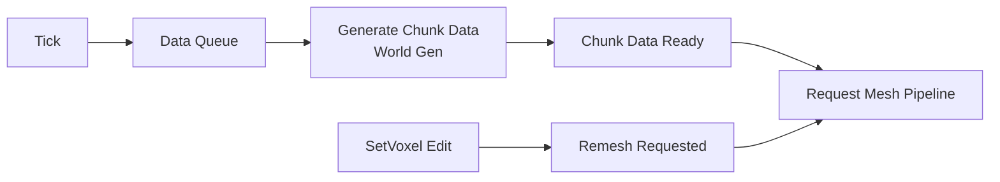

# Chunk Pipeline (Overview)

## Lifetime rules (Phase S)

- **Eviction is by plain distance (F-23, DEC-14).** `ChunkManager` and `ChunkPool` reclaim the chunk or partition
  farthest from the focus. The view direction only orders work, never eviction.
- **Unloading raises the eviction event (F-05).** `ChunkManager.UnloadChunk` raises `OnChunkUnloaded`, which
  `VoxelWorld` forwards as `ChunkEvicted`, so the renderer releases the chunk's GPU buffer and render pages.
- **Chunk data is not written while a job reads it (F-01).** Before `SetVoxel` or `UnloadChunk` changes or disposes
  a chunk, `ChunkManager.AccessorChunkWriting` makes the collider mesh scheduler complete its running job. Only the
  job is completed there; the results are applied later by `CMeshBuildScheduler.Complete`, because applying them
  can claim partitions, evict chunks and re-enter the unload.
- **A collider bake only marks its own mesh version collidable (F-04).** Partition objects are pooled per chunk, so
  each `ChunkPartition` carries a `MeshVersion` that changes on every clear or rewrite of its collider mesh.
  `ColliderBakeScheduler` completes a running bake before any collider mesh is cleared or rewritten
  (`ChunkPool.PartitionMeshWriting`) and skips results whose partition was reclaimed or re-meshed meanwhile.
