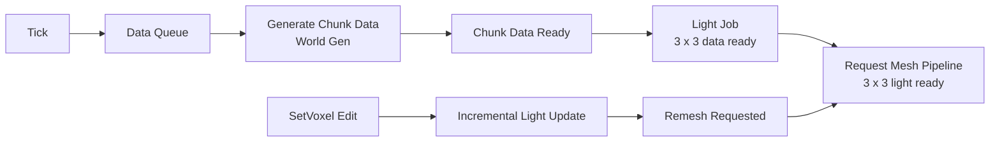

# Chunk Pipeline (Overview)

## Rings around the focus

`VoxelEngineScheduler` runs the steps round robin: data, light, mesh, collider. Each step needs the one before it
in the 3 x 3 neighbourhood of a chunk, so each step reaches one ring less than the one before:

| Step | Needs | Reaches (Chebyshev chunk distance) |
| --- | --- | --- |
| Data (`ChunkScheduler`) | nothing | `LoadDistance` = `DrawDistance + 3` |
| Light (`LightScheduler`) | 3 x 3 voxel data | `LoadDistance - 1` |
| Mesh (`CMeshBuildScheduler` + GPU build) | 3 x 3 lit chunks | `DrawDistance` |

Strictly, `DrawDistance + 2` would be enough (light up to `DrawDistance + 1`, mesh up to `DrawDistance`); the extra
ring is slack, so lit neighbours are usually ready by the time a chunk enters the draw distance.

## Scheduling

Each step has a `JobStateHandler` with a priority queue (nearest to the focus first) and one batch of jobs in
flight. The scheduler gives one step per frame a turn on the main thread, so a frame never pays for two steps:

- **A turn does everything the step can do now:** it collects the finished batch, refills the queue when it runs
  low (a scan of the step's window, at the latest every fourth turn), and dispatches the next batch. A step whose
  batch still runs has nothing to do and costs no frame.
- **Work-conserving round robin.** The scheduler starts with the step after the one that worked last and takes the
  first step that has work. With every step busy each gets every fourth frame; a step that is alone gets every
  frame. (Until 2026-11 each step got every fourth frame for one of three sub-steps, twelve frames per batch,
  whether the other steps had work or not: at draw distance 12 the mesh step took 7553 frames for a fresh world
  while data and light were done after a fifth of them.)
- **Queues stay inside their windows.** The focus update (every 0.5 s) removes the queued entries that left the
  step's window before it re-sorts the rest, so no queue holds more than its window (mesh: the draw window, 5000
  partitions at draw distance 12). Before, entries the focus had left behind stayed queued until they were
  dequeued and thrown away; in a sprint flight the mesh queue reached 13 000.
- **The mesh step waits for the renderer.** Every meshed partition also needs a GPU build
  (`MeshAndRenderPipeline.md`, version 1.8). While more than two rounds of GPU build slots wait in the renderer,
  the mesh step dispatches nothing: the partitions stay in the priority queue, which follows the focus, instead
  of piling up in the renderer's first-in-first-out list.
- **The mesh batch and the GPU build slots follow the draw distance.** `SchedulerSettings.MeshBatchSizeAt` and
  `BuildSlotsAt` scale the two asset values with the side of the draw window; they are read once, when the world
  is built (`MeshAndRenderPipeline.md`, version 1.9).
- **A partition without a voxel is not meshed.** `ChunkVoxelData.OccupiedPartitions` has one bit per partition of
  the chunk, set when generation or `SetVoxel` puts a voxel that is not air into it, and never cleared. The mesh
  step takes a partition whose bit is clear from the queue and makes it active at once, with an empty mesh: no
  mesh job, no GPU build, no collider bake. `SetVoxel` sets the bit and flags the partition, so the first block
  placed in it meshes it like any other. Light changes and edits next to it do not flag it, because it has no
  face (`MeshAndRenderPipeline.md`, version 1.9).

### Main-thread budget per frame

The turn of a frame is bounded by time: `SchedulerSettings.mainThreadBudgetMs` (shipped 2 ms; 0 = no limit, which
is the behaviour before 2026-11-15; read once when the world is built), plus the spare time of a capped frame
(`SchedulerSettings.cappedFrameSpareShare`, see below).

- **A turn is made of items of work.** An item is: adding a data batch to the chunk store, the upload of one
  chunk to the renderer, the pool claim of one meshed partition, handing the meshes of a batch to Unity, one
  partition without a voxel, one row of a queue scan, 32 entries the mesh dispatch takes from its queue, the
  apply of a light batch or of a bake batch, the start of a batch.
- **`FrameBudget` is asked before every item.** The scheduler starts it once per frame. The first item of a
  frame always runs, so every frame makes progress; a later item runs only while time is left. It reads
  `Stopwatch.GetTimestamp` and allocates nothing.
- **A cut turn keeps its place.** The step whose turn ran out of time is first in line in the next frame and
  continues where it stopped; the other steps wait until that turn is finished (`StageRing`). So a batch is
  applied completely and in order, and no step sees a batch another step has applied in part.
- **A started item is finished.** A frame can exceed the budget by one item; the largest items are the apply of
  a light batch and handing a mesh batch to Unity. Measured with 2 ms in a sprint flight at draw distance 12
  (Editor): scheduler time per frame p95 2.3 ms, p99 2.6 ms, max 4.8 to 6.9 ms; without the limit p95 6.5 to
  6.7 ms, p99 11.9 ms, max 21 to 22 ms.
- **The world can change between the frames of a cut turn** (focus update, an edit, an unload). A cut mesh
  dispatch checks the draw window again for its partitions without a voxel and drops the partitions that lost a
  chunk of their neighbourhood; a cut data collect skips a chunk that was unloaded again; a cut mesh collect
  claims no partition whose chunk is gone. A mesh dispatch cut while it takes its partitions from the queue goes
  on filling the same batch in the next frame, with that frame's focus. A partition without a voxel that a cut
  mesh dispatch still holds and
  that got a block in the meantime is not made active empty: it is left to the next scan and meshed like any
  other flagged partition. A wake-up or a queue prune that arrives while a scan is cut makes the stage scan again
  instead of going to sleep after it. `CompleteRunning` (shutdown, tests) finishes a cut turn's batch without
  the budget.
- **Not part of the budget:** the focus update (outside the turn: a check every 0.5 s that reaches the stages
  when the focus moved to another partition or its forward vector, quantised to 45°, changed) and the
  renderer's GPU builds, which have their own slot count.
- **A capped frame gives part of its spare time to the budget.** The budget is per frame, and a frame of the
  120 frames goal is 8.33 ms; a frame cap with a longer period leaves that much more time in every frame. The
  budget of a capped frame is `mainThreadBudgetMs + cappedFrameSpareShare × (period − 8.33 ms)` (shipped share
  0.5): 6.17 ms under the 60 frames cap, 14.5 ms under 30, 2 ms under 120 or more and uncapped. `FrameCap` reads
  the cap in force every frame (vertical sync with the display's refresh rate wins over
  `Application.targetFrameRate`), so a cap changed at run time is followed from the next frame; vertical sync
  forced by the driver or by the Editor's game view is not seen and keeps the plain budget. The shipped game
  runs uncapped (vertical sync 0 on both quality levels, no target frame rate); only the PlayMode tests cap at 60.
  Measured under the 60 frames cap at draw distance 12 (Editor, 2026-11-15, two runs each, no budget / 2 ms
  alone / share 0.5 / share 1): fresh world 703 / 799 to 804 / 703 / 703 frames; draw window meshed in a sprint
  flight through a building world 0.60 / 0.40 / 0.59 / 0.60 on average and 0.80 to 0.81 / 0.47 / 0.72 to 0.74 /
  0.78 at its end, complete 4.5 / 10.2 to 10.3 / 5.2 to 5.4 / 4.6 to 4.7 s after the flight; scheduler time per
  frame in the flight p95 6.6 to 6.9 / 2.7 / 6.2 / 6.6 to 6.7 ms, max 17 to 19 / 5 to 9 / 8.8 to 9.0 / 10.5 to
  10.6 ms. The owner picked 0.5 for the margin: with 1 the pipeline may take all the spare time, and since a
  started item is finished, a 60 frames frame then fits only while the rest of it stays within 6.33 ms; with
  0.5 about 4.2 ms of the frame stay free, 1.5 ms even after an overshoot like the measured 2.7 ms. In the
  Editor the frame time under the cap jitters around the period (p95 about 22 ms in every variant), so missed
  refreshes could not be measured there. Uncapped nothing changed. `cappedFrameSpareShare` 0 is the budget as
  introduced on 2026-11-15.
- **What the 2 ms cost and buy** (owner's pick of 2026-11-15 from 2, 3 and 4 ms; Editor, uncapped, sprint flight
  of 80 units per second at draw distance 12, two runs each, without / with the limit): frames over 16.67 ms 93
  to 103 / 2 to 7 of about 4800; frame p95 13.0 to 13.3 / 9.6 to 9.7 ms; frames over 8.33 ms 21 % / 10 to 12 %;
  columns within 4 of the focus meshed 100 % / 100 %; draw window meshed 98.4 % / 96 %; collider queue at its
  peak about 200 / 950 partitions (nearest first); settled after the flight stops within 8 to 22 / 105 to 206
  frames. A larger value fills the far edge and the collider queue sooner and has longer frames.

`FrameBudgetTests` (EditMode) holds the budget and the round robin with a counting clock, that a wake-up or
prune during a cut scan leads to another scan, the cap's period and the budget after the cap.
`PipelineThroughputTests` (PlayMode) holds the limit on the number of frames a fresh world may take, the queue
limits in a flight, the meshed share of the draw window in a capped flight, the scheduler's share of a frame and
that a world built under a tight budget is the same world. The scheduler's share is held twice: in an uncapped
sprint flight p95 at most twice the budget (4 ms; 2.3 to 2.6 ms with the budget, 6.5 to 7.0 ms without), which fails
when the budget is lost; in the capped flight p95 at most the budget after the frame cap plus the budget
(8.17 ms; 6.2 ms with the budget), a limit a run without the budget meets too (6.6 to 6.9 ms).
`EmptyPartitionTests` covers a cut mesh dispatch, including a block placed in a partition it still holds;
`SchedulerBatchSizeTests` that a batch size of 0 in the settings does not stall the data, light or bake stage.
`PipelineMeasurementTests` (explicit) prints the timings.

## Light

- **Light job.** `LightJob` lights one chunk per index from the voxel data of its 3 x 3 neighbourhood
  over the box chunk +-14 (full height; a source 15 columns away contributes 0) and writes only that chunk's light,
  so no job writes another chunk's light.
  Sky columns are 15 without BFS; the BFS starts only at the frontier (under leaves and water, at overhangs and
  cliffs, at emitters). `ChunkManager.ApplyLight` sets `Chunk.LightReady`; `VoxelWorld.ChunkLightChanged` tells the
  renderer to upload the light.
- **Meshing waits for light.** `MeshJobStateHandler` only meshes a chunk whose 3 x 3 chunks are loaded and
  lit, because faces at chunk borders sample the neighbour's light.
- **The light job reads voxel data.** `ChunkManager.GetLightJobChunks` records the chunks the running batch
  reads. Before `SetVoxel` or `UnloadChunk` writes one of them, `ChunkManager.LightJobReading` makes the light
  scheduler complete *and apply* the batch. Applying only assigns light data, so it cannot re-enter an unload.
- **Edits.** `SetVoxel` raises `ChunkManager.VoxelEdited`; `LightScheduler` runs `LightEditJob`
  synchronously (`Run()`) on the 3 x 3 chunks around the edit (removal BFS, then re-propagation; box edit +-16).
  Partitions whose light changed, or that touch a changed voxel, are flagged for remeshing. If one of the 3 x 3
  chunks is not lit yet, the lit ones are invalidated instead and re-lit by the light job.
- **Unloading invalidates neighbours.** A lit neighbour's light may hold edits of the unloaded chunk that a reload
  regenerates away, so `UnloadChunk` clears `LightReady` of the 8 neighbours. A chunk that was lit before
  (`Chunk.WasLit`) flags its and its neighbours' partitions for remeshing when it is lit again.

## Lifetime rules

- **Eviction is by plain distance.** `ChunkManager` and `ChunkPool` reclaim the chunk or partition
  farthest from the focus. The view direction only orders work, never eviction.
- **Unloading raises the eviction event.** `ChunkManager.UnloadChunk` raises `OnChunkUnloaded`, which
  `VoxelWorld` forwards as `ChunkEvicted`, so the renderer releases the chunk's GPU buffer and render pages.
- **Chunk data is not written while a job reads it.** Before `SetVoxel` or `UnloadChunk` changes or disposes
  a chunk, `ChunkManager.AccessorChunkWriting` makes the collider mesh scheduler complete its running job. Only the
  job is completed there; the results are applied later by `CMeshBuildScheduler.Complete`, because applying them
  can claim partitions, evict chunks and re-enter the unload.
- **A collider bake only marks its own mesh version collidable.** Partition objects are pooled per chunk, so
  each `ChunkPartition` carries a `MeshVersion` that changes on every clear or rewrite of its collider mesh.
  `ColliderBakeScheduler` completes a running bake before any collider mesh is cleared or rewritten
  (`ChunkPool.PartitionMeshWriting`) and skips results whose partition was reclaimed or re-meshed meanwhile.
