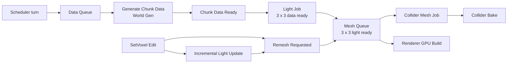

# Chunk Pipeline (Overview)



One dispatch of the mesh stage starts both the collider mesh job and the renderer's GPU builds of the same
partitions; they run side by side (`MeshAndRenderPipeline.md`). An edit flags its partitions for remeshing directly,
and the light edit flags the partitions whose light it changed.

## Rings around the focus

`VoxelEngineScheduler` runs the stages round robin: data, light, mesh, collider bake. Each stage needs the one
before it in the 3 x 3 neighbourhood of a chunk, so each stage reaches one ring less than the one before:

| Stage | Needs | Reaches (Chebyshev chunk distance) |
| --- | --- | --- |
| Data (`ChunkScheduler`) | nothing | `LoadDistance` = `DrawDistance + 3` |
| Light (`LightScheduler`) | 3 x 3 voxel data | `LoadDistance - 1` |
| Mesh (`CMeshBuildScheduler` + GPU build) | 3 x 3 lit chunks | `DrawDistance` |
| Collider bake (`ColliderBakeScheduler`) | a meshed partition | `UpdateDistance` = max(`DrawDistance` - 2, 2) |

Strictly, `DrawDistance + 2` would be enough (light up to `DrawDistance + 1`, mesh up to `DrawDistance`); the extra
ring is slack, so lit neighbours are usually ready by the time a chunk enters the draw distance.

### Changing the draw distance at run time

Every distance above follows `ChunkSettings.ActiveDrawDistance`: the draw distance of the settings asset, unless an
override replaces it. The override is not serialized, so the asset keeps its value; the world clears it when it is
destroyed.

- **Before the world is built:** `VoxelWorld.RequestedDrawDistance` (static, 0 = the asset's) is the distance the
  next world is built with. The game sets it from the player's saved choice before the scene loads. Tests and the
  goal run set `AutomatedRun.Active`, and the world then ignores the request.
- **While the world runs:** `VoxelWorld.ChangeDrawDistance(n)` (1 to 32) builds the world again in the running
  scene. It completes the running batches, evicts every chunk through the normal events, makes the chunk store,
  the chunk and partition pool (with its game objects) and the schedulers anew, raises `DrawDistanceRebuilding`
  (the renderer makes its draw-distance-sized buffers anew, `MeshAndRenderPipeline.md`, version 1.10) and starts
  loading around the focus again; then `DrawDistanceChanged`. Edits to the world are lost, and the ground under
  the player is missing until the first chunks are built: the game holds the player meanwhile
  (`PlayerManager.HoldUntilGrounded`). The same distance returns false and rebuilds nothing.

## Scheduling

Each stage has a `JobStateHandler` with a priority queue (nearest to the focus first) and one batch of jobs in
flight. The scheduler gives one stage per frame a turn on the main thread, so a frame never pays for two stages:

- **A turn does everything the stage can do now** (`IPipelineStage.Update`): it collects the finished batch,
  refills the queue when it runs low (a scan of the stage's window, at the latest every fourth turn), and
  dispatches the next batch. The turn reports `StageTurn.Done` when it did main-thread work, `StageTurn.Cut` when
  the frame's budget ran out inside it, and `StageTurn.None` when the stage sleeps, its batch still runs or it may
  not dispatch. A stage with `None` costs no frame.
- **Work-conserving round robin** (`StageRing`). The scheduler starts with the stage after the one that worked
  last and takes the first stage that has work. With every stage busy each gets every fourth frame; a stage that
  is alone gets every frame.
- **Queues stay inside their windows.** The focus update removes the queued entries that left the stage's window
  before it re-sorts the rest, so no queue holds more than its window (mesh: the draw window, 5000 partitions at
  draw distance 12). It runs when a check every 0.5 s finds the focus in another partition or facing another
  direction (the forward vector quantised to 45°), and once when the world starts or is regenerated.
- **The mesh stage waits for the renderer.** Every meshed partition also needs a GPU build. While more than twice
  the GPU build slots wait in the renderer (`CMeshBuildScheduler.RendererBehind`), the mesh stage neither scans nor
  dispatches: it still collects a finished batch and otherwise passes the frame to the next stage. The partitions
  stay in the priority queue, which follows the focus, instead of piling up in the renderer's first-in-first-out
  list.
- **The mesh batch and the GPU build slots follow the draw distance.** `SchedulerSettings.MeshBatchSizeAt` and
  `BuildSlotsAt` scale the two asset values with the side of the draw window, up to 32 and 16; they are read once,
  when the world is built or its draw distance changes (`MeshAndRenderPipeline.md`, version 1.9). The data, light and collider batch sizes are
  read once as well, with at least 1. The class default of `colliderBatchSize` is 4; the shipped
  `VoxelEngineSettings.asset` sets 6.
- **A partition without a voxel is not meshed.** `ChunkVoxelData.OccupiedPartitions` has one bit per partition of
  the chunk, set when generation or `SetVoxel` puts a voxel that is not air into it, and never cleared. The mesh
  stage takes a partition whose bit is clear from the queue and makes it active at once, with an empty mesh
  (`CMeshBuildScheduler.ApplyEmpty`): no mesh job, no GPU build, no collider bake. A dispatch makes at most four
  times the mesh batch size of such partitions active. `SetVoxel` sets the bit and flags the partition, so the first block placed
  in it meshes it like any other. Light changes and edits next to it do not flag it, because it has no face
  (`MeshAndRenderPipeline.md`, version 1.9).

### Main-thread budget per frame

The turn of a frame is bounded by time: `SchedulerSettings.mainThreadBudgetMs` (shipped 2 ms; 0 = no limit; read
once when the world is built), plus the spare time of a slow capped frame (`SchedulerSettings.cappedFrameSpareShare`)
and at most a share of a fast capped frame (`SchedulerSettings.fastCapBudgetShare`, see below).

- **A turn is made of items of work.** An item is: adding a data batch to the chunk store, the upload of one
  chunk to the renderer, the pool claim of one meshed partition, handing the meshes of a batch to Unity, one
  partition without a voxel, one row of a queue scan, 32 entries the mesh dispatch takes from its queue
  (`MeshJobStateHandler.DefaultDequeueSlice`), the apply of a light batch or of a bake batch, the start of a batch.
- **`FrameBudget` is asked before every item.** The scheduler starts it once per frame. The first item of a
  frame always runs, so every frame makes progress; a later item runs only while time is left. It reads
  `Stopwatch.GetTimestamp` and allocates nothing.
- **A cut turn keeps its place.** The stage whose turn ran out of time is first in line in the next frame and
  continues where it stopped; the other stages wait until that turn is finished (`StageRing`). So a batch is
  applied completely and in order, and no stage sees a batch another stage has applied in part.
- **A started item is finished.** A frame can exceed the budget by one item. The largest items are adding a data
  batch to the chunk store (up to a batch of chunks with their evictions), the apply of a light batch and handing
  a mesh batch to Unity.
- **The world can change between the frames of a cut turn** (focus update, an edit, an unload). A cut mesh
  dispatch checks the draw window again for its partitions without a voxel and drops the partitions that lost a
  chunk of their neighbourhood; a cut data collect skips a chunk that was unloaded again; a cut mesh collect
  claims no partition whose chunk is gone. A mesh dispatch cut while it takes its partitions from the queue goes
  on filling the same batch in the next frame, with that frame's focus. A partition without a voxel that a cut
  mesh dispatch still holds and that got a block in the meantime is not made active empty: it is left to the next
  scan and meshed like any other flagged partition. A wake-up or a queue prune that arrives while a scan is cut
  makes the stage scan again instead of going to sleep after it.
- **Regenerating the world** (`VoxelWorld.Regenerate`) calls `CompleteRunning`, which completes and applies every
  running batch without the budget, a collect the budget cut included. Partitions a cut mesh dispatch still holds
  are dropped together with the old handlers.
- **Not part of the budget:** the focus update (outside the turn, see above) and the renderer's GPU builds, which
  have their own slot count.
- **A capped frame gives part of its spare time to the budget.** The budget is per frame, and a frame at 120
  frames per second is 8.33 ms; a frame cap with a longer period leaves that much more time in every frame. The
  budget of a capped frame is `mainThreadBudgetMs + cappedFrameSpareShare × (period − 8.33 ms)` (shipped share
  0.5): 6.17 ms under the 60 frames cap, 14.5 ms under 30, 2 ms under 120 or more and uncapped. With 0.5 about
  4 ms of a 60 frames frame stay free for the rest of the frame. While the budget is on and the share is above 0,
  `FrameCap` reads the cap in force every frame (vertical sync with the display's refresh rate wins over
  `Application.targetFrameRate`), so a cap changed at run time is followed from the next frame; vertical sync
  forced by the driver or by the Editor's game view is not seen and keeps the plain budget. The shipped game
  runs uncapped (vertical sync 0 on both quality levels, no target frame rate) unless the player picks a frame
  rate in the menu; only the PlayMode tests cap at 60. The share is read once when the world is built; 0 gives the
  plain budget in every frame.
- **A fast cap limits the budget.** A frame cap shorter than 8.33 ms leaves less time than the budget assumes, so
  there the budget is at most `fastCapBudgetShare × period` (shipped 0.3): 2 ms under 120 and 144 frames, 1.25 ms
  under 240, 1 ms under 300. The ceiling never raises the budget, and it does not apply uncapped (2 ms) or under a
  slower cap. With the two shares, the menu's frame rates give 6.17 ms (60), 3.39 ms (90), 2 ms (120), 1 ms (300)
  and 2 ms uncapped. 0 turns the ceiling off; it is read once when the world is built, like the other share.

The measured effect of the budget and of the share, and the frame-time goal, are recorded in the spec
(`Docs/WorldGenSpec.html`, §E1.1).

### Tests

`FrameBudgetTests` (EditMode) holds the budget and the round robin with a counting clock, that a wake-up or
prune during a cut scan leads to another scan, the cap's period and the budget after the cap, including the
fast-cap ceiling and the shipped shares at the menu's frame rates. `DrawDistanceChangeTests` (PlayMode) holds that
`ChangeDrawDistance` builds the world again at the new size (load distance, interval store, build slots), keeps
the settings asset, rebuilds nothing for the same distance and gives the original sizes back.
`SchedulerBatchSizeTests` holds that a batch size of 0 in the settings does not stall the data, light or bake
stage.

`PipelineThroughputTests` (PlayMode, capped at 60) holds:

- that the mesh batch and the build slots follow the draw distance (8 and 4 at draw distance 6, 16 and 8 at 12);
- the limit on the number of frames a fresh world may take, and that the columns near the focus are meshed
  before the rest of the window;
- that no partition without a voxel gets a mesh job;
- the queue limits in a flight and the meshed share of the draw window in a capped flight;
- the scheduler's share of a frame, twice: in an uncapped sprint flight p95 at most twice the budget (4 ms),
  which fails when the budget is lost; in the capped flight p95 at most the budget after the frame cap plus the
  budget (8.17 ms);
- that a world built under a tight budget is the same world.

`EmptyPartitionTests` covers a cut mesh dispatch, including a block placed in a partition it still holds, and a
cut dequeue loop: it loses no partition, meshes none twice and takes an entry in every frame.

### Measuring

- **Profiler markers** (`VoxelProfilerMarkers`, all named `Voxel.…`): `Voxel.Scheduler.{Data,Light,Mesh,Collider}`
  for the turn of each stage and `Voxel.Scheduler.{Collect,Scan,Dispatch}` for its three steps;
  `Voxel.Focus.*` for the focus update; `Voxel.MeshBuild.{WaitBake,Claim,Apply,Dequeue}` for the parts of the
  mesh stage (`WaitBake` also covers completing the mesh job); `Voxel.Wait.*` where the main thread waits for a
  job whose data is about to change.
- **The rig** (PlayMode test helpers): `PipelineProbe` samples per frame the queues, the stages' job states, the
  renderer's waiting builds, the scheduler's milliseconds, the cut frames, the effective budget and the dequeue
  counts (`MeshJobStateHandler.Dequeued`, with `TrackRequeues` for the entries a scan queues again);
  `FrameAttribution` splits each frame's time by marker; `FrameHierarchy` records the profiler hierarchy of the
  longest frames. A flight takes the focus out of the player and switches the player off, then flies the focus at
  y 200 with a pitch of 20° (`GoalRunRig.FlightBody`).
- **`PipelineMeasurementTests`** (PlayMode, explicit) prints the timings. It switches the game view's Gizmos off
  for the run (the pool's `SetActive` calls make the Editor rebuild the gizmo list) and needs a focused Editor;
  an unfocused Editor reads slow.
- **The goal run in a player build** (`GoalRunner`, in `Scripts/Diagnostics`) runs the rig of the frame-time
  goal in a release player, outside the Editor. It starts only with the command-line flag `-goalrun`; without it
  nothing of it runs. The rig (`GoalRunRig`: flight height, pitch, speeds, phases) and the frame statistics
  (`FrameTimeStats`) are the ones the PlayMode tests use. Per draw distance (6, then 12) it loads a fresh world,
  stands 40 s, flies at 80 u/s for 30 s and stops until the world is built, then the same at 40 u/s; uncapped
  (vSync off, no target frame rate). It writes one text file per run: the machine, the window, the build
  (`build-info.txt`), one table per draw distance in the column order of the probe's goal rows (p95, p99, max,
  frames over 8.33 ms and over 16.67 ms, world built after, meshed share near the focus and of the draw window),
  a verdict per phase (frames from 20 s after the world start are judged: p95 at most 8.33 ms) and the same rows
  as CSV. Frame times are the wall-clock time between frames. The scheduler's milliseconds per frame are not in
  it: the engine reports them only through profiler markers, which a release player does not record.

#### Goal run on another machine

1. Build the player on the development machine: menu **Infinitile → Goal Run → Build Release Player (Mono)**
   (or IL2CPP; IL2CPP needs the Visual Studio C++ tools and a Windows SDK). The build lands in
   `Builds/Mono/` (or `Builds/IL2CPP/`) at the repository root, with `build-info.txt` naming the commit. The
   build is always x64, whatever architecture the Editor's build settings hold. A build leaves Unity's own
   changes in `ProjectSettings/` and `Assets/Settings/` (shader prefilter flags, preloaded assets); they are
   not part of a change.
2. Copy the whole folder `Builds/Mono/` to the other machine (any path; it needs write access next to the
   executable, otherwise the result goes to `%USERPROFILE%\AppData\LocalLow\anilas5235\Infinitile\`).
3. Close other programs, plug a laptop in, then start from a terminal in that folder:

   ```
   .\Infinitile.exe -goalrun -goalrun-label <machine-name>
   ```

   Do not touch mouse or keyboard and leave the window in front for the whole run (about 6 to 10 minutes; the
   file counts frames without focus). The player quits by itself when it is done. Optional: `-goalrun-draw 12`
   for one draw distance only, `-screen-width 1920 -screen-height 1080 -screen-fullscreen 1` for a fixed
   window, `-goalrun-timeout <minutes>` (default 30).
4. The result is `GoalRunResults/goal-run-<label>-<date>-<time>.txt` next to the executable. Send back that file
   and `Player.log` (`%USERPROFILE%\AppData\LocalLow\anilas5235\Infinitile\Player.log`).

## Light

- **Light job.** `LightJob` lights one chunk per index from the voxel data of its 3 x 3 neighbourhood
  over the box chunk +-14 (full height; a source 15 columns away contributes 0) and writes only that chunk's light,
  so no job writes another chunk's light.
  Sky columns are 15 without BFS; the BFS starts only at the frontier (under leaves and water, at overhangs and
  cliffs, at emitters). `ChunkManager.ApplyLight` sets `Chunk.LightReady`; `VoxelWorld.ChunkLightChanged` tells the
  renderer to upload the light.
- **Meshing waits for light.** `MeshJobStateHandler` only meshes a chunk whose 3 x 3 chunks are loaded and
  lit, because faces at chunk borders sample the neighbour's light.
- **The light job reads voxel data.** `ChunkManager.GetLightJobChunks` records the chunks the running batch
  reads. Before `SetVoxel` or `UnloadChunk` writes one of them, `ChunkManager.LightJobReading` makes the light
  scheduler complete *and apply* the batch. Applying only assigns light data, so it cannot re-enter an unload.
- **Edits.** `SetVoxel` raises `ChunkManager.VoxelEdited`; `LightScheduler` runs `LightEditJob`
  synchronously (`Run()`) on the 3 x 3 chunks around the edit (removal BFS, then re-propagation; box edit +-16).
  Partitions whose light changed, or that touch a changed voxel, are flagged for remeshing. If one of the 3 x 3
  chunks is not lit yet, the lit ones are invalidated instead and re-lit by the light job.
- **Unloading invalidates neighbours.** A lit neighbour's light may hold edits of the unloaded chunk that a reload
  regenerates away, so `UnloadChunk` clears `LightReady` of the 8 neighbours. A chunk that was lit before
  (`Chunk.WasLit`) flags its and its neighbours' partitions for remeshing when it is lit again.

## Lifetime rules

- **Eviction is by plain distance.** `ChunkManager` and `ChunkPool` reclaim the chunk or partition
  farthest from the focus. The view direction only orders work, never eviction.
- **Unloading raises the eviction event.** `ChunkManager.UnloadChunk` raises `OnChunkUnloaded`, which
  `VoxelWorld` forwards as `ChunkEvicted`, so the renderer releases the chunk's GPU buffer and render pages.
- **Chunk data is not written while a job reads it.** Before `SetVoxel` or `UnloadChunk` changes or disposes
  a chunk, `ChunkManager.AccessorChunkWriting` makes the collider mesh scheduler complete its running job. Only the
  job is completed there; the results are applied later by `CMeshBuildScheduler.Complete`, because applying them
  can claim partitions, evict chunks and re-enter the unload.
- **A collider bake only marks its own mesh version collidable.** Partition objects are pooled per chunk, so
  each `ChunkPartition` carries a `MeshVersion` that changes on every clear or rewrite of its collider mesh.
  `ColliderBakeScheduler` completes a running bake before any collider mesh is cleared or rewritten
  (`ChunkPool.PartitionMeshWriting`) and skips results whose partition was reclaimed or re-meshed meanwhile.
- **No `Allocator.Domain` memory inside a job.** Chunk voxel and light lists are created by the generation and
  light jobs on worker threads, so they use `ChunkLists.Allocator` (`Allocator.Persistent`). Domain memory
  allocated, grown or freed on a worker thread crashes the Editor at the next domain reload; the remaining
  `Allocator.Domain` allocations are made on the main thread.
