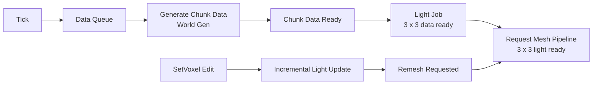

# Chunk Pipeline (Overview)

## Rings around the focus

`VoxelEngineScheduler` runs the steps round robin: data, light, mesh, collider. Each step needs the one before it
in the 3 x 3 neighbourhood of a chunk, so each step reaches one ring less than the one before:

| Step | Needs | Reaches (Chebyshev chunk distance) |
| --- | --- | --- |
| Data (`ChunkScheduler`) | nothing | `LoadDistance` = `DrawDistance + 3` |
| Light (`LightScheduler`) | 3 x 3 voxel data | `LoadDistance - 1` |
| Mesh (`CMeshBuildScheduler` + GPU build) | 3 x 3 lit chunks | `DrawDistance` |

Strictly, `DrawDistance + 2` would be enough (light up to `DrawDistance + 1`, mesh up to `DrawDistance`); the extra
ring is slack, so lit neighbours are usually ready by the time a chunk enters the draw distance.

## Light

- **Light job.** `LightJob` lights one chunk per index from the voxel data of its 3 x 3 neighbourhood
  over the box chunk +-14 (full height; a source 15 columns away contributes 0) and writes only that chunk's light,
  so no job writes another chunk's light.
  Sky columns are 15 without BFS; the BFS starts only at the frontier (under leaves and water, at overhangs and
  cliffs, at emitters). `ChunkManager.ApplyLight` sets `Chunk.LightReady`; `VoxelWorld.ChunkLightChanged` tells the
  renderer to upload the light.
- **Meshing waits for light.** `MeshJobStateHandler` only meshes a chunk whose 3 x 3 chunks are loaded and
  lit, because faces at chunk borders sample the neighbour's light.
- **The light job reads voxel data.** `ChunkManager.GetLightJobChunks` records the chunks the running batch
  reads. Before `SetVoxel` or `UnloadChunk` writes one of them, `ChunkManager.LightJobReading` makes the light
  scheduler complete *and apply* the batch. Applying only assigns light data, so it cannot re-enter an unload.
- **Edits.** `SetVoxel` raises `ChunkManager.VoxelEdited`; `LightScheduler` runs `LightEditJob`
  synchronously (`Run()`) on the 3 x 3 chunks around the edit (removal BFS, then re-propagation; box edit +-16).
  Partitions whose light changed, or that touch a changed voxel, are flagged for remeshing. If one of the 3 x 3
  chunks is not lit yet, the lit ones are invalidated instead and re-lit by the light job.
- **Unloading invalidates neighbours.** A lit neighbour's light may hold edits of the unloaded chunk that a reload
  regenerates away, so `UnloadChunk` clears `LightReady` of the 8 neighbours. A chunk that was lit before
  (`Chunk.WasLit`) flags its and its neighbours' partitions for remeshing when it is lit again.

## Lifetime rules

- **Eviction is by plain distance.** `ChunkManager` and `ChunkPool` reclaim the chunk or partition
  farthest from the focus. The view direction only orders work, never eviction.
- **Unloading raises the eviction event.** `ChunkManager.UnloadChunk` raises `OnChunkUnloaded`, which
  `VoxelWorld` forwards as `ChunkEvicted`, so the renderer releases the chunk's GPU buffer and render pages.
- **Chunk data is not written while a job reads it.** Before `SetVoxel` or `UnloadChunk` changes or disposes
  a chunk, `ChunkManager.AccessorChunkWriting` makes the collider mesh scheduler complete its running job. Only the
  job is completed there; the results are applied later by `CMeshBuildScheduler.Complete`, because applying them
  can claim partitions, evict chunks and re-enter the unload.
- **A collider bake only marks its own mesh version collidable.** Partition objects are pooled per chunk, so
  each `ChunkPartition` carries a `MeshVersion` that changes on every clear or rewrite of its collider mesh.
  `ColliderBakeScheduler` completes a running bake before any collider mesh is cleared or rewritten
  (`ChunkPool.PartitionMeshWriting`) and skips results whose partition was reclaimed or re-meshed meanwhile.
