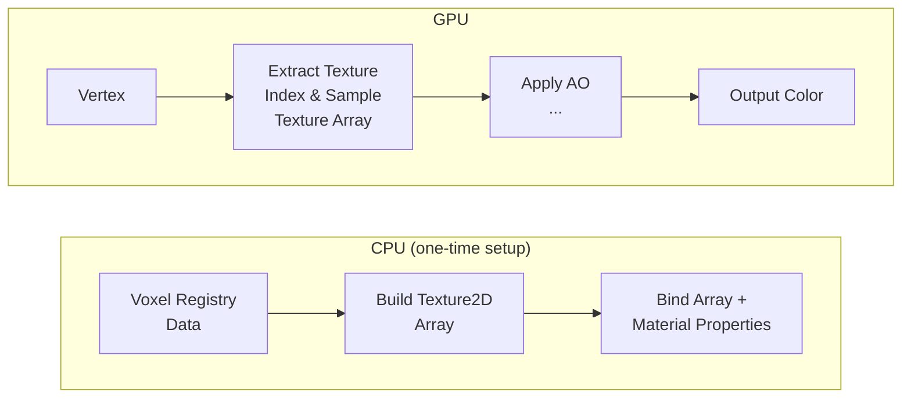
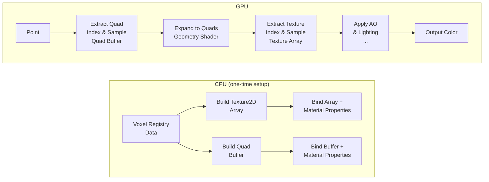
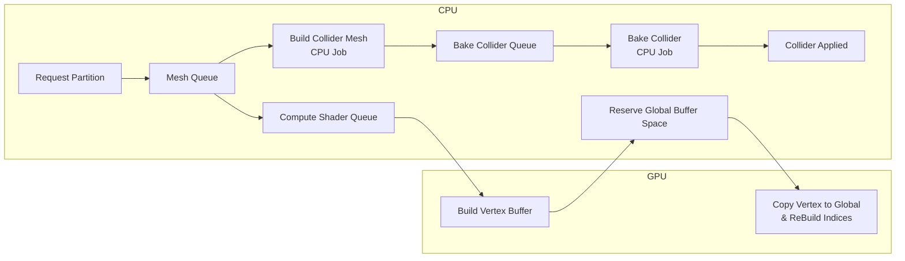
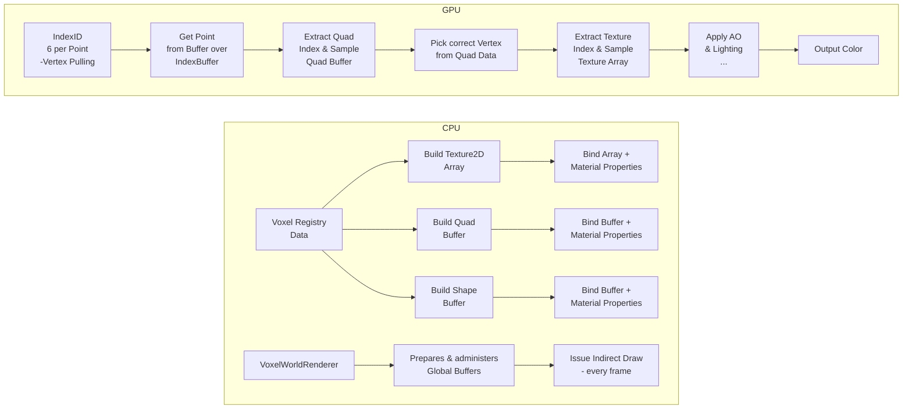
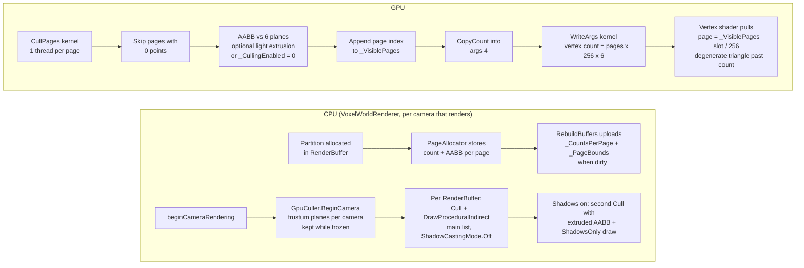
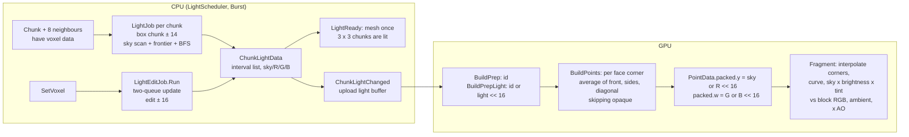
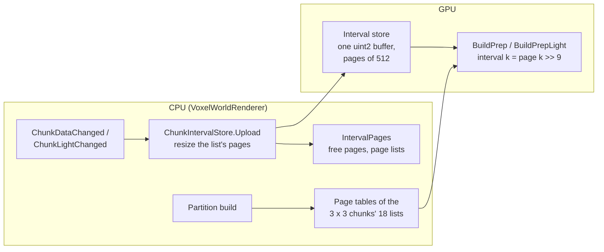
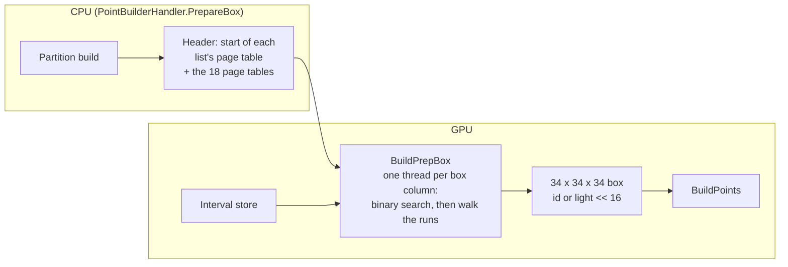

# Mesh & Render Pipeline (Overview)

# Version 1.0 (Chunks)

## Mesh Pipeline


### Description

In version 1.0, the mesh pipeline is built around whole chunks.
Each chunk generates its own render mesh and collider mesh on the CPU, and the pipeline applies them in sequence.

Advantages:

- Very simple data flow and easy to reason about.
- Low draw call count because each chunk uses a single render mesh.

Trade-offs:

- Any small change can force a full chunk rebuild.
- Updates become slower and less responsive as the world grows.

## Render Pipeline (Texture Array, ShaderGraph)



### Description

In version 1.0, rendering uses classic mesh rendering per chunk with a Texture2D Array bound to a ShaderGraph material.
Each voxel face stores texture indices, and the shader samples the correct layer from the texture array.

Advantages:

- Simple authoring workflow in ShaderGraph.
- Good visual flexibility without changing mesh topology.

Trade-offs:

- Rendering is still tied to fully built meshes.

# Version 1.1 (Partitions)
## Mesh Pipeline


### Description

In version 1.1, the pipeline switches from chunks to partitions.
This solves the main v1.0 problem: small edits no longer force a full chunk rebuild, because only the affected
partitions need new mesh data.

Advantages:

- Faster and more responsive updates after edits.
- Less CPU work per change because only local partitions are rebuilt.

Trade-offs:

- Each partition adds render overhead and more draw calls.
- Many visible partitions can quickly become expensive, especially with multiple materials.

## Render Pipeline (Vertex Pulling, Point Mesh)



### Description

In version 1.1, rendering shifts toward vertex pulling, where shaders fetch packed vertex data from buffers instead of
relying only on classic mesh attributes.
The geometry stage expands primitives for rendering and keeps CPU-side mesh binding lighter.

Advantages:

- Lower CPU mesh management overhead compared to fully traditional mesh binding.
- Smaller Meshes
- Better control over data layout in GPU buffers.

Trade-offs:

- Geometry stage overhead can limit scalability.
- Geometry Stage is not supported on all platforms.
- Draw call pressure remains high with many visible partitions. (Fixed by Unity's SRP batcher)

# Version 1.2 (Compute Shaders)
## Mesh Pipeline


### Description

In version 1.2, compute shaders take over the render-data generation path.
This solves the main v1.1 problem: the partition approach still caused too many draw calls and too much CPU-side mesh
overhead, so the pipeline moves the heavy work to the GPU and global buffers.

Advantages:

- Much lower CPU cost for generating render data.
- Better scalability when many partitions are visible at once.
- Fewer draw calls thanks to global buffers and indirect-style rendering.

Trade-offs:

- More complex shader, buffer, and synchronization logic.
- Debugging becomes harder than with a classic mesh pipeline.

## Render Pipeline (Meshless Draw, Global Buffers, Index Vertex Pulling)



### Description

In version 1.2, rendering becomes fully meshless and GPU-driven.
Instead of building and binding traditional meshes per partition, compute shaders process voxel data directly and build
compact vertex/index buffers in global GPU memory.
The render pipeline then issues a single indirect draw call, with shaders performing vertex pulling to fetch and expand
quad data for rasterization.

Advantages:

- Strong reduction of CPU render setup work—no mesh binding overhead per partition.
- Much better scaling for large numbers of visible partitions through global buffer management.
- Lower draw call overhead through batched indirect rendering instead of per-partition draws.
- Unified GPU-driven path simplifies CPU-side rendering logic.
- No Geometry Shader needed.

Trade-offs:

- Higher implementation complexity (compute pipeline, buffer synchronization, indirect args management).
- Harder debugging and profiling compared to traditional mesh-based rendering.
- Requires support for compute shaders and indirect rendering on target platforms.

# Version 1.3 (GPU Page Culling)

## Render Pipeline (Per-Camera Frustum Culling of Pages)



### Description

Version 1.3 replaces the old `Culling.compute` / `ReBuildBuffers.compute` pair (one index per point, rebuilt on
every page change) with per-page frustum culling that runs once per camera and frame.

- **Page bounds.** `PageAllocator` keeps, next to the point count, the world-space AABB of the partition
  that owns each page (`PageBounds`, 24 bytes). `RenderBuffer.RebuildBuffers` uploads both arrays only when a page
  was allocated or released.
- **Cull kernel.** `PageCulling.compute` tests every page with points against the six camera planes
  (positive-vertex test, conservative at edges) and appends the surviving page indices to an append buffer. The
  counter is copied into slot 4 of the indirect args and a one-thread kernel writes the vertex count, so the CPU
  never reads anything back for the draw.
- **Vertex pulling.** The vertex shader maps `vertexID / 6` to a slot, the slot to a page through
  `_VisiblePages`, and emits a degenerate triangle for slots past the page's point count. Visible pages are drawn
  densely, empty slots cost nothing on the raster side.
- **Per-camera state.** `GpuCuller` owns a `CameraCullState` per camera (planes plus a `CullList` with
  append buffer, args and property block per render buffer). States are created on first sight and released when
  the camera is destroyed or has not rendered for 300 frames.
- **Shadows.** With `RendererSettings.shadows` not `Off` and a main light, every buffer is culled a second
  time with the AABB extruded along the light direction by the shadow distance and drawn `ShadowsOnly`; the main
  pass stops casting but still receives shadows. The mechanics are in place; the voxel shaders have no
  `ShadowCaster` pass yet, so this path does not produce shadows until one is added.
- **Debugging.** `RendererSettings.gpuCulling` (default on) and `VoxelWorldRenderer.GpuCulling` fall back
  to "every page with points is visible". `FreezeCulling` keeps the game camera's last unfrozen frustum and culls
  *every* camera with it, so the Scene view (or a detached game camera) shows exactly the pages the game camera
  kept; the frozen frustum is drawn as a yellow gizmo. `ShowCullingOverlay` shows visible / allocated pages per
  layer and buffer (read back asynchronously with one frame of latency). All three are Inspector check-boxes on
  `VoxelWorldRenderer`; in the game `CullingDebugKeys` maps them to F7 (overlay), F8 (culling), F9 (freeze).
  The Input System only sees the keyboard while the Game view has focus, so the Editor-only
  `CullingSceneViewKeys` handles F7/F8/F9 with the Scene view focused too and shows the switches there. Without
  freeze the Scene view camera culls with its own frustum, so nothing ever looks missing from it. To watch
  culling in the Editor: enter Play, let the Game view render once, press F9 (or tick *Freeze Culling*), then
  orbit the Scene view around the yellow frustum; F9 again picks up the current game frustum.
- **Tests.** `FrustumCulling` is the C# reference of the GPU test (EditMode `FrustumCullingTests`); the
  PlayMode `GpuCullingTests` read the GPU set back for 50 random camera poses and compare it page by page, check
  the shadow list, the fallback, the camera life-cycle, freeze, the allocation-free draw path and log culling
  on/off frame times at a fixed viewpoint. `FrustumCullingBenchmark` records the CPU reference cost.

Advantages:

- Draw work scales with what the camera sees instead of with everything loaded.
- No per-page-change rebuild of an index buffer; the per-frame cost is one small dispatch per buffer and camera.
- Scene, preview and reflection cameras each get a correct visible set without CPU bookkeeping.

Trade-offs:

- Page bounds are partition bounds, so a page is as coarse as its partition; sparse partitions are drawn whole.
- Each camera holds its own append buffer and args per render buffer (a few KB each).
- The conservative plane test keeps boxes that straddle a frustum corner; Hi-Z occlusion culling is future work.

# Version 1.4 (Lighting)

## Light Pipeline (Propagated Voxel Light, Smooth Corners, Day/Night)



### Description

Version 1.4 adds propagated voxel light. Light is computed on the CPU once per chunk and on edits. On the GPU it is
only unpacked and interpolated, so day and night never re-propagate anything.

- **Data.** Every voxel has 16 bits of light: one 4-bit level each for sky, red, green and blue
  (`VoxelLight`, channel c at bits 4c, sky is c = 3). `ChunkLightData` stores them as an interval list in the same
  Flatten order as the voxel data. Each voxel definition has `lightAttenuation` (0 clear … 15 opaque, the default)
  and `lightEmission` (RGB). `VoxelRegistry` turns them into a `VoxelLightTable` for the jobs, and the attenuation
  also goes into `GPUVoxelDef` (80 bytes).
- **Initial light.** `LightJob` lights one chunk from the voxel data of its 3 × 3
  neighbourhood. It runs over a box of chunk ± 14 columns at full height (`LightRegion`), surrounded by an opaque
  sentinel ring. Light loses at least one level per step, so a source 15 columns away contributes 0: the result is
  exact and every chunk can be lit independently and in parallel.
  - Sky without BFS: every voxel above a column's highest non-clear voxel is 15.
  - BFS seeds:
    - the first non-clear voxel under the sky part;
    - sky voxels next to a taller neighbour column that has non-opaque voxels at that height;
    - emitters.
  - BFS: each channel of a neighbour becomes max(current, source − 1 − attenuation). Sky 15 moves down into a clear
    voxel without loss.
- **Scheduling.** `LightScheduler` batches chunks whose 3 × 3 neighbourhood has voxel data. The load
  distance is the draw distance + 3, so the outermost drawn chunks can be lit. A partition is meshed only when its
  chunk and the 8 neighbours are lit. Unloading a chunk invalidates the lit neighbours that read it.
- **Edits.** `SetVoxel` runs `LightEditJob` synchronously, after any job that reads those chunks has
  completed. Per channel it uses the two-queue method in a box of edit ± 16:
  - a removal BFS clears the light that may have come through the edited voxel;
  - light is then re-propagated from the border, the edited voxel's neighbours and the cleared voxels' own sources.

  Partitions whose light changed are remeshed. The result equals a full recomputation (tested over 500 random
  edits).
- **GPU light.** The renderer uploads each chunk's light intervals into the shared interval store, like the
  voxel data (two lists per chunk, see Version 1.5). `PointBuilder.compute` decompresses the voxel ids (`BuildPrep`), then
  ORs the light into the upper 16 bits of the same uint (`BuildPrepLight`). A neighbour lookup therefore fetches
  id and light at once. Version 1.6 writes both in one pass (`BuildPrepBox`). A build without a light buffer for every chunk is invalid.
- **Smooth light.** For each face corner, `BuildPoints` averages every channel over the front voxel,
  the two side neighbours and the diagonal, with rounding.
  - It skips opaque voxels (attenuation 15), and the diagonal too when both sides are opaque, so light never leaks
    through a closed corner.
  - If every voxel is opaque, the corner gets the front voxel's light.
  - Inner and foliage quads use the voxel's own light; for an opaque voxel, the per-channel max of its six
    neighbours.
  - Above the world counts as air with sky 15.
  - The 16 corner nibbles go into `PointData.packed.y` (sky | R << 16) and `.w` (G | B << 16), each channel as the
    four corners up-left, up-right, down-right, down-left (UV space, like AO). The point size is unchanged.
  - `PointLightPacking` is the C# port of the accessors and the corner average, used by the round-trip tests.
- **Shading.** The solid and transparent shaders (foliage uses the transparent one) compute the light per
  fragment. They interpolate each channel's corner levels bilinearly and apply the curve 0.85^(15 − level).

  ```
  light = max(curve(sky) × _VoxelSkyBrightness × _VoxelSkyTint, curve(RGB))
  light = max(light, _VoxelAmbient) × AO      (× glow in the transparent shader)
  ```

  `DayNightCycle` (on the main directional light in `SampleScene`) drives the three globals and the light's
  rotation from `timeOfDay` and `speed`. The default speed is a 20-minute day. Without the component, the
  renderer sets full daylight (`VoxelLightingGlobals.SetDefaults`).
- **Tests and benchmarks.**
  - EditMode `LightPropagationTests`: emitter falloff, walls, media, channels, sky columns, frontier vs
    exhaustive seeding, 3 × 3 vs 5 × 5 border exactness, 500 random edits vs a full recomputation.
  - `PointLightPackingTests` and `DayNightCycleTests`.
  - `LightJobBenchmark`: 0.73 ms per chunk on natural terrain, 9.0 ms in the emitter-cavity worst case, with the
    BFS computing all four channels at once in byte lanes (see `Tests/Performance/Baselines/README.md`).

Advantages:

- Coloured block light and sky light with soft corners at no extra point size.
- Day/night is three shader globals; nothing is recomputed when the time changes.
- Chunk light is exact across borders and can be computed in parallel; edits stay local and synchronous.

Trade-offs:

- Each light job processes about 3.5 times its chunk's column count (the ± 14 margin) and uses about 3 MB of
  temporary memory.
- A chunk can be meshed only after its neighbours are lit, so the load distance is three chunks beyond the draw
  distance.
- Light changes need a remesh of the affected partitions, because the corner values are baked into the points.

# Version 1.5 (Shared Interval Store)

## Chunk Data on the GPU (One Paged Buffer Instead of One Buffer per Chunk)



### Description

Until version 1.4, the renderer kept one `GraphicsBuffer` per chunk list (voxel ids and light), taken from a pool
created at start-up. A list longer than the pool's default length (8 intervals per column) created a new buffer at
runtime, and with it a managed allocation. Every pooled buffer was as large as that default, whatever its chunk
needed.

- **Store.** `ChunkIntervalStore` holds every list in one structured `uint2` buffer of 512-element pages (4 KB).
  A list is the header (interval count, last end) followed by its (value, exclusive end) nodes, as before.
- **Pages.** `IntervalPages` hands out the pages; a list's pages need not be adjacent.
  - An update keeps the pages the list still needs and adds or frees pages only at its end.
  - New pages are handed out lowest first, so a fresh list usually gets one run of pages and one `SetData`.
  - The renderer keeps an `IntervalRange` (slot and length) per chunk list.
- **Kernels.** Per partition build, `PointBuilderHandler` writes the page tables of the 18 lists back to back into a
  small buffer. `BuildPrep` and `BuildPrepLight` read interval k at
  `store[_CompPages[_CompPagesOffset + (k >> 9)] * 512 + (k & 511)]` (Version 1.6: `BuildPrepBox`, through a
  header of table offsets).
- **Growth.** If the free pages do not suffice, the store allocates a larger buffer, copies the old one on the GPU
  (`CopyIntervals`) and logs it. It starts with 17 pages per list, two lists per chunk the `ChunkManager` can hold, the
  same memory as the former pool.
- **Measured** (PlayMode allocation flight test in the game scene): 6935 of 17986 pages used at the peak (39 %). No growth, 0/300
  allocating frames. Upload about 71 µs per chunk list as before. The prep dispatch takes about 22 µs per build
  instead of 20 µs (page-table upload).

Advantages:

- No managed object per chunk upload, whatever the list length.
- Memory follows the actual list lengths; a long list just takes more pages.
- Free pages are shared by all chunks; there is no fragmentation by buffer size.

Trade-offs:

- One more indirection per interval read in the prep kernels, and a page-table upload per build.
- Growth copies the whole store on the GPU and allocates once.

# Version 1.6 (Partition Box Prep)

## Decompressing Only What BuildPoints Reads



### Description

Until version 1.5, every partition build decompressed all 9 chunks of the 3 × 3 neighbourhood into 9 buffers of
32 × 256 × 32 uints: `BuildPrep` wrote the ids, `BuildPrepLight` then read and rewrote every uint to add the light.
`BuildPoints` reads only the partition and a 1-voxel border of it (a face corner or AO lookup is at most one voxel
away along each axis).

- **Box.** `BuildPrepBox` writes just that border box, 34 × 34 × 34 uints (`BOX_SIZE`), id and light in one pass.
  Box position = partition-local position + 1, index `(bx * 34 + bz) * 34 + by`; `_BoxOriginY` is the world y of
  box layer 0 (the partition's base − 1).
- **Kernel.** One thread per box column (34 × 34). The column's chunk follows from its x and z: the partition spans
  its chunk in x and z, so the border columns lie in the neighbours. Per list (ids, light) the thread finds the
  interval of its first voxel by a binary search, then walks the runs up the column. Layers below the world read
  as air, layers above it as air with sky 15.
- **Page tables.** `_CompPages` starts with 18 entries, the start of each list's page table in the same buffer
  (voxel lists, then light lists, in `PartitionBuildRequest` order), followed by the tables.
- **Lookup.** `get_voxel_safe` maps a position to the box; anything outside reads as air (never reached).
- **Memory.** One 154 KB buffer per handler instead of 9 × 1 MiB.
- **Measured** (EditMode probe, 3 runs; GPU times are 200 back-to-back builds until the GPU is done):
  - issuing the prep on the CPU: 10.1–10.6 µs → 2.9–3.4 µs;
  - prep on the GPU: about 3.86 ms → 23–26 µs per build;
  - whole build until its counts are read back: 4.23 ms → 0.42 ms.
- **Tests.** `PointBuildTests` hashes the points of three partitions (world bottom, surface with every voxel type,
  world top), recorded with the old kernels; they pass unchanged. `IntervalStoreTests` checks every box voxel of
  all 8 partitions of a chunk read through scattered pages and after a growth step.
