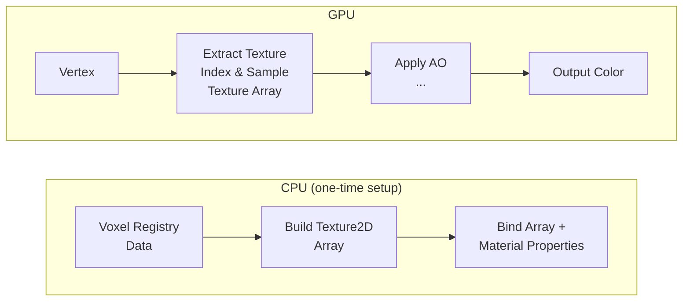
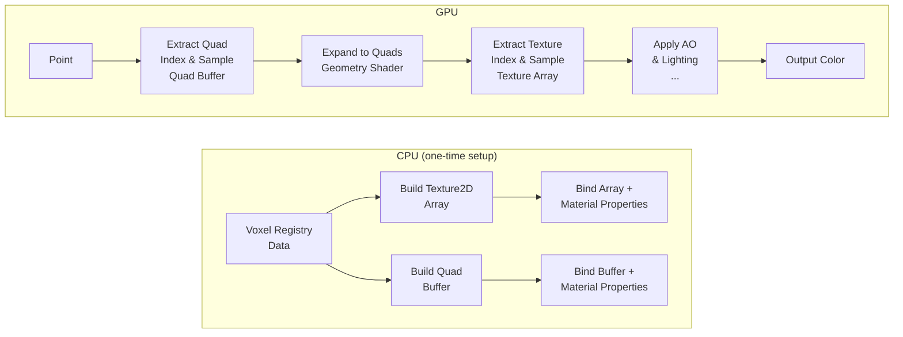
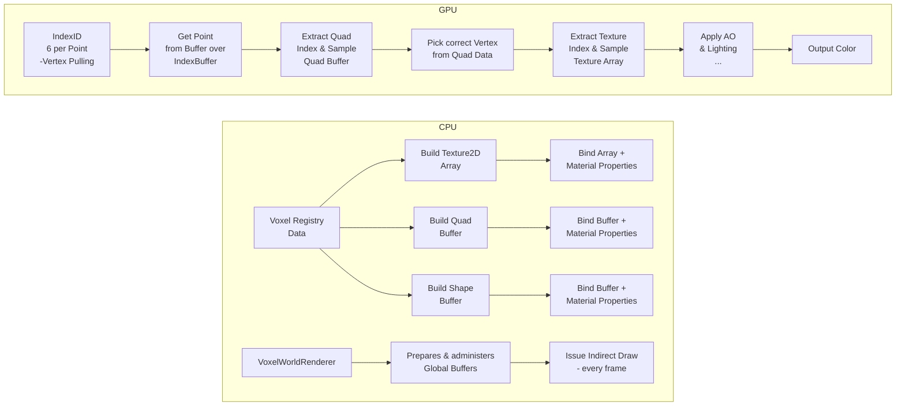
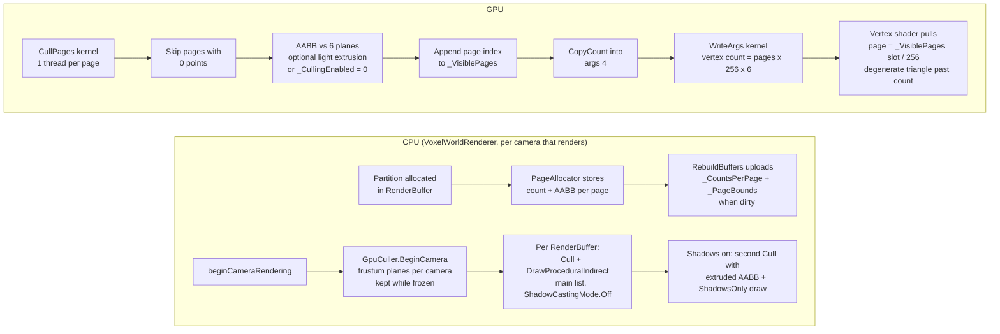

# Mesh & Render Pipeline (Overview)

# Version 1.0 (Chunks)

## Mesh Pipeline

### Description

In version 1.0, the mesh pipeline is built around whole chunks.
Each chunk generates its own render mesh and collider mesh on the CPU, and the pipeline applies them in sequence.

Advantages:

- Very simple data flow and easy to reason about.
- Low draw call count because each chunk uses a single render mesh.

Trade-offs:

- Any small change can force a full chunk rebuild.
- Updates become slower and less responsive as the world grows.

## Render Pipeline (Texture Array, ShaderGraph)

### Description

In version 1.0, rendering uses classic mesh rendering per chunk with a Texture2D Array bound to a ShaderGraph material.
Each voxel face stores texture indices, and the shader samples the correct layer from the texture array.

Advantages:

- Simple authoring workflow in ShaderGraph.
- Good visual flexibility without changing mesh topology.

Trade-offs:

- Rendering is still tied to fully buildt meshes.

# Version 1.1 (Partitions)
## Mesh Pipeline

### Description

In version 1.1, the pipeline switches from chunks to partitions.
This solves the main v1.0 problem: small edits no longer force a full chunk rebuild, because only the affected
partitions need new mesh data.

Advantages:

- Faster and more responsive updates after edits.
- Less CPU work per change because only local partitions are rebuilt.

Trade-offs:

- Each partition adds render overhead and more draw calls.
- Many visible partitions can quickly become expensive, especially with multiple materials.

## Render Pipeline (Vertex Pulling, Point Mesh)

### Description

In version 1.1, rendering shifts toward vertex pulling, where shaders fetch packed vertex data from buffers instead of
relying only on classic mesh attributes.
The geometry stage expands primitives for rendering and keeps CPU-side mesh binding lighter.

Advantages:

- Lower CPU mesh management overhead compared to fully traditional mesh binding.
- Smaller Meshes
- Better control over data layout in GPU buffers.

Trade-offs:

- Geometry stage overhead can limit scalability.
- Geometry Stage is not supported on all platforms.
- Draw call pressure remains high with many visible partitions. (Fixed by Unity's SRP batcher)

# Version 1.2 (Compute Shaders)
## Mesh Pipeline

### Description

In version 1.2, compute shaders take over the render-data generation path.
This solves the main v1.1 problem: the partition approach still caused too many draw calls and too much CPU-side mesh
overhead, so the pipeline moves the heavy work to the GPU and global buffers.

Advantages:

- Much lower CPU cost for generating render data.
- Better scalability when many partitions are visible at once.
- Fewer draw calls thanks to global buffers and indirect-style rendering.

Trade-offs:

- More complex shader, buffer, and synchronization logic.
- Debugging becomes harder than with a classic mesh pipeline.

## Render Pipeline (Meshless Draw, Global Buffers, Index Vertex Pulling)

### Description

In version 1.2, rendering becomes fully meshless and GPU-driven.
Instead of building and binding traditional meshes per partition, compute shaders process voxel data directly and build
compact vertex/index buffers in global GPU memory.
The render pipeline then issues a single indirect draw call, with shaders performing vertex pulling to fetch and expand
quad data for rasterization.

Advantages:

- Strong reduction of CPU render setup work—no mesh binding overhead per partition.
- Much better scaling for large numbers of visible partitions through global buffer management.
- Lower draw call overhead through batched indirect rendering instead of per-partition draws.
- Unified GPU-driven path simplifies CPU-side rendering logic.
- No Geometry Shader needed.

Trade-offs:

- Higher implementation complexity (compute pipeline, buffer synchronization, indirect args management).
- Harder debugging and profiling compared to traditional mesh-based rendering.
- Requires support for compute shaders and indirect rendering on target platforms.

# Version 1.3 (GPU Page Culling, Phase C)

## Render Pipeline (Per-Camera Frustum Culling of Pages)

### Description

Version 1.3 replaces the old `Culling.compute` / `ReBuildBuffers.compute` pair (one index per point, rebuilt on
every page change) with per-page frustum culling that runs once per camera and frame (CUL-01 to CUL-08 in
`WorldGenSpec.html`, section E2).

- **Page bounds (CUL-01).** `PageAllocator` keeps, next to the point count, the world-space AABB of the partition
  that owns each page (`PageBounds`, 24 bytes). `RenderBuffer.RebuildBuffers` uploads both arrays only when a page
  was allocated or released.
- **Cull kernel (CUL-02).** `PageCulling.compute` tests every page with points against the six camera planes
  (positive-vertex test, conservative at edges) and appends the surviving page indices to an append buffer. The
  counter is copied into slot 4 of the indirect args and a one-thread kernel writes the vertex count, so the CPU
  never reads anything back for the draw.
- **Vertex pulling (CUL-03).** The vertex shader maps `vertexID / 6` to a slot, the slot to a page through
  `_VisiblePages`, and emits a degenerate triangle for slots past the page's point count. Visible pages are drawn
  densely, empty slots cost nothing on the raster side.
- **Per-camera state (CUL-04).** `GpuCuller` owns a `CameraCullState` per camera (planes plus a `CullList` with
  append buffer, args and property block per render buffer). States are created on first sight and released when
  the camera is destroyed or has not rendered for 300 frames.
- **Shadows (CUL-05).** With `RendererSettings.shadows` not `Off` and a main light, every buffer is culled a second
  time with the AABB extruded along the light direction by the shadow distance and drawn `ShadowsOnly`. The
  mechanics are in place; the voxel shaders have no `ShadowCaster` pass yet, so this path does not produce shadows
  until one is added.
- **Debugging (CUL-06).** `RendererSettings.gpuCulling` (default on) and `VoxelWorldRenderer.GpuCulling` fall back
  to "every page with points is visible". `FreezeCulling` keeps the last planes so you can fly out and look at what
  was culled; `ShowCullingOverlay` shows visible / allocated pages per layer and buffer (read back asynchronously
  with one frame of latency).
- **Tests (CUL-08).** `FrustumCulling` is the C# reference of the GPU test (EditMode `FrustumCullingTests`); the
  PlayMode `GpuCullingTests` read the GPU set back for 50 random camera poses and compare it page by page, check
  the shadow list, the fallback, the camera life-cycle, freeze, the allocation-free draw path and log culling
  on/off frame times at a fixed viewpoint. `FrustumCullingBenchmark` records the CPU reference cost (PERF-02).

Advantages:

- Draw work scales with what the camera sees instead of with everything loaded.
- No per-page-change rebuild of an index buffer; the per-frame cost is one small dispatch per buffer and camera.
- Scene, preview and reflection cameras each get a correct visible set without CPU bookkeeping.

Trade-offs:

- Page bounds are partition bounds, so a page is as coarse as its partition; sparse partitions are drawn whole.
- Each camera holds its own append buffer and args per render buffer (a few KB each).
- The conservative plane test keeps boxes that straddle a frustum corner; Hi-Z occlusion (CUL-20) is future work.
