# Mesh & Render Pipeline (Overview)

# Version 1.0 (Chunks)

## Mesh Pipeline


### Description

In version 1.0, the mesh pipeline is built around whole chunks.
Each chunk generates its own render mesh and collider mesh on the CPU, and the pipeline applies them in sequence.

Advantages:

- Very simple data flow and easy to reason about.
- Low draw call count because each chunk uses a single render mesh.

Trade-offs:

- Any small change can force a full chunk rebuild.
- Updates become slower and less responsive as the world grows.

## Render Pipeline (Texture Array, ShaderGraph)

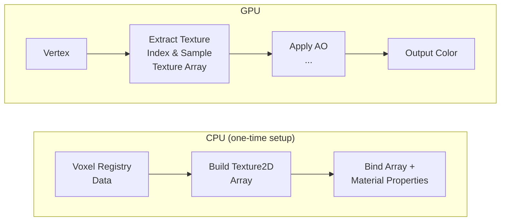

### Description

In version 1.0, rendering uses classic mesh rendering per chunk with a Texture2D Array bound to a ShaderGraph material.
Each voxel face stores texture indices, and the shader samples the correct layer from the texture array.

Advantages:

- Simple authoring workflow in ShaderGraph.
- Good visual flexibility without changing mesh topology.

Trade-offs:

- Rendering is still tied to fully built meshes.

# Version 1.1 (Partitions)
## Mesh Pipeline


### Description

In version 1.1, the pipeline switches from chunks to partitions.
This solves the main v1.0 problem: small edits no longer force a full chunk rebuild, because only the affected
partitions need new mesh data.

Advantages:

- Faster and more responsive updates after edits.
- Less CPU work per change because only local partitions are rebuilt.

Trade-offs:

- Each partition adds render overhead and more draw calls.
- Many visible partitions can quickly become expensive, especially with multiple materials.

## Render Pipeline (Vertex Pulling, Point Mesh)

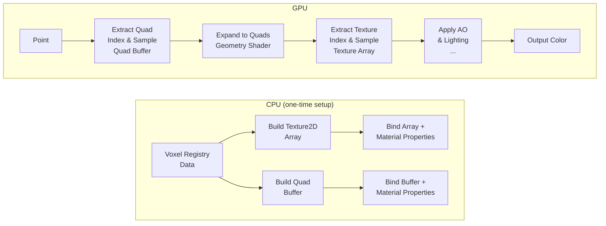

### Description

In version 1.1, rendering shifts toward vertex pulling, where shaders fetch packed vertex data from buffers instead of
relying only on classic mesh attributes.
The geometry stage expands primitives for rendering and keeps CPU-side mesh binding lighter.

Advantages:

- Lower CPU mesh management overhead compared to fully traditional mesh binding.
- Smaller Meshes
- Better control over data layout in GPU buffers.

Trade-offs:

- Geometry stage overhead can limit scalability.
- Geometry Stage is not supported on all platforms.
- Draw call pressure remains high with many visible partitions. (Fixed by Unity's SRP batcher)

# Version 1.2 (Compute Shaders)
## Mesh Pipeline
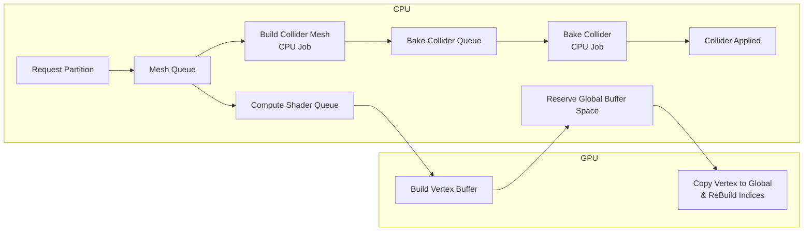

### Description

In version 1.2, compute shaders take over the render-data generation path.
This solves the main v1.1 problem: the partition approach still caused too many draw calls and too much CPU-side mesh
overhead, so the pipeline moves the heavy work to the GPU and global buffers.

Advantages:

- Much lower CPU cost for generating render data.
- Better scalability when many partitions are visible at once.
- Fewer draw calls thanks to global buffers and indirect-style rendering.

Trade-offs:

- More complex shader, buffer, and synchronization logic.
- Debugging becomes harder than with a classic mesh pipeline.

## Render Pipeline (Meshless Draw, Global Buffers, Index Vertex Pulling)

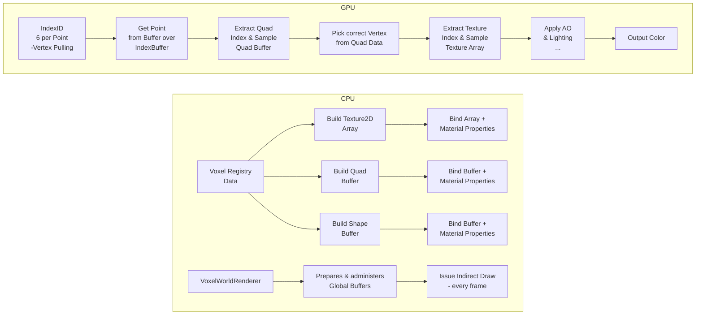

### Description

In version 1.2, rendering becomes fully meshless and GPU-driven.
Instead of building and binding traditional meshes per partition, compute shaders process voxel data directly and build
compact vertex/index buffers in global GPU memory.
The render pipeline then issues a single indirect draw call, with shaders performing vertex pulling to fetch and expand
quad data for rasterization.

Advantages:

- Strong reduction of CPU render setup work—no mesh binding overhead per partition.
- Much better scaling for large numbers of visible partitions through global buffer management.
- Lower draw call overhead through batched indirect rendering instead of per-partition draws.
- Unified GPU-driven path simplifies CPU-side rendering logic.
- No Geometry Shader needed.

Trade-offs:

- Higher implementation complexity (compute pipeline, buffer synchronization, indirect args management).
- Harder debugging and profiling compared to traditional mesh-based rendering.
- Requires support for compute shaders and indirect rendering on target platforms.

# Version 1.3 (GPU Page Culling)

## Render Pipeline (Per-Camera Frustum Culling of Pages)

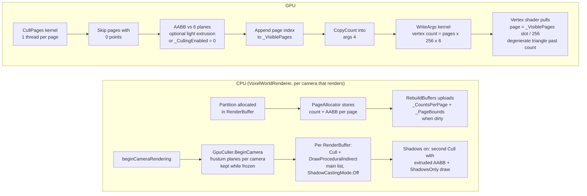

### Description

Version 1.3 replaces the old `Culling.compute` / `ReBuildBuffers.compute` pair (one index per point, rebuilt on
every page change) with per-page frustum culling that runs once per camera and frame.

- **Page bounds.** `PageAllocator` keeps, next to the point count, the world-space AABB of the partition
  that owns each page (`PageBounds`, 24 bytes). `RenderBuffer.RebuildBuffers` uploads both arrays only when a page
  was allocated or released.
- **Cull kernel.** `PageCulling.compute` tests every page with points against the six camera planes
  (positive-vertex test, conservative at edges) and appends the surviving page indices to an append buffer. The
  counter is copied into slot 4 of the indirect args and a one-thread kernel writes the vertex count, so the CPU
  never reads anything back for the draw.
- **Vertex pulling.** The vertex shader maps `vertexID / 6` to a slot, the slot to a page through
  `_VisiblePages`, and emits a degenerate triangle for slots past the page's point count. Visible pages are drawn
  densely, empty slots cost nothing on the raster side.
- **Per-camera state.** `GpuCuller` owns a `CameraCullState` per camera (planes plus a `CullList` with
  append buffer, args and property block per render buffer). States are created on first sight and released when
  the camera is destroyed or has not rendered for 300 frames.
- **Shadows.** With `RendererSettings.shadows` not `Off` and a main light, every buffer is culled a second
  time with the AABB extruded along the light direction by the shadow distance and drawn `ShadowsOnly`; the main
  pass stops casting but still receives shadows. The mechanics are in place; the voxel shaders have no
  `ShadowCaster` pass yet, so this path does not produce shadows until one is added.
- **Debugging.** `RendererSettings.gpuCulling` (default on) and `VoxelWorldRenderer.GpuCulling` fall back
  to "every page with points is visible". `FreezeCulling` keeps the game camera's last unfrozen frustum and culls
  *every* camera with it, so the Scene view (or a detached game camera) shows exactly the pages the game camera
  kept; the frozen frustum is drawn as a yellow gizmo. `ShowCullingOverlay` shows visible / allocated pages per
  layer and buffer (read back asynchronously with one frame of latency). All three are Inspector check-boxes on
  `VoxelWorldRenderer`; in the game `CullingDebugKeys` maps culling and freeze to F8 and F9 through the "Hud" map
  of the input actions, and the HUD's Culling panel (F3) shows the page counts.
  The Input System only sees the keyboard while the Game view has focus, so the Editor-only
  `CullingSceneViewKeys` handles F7/F8/F9 with the Scene view focused too and shows the switches there. Without
  freeze the Scene view camera culls with its own frustum, so nothing ever looks missing from it. To watch
  culling in the Editor: enter Play, let the Game view render once, press F9 (or tick *Freeze Culling*), then
  orbit the Scene view around the yellow frustum; F9 again picks up the current game frustum.
- **Tests.** `FrustumCulling` is the C# reference of the GPU test (EditMode `FrustumCullingTests`); the
  PlayMode `GpuCullingTests` read the GPU set back for 50 random camera poses and compare it page by page, check
  the shadow list, the fallback, the camera life-cycle, freeze, the allocation-free draw path and log culling
  on/off frame times at a fixed viewpoint. `FrustumCullingBenchmark` records the CPU reference cost.

Advantages:

- Draw work scales with what the camera sees instead of with everything loaded.
- No per-page-change rebuild of an index buffer; the per-frame cost is one small dispatch per buffer and camera.
- Scene, preview and reflection cameras each get a correct visible set without CPU bookkeeping.

Trade-offs:

- Page bounds are partition bounds, so a page is as coarse as its partition; sparse partitions are drawn whole.
- Each camera holds its own append buffer and args per render buffer (a few KB each).
- The conservative plane test keeps boxes that straddle a frustum corner; Hi-Z occlusion culling is future work.

# Version 1.4 (Lighting)

## Light Pipeline (Propagated Voxel Light, Smooth Corners, Day/Night)

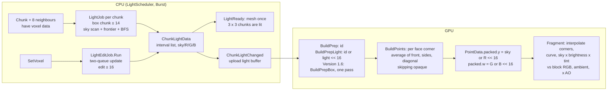

### Description

Version 1.4 adds propagated voxel light. Light is computed on the CPU once per chunk and on edits. On the GPU it is
only unpacked and interpolated, so day and night never re-propagate anything.

- **Data.** Every voxel has 16 bits of light: one 4-bit level each for sky, red, green and blue
  (`VoxelLight`, channel c at bits 4c, sky is c = 3). `ChunkLightData` stores them as an interval list in the same
  Flatten order as the voxel data. Each voxel definition has `lightAttenuation` (0 clear … 15 opaque, the default)
  and `lightEmission` (RGB). `VoxelRegistry` turns them into a `VoxelLightTable` for the jobs, and the attenuation
  also goes into `GPUVoxelDef` (80 bytes).
- **Initial light.** `LightJob` lights one chunk from the voxel data of its 3 × 3
  neighbourhood. It runs over a box of chunk ± 14 columns at full height (`LightRegion`), surrounded by an opaque
  sentinel ring. Light loses at least one level per step, so a source 15 columns away contributes 0: the result is
  exact and every chunk can be lit independently and in parallel.
  - Sky without BFS: every voxel above a column's highest non-clear voxel is 15.
  - BFS seeds:
    - the first non-clear voxel under the sky part;
    - sky voxels next to a taller neighbour column that has non-opaque voxels at that height;
    - emitters.
  - BFS: each channel of a neighbour becomes max(current, source − 1 − attenuation). Sky 15 moves down into a clear
    voxel without loss.
- **Scheduling.** `LightScheduler` batches chunks whose 3 × 3 neighbourhood has voxel data. The load
  distance is the draw distance + 3, so the outermost drawn chunks can be lit. A partition is meshed only when its
  chunk and the 8 neighbours are lit. Unloading a chunk invalidates the lit neighbours that read it.
- **Edits.** `SetVoxel` runs `LightEditJob` synchronously, after any job that reads those chunks has
  completed. Per channel it uses the two-queue method in a box of edit ± 16:
  - a removal BFS clears the light that may have come through the edited voxel;
  - light is then re-propagated from the border, the edited voxel's neighbours and the cleared voxels' own sources.

  Partitions whose light changed are remeshed. The result equals a full recomputation (tested over 500 random
  edits).
- **GPU light.** The renderer uploads each chunk's light intervals into the shared interval store, like the
  voxel data (two lists per chunk, see Version 1.5). `PointBuilder.compute` decompresses the voxel ids (`BuildPrep`), then
  ORs the light into the upper 16 bits of the same uint (`BuildPrepLight`). A neighbour lookup therefore fetches
  id and light at once (Version 1.6: `BuildPrepBox` writes both in one pass, see below). A build without a light
  list for every chunk is invalid.
- **Smooth light.** For each face corner, `BuildPoints` averages every channel over the front voxel,
  the two side neighbours and the diagonal, with rounding.
  - It skips opaque voxels (attenuation 15), and the diagonal too when both sides are opaque, so light never leaks
    through a closed corner.
  - If every voxel is opaque, the corner gets the front voxel's light.
  - Inner and foliage quads use the voxel's own light; for an opaque voxel, the per-channel max of its six
    neighbours.
  - Above the world counts as air with sky 15.
  - The 16 corner nibbles go into `PointData.packed.y` (sky | R << 16) and `.w` (G | B << 16), each channel as the
    four corners up-left, up-right, down-right, down-left (UV space, like AO). The point size is unchanged.
  - `PointLightPacking` is the C# port of the accessors and the corner average, used by the round-trip tests.
- **Shading.** The solid, cut-out and transparent shaders (Version 1.11) compute the light per
  fragment. They interpolate each channel's corner levels bilinearly and apply the curve 0.85^(15 − level).

  ```
  light = max(curve(sky) × _VoxelSkyBrightness × _VoxelSkyTint, curve(RGB))
  light = max(light, _VoxelAmbient) × AO      (× glow in the transparent shader)
  ```

  `DayNightCycle` (on the main directional light in `SampleScene`) drives the three globals and the light's
  rotation from `timeOfDay` and `speed`. The default speed is a 20-minute day. Without the component, the
  renderer sets full daylight (`VoxelLightingGlobals.SetDefaults`).
- **Tests and benchmarks.**
  - EditMode `LightPropagationTests`: emitter falloff, walls, media, channels, sky columns, frontier vs
    exhaustive seeding, 3 × 3 vs 5 × 5 border exactness, 500 random edits vs a full recomputation.
  - `PointLightPackingTests` and `DayNightCycleTests`.
  - `LightJobBenchmark`: 0.73 ms per chunk on natural terrain, 9.0 ms in the emitter-cavity worst case, with the
    BFS computing all four channels at once in byte lanes (see `Tests/Performance/Baselines/README.md`).

Advantages:

- Coloured block light and sky light with soft corners at no extra point size.
- Day/night is three shader globals; nothing is recomputed when the time changes.
- Chunk light is exact across borders and can be computed in parallel; edits stay local and synchronous.

Trade-offs:

- Each light job processes about 3.5 times its chunk's column count (the ± 14 margin) and uses about 3 MB of
  temporary memory.
- A chunk can be meshed only after its neighbours are lit, so the load distance is three chunks beyond the draw
  distance.
- Light changes need a remesh of the affected partitions, because the corner values are baked into the points.

# Version 1.5 (Shared Interval Store)

## Chunk Data on the GPU (One Paged Buffer Instead of One Buffer per Chunk)

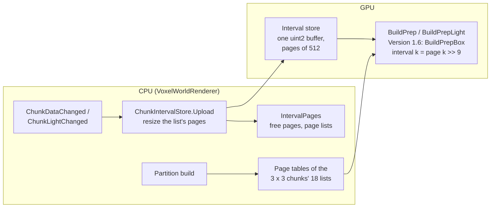

### Description

Until version 1.4, the renderer kept one `GraphicsBuffer` per chunk list (voxel ids and light), taken from a pool
created at start-up. A list longer than the pool's default length (8 intervals per column) created a new buffer at
runtime, and with it a managed allocation. Every pooled buffer was as large as that default, whatever its chunk
needed.

- **Store.** `ChunkIntervalStore` holds every list in one structured `uint2` buffer of 512-element pages (4 KB).
  A list is the header (interval count, last end) followed by its (value, exclusive end) nodes, as before.
- **Pages.** `IntervalPages` hands out the pages; a list's pages need not be adjacent.
  - An update keeps the pages the list still needs and adds or frees pages only at its end.
  - New pages are handed out lowest first, so a fresh list usually gets one run of pages and one `SetData`.
  - The renderer keeps an `IntervalRange` (slot and length) per chunk list.
- **Kernels.** Per partition build, `PointBuilderHandler` writes the page tables of the 18 lists back to back into a
  small buffer. `BuildPrep` and `BuildPrepLight` read interval k at
  `store[_CompPages[_CompPagesOffset + (k >> 9)] * 512 + (k & 511)]` (Version 1.6: `BuildPrepBox`, through a
  header of table offsets).
- **Growth.** If the free pages do not suffice, the store allocates a larger buffer, copies the old one on the GPU
  (`CopyIntervals`) and logs it. It started with 17 pages per list (8 intervals per column), two lists per chunk the
  `ChunkManager` can hold, the same memory as the former pool. Caves and the denser terrain later outgrew that: the goal
  run's sprint flight grew the store twice at draw distance 12, and each grow was a 17–23 ms frame. It now starts with
  41 pages per list (20 intervals per column, `InitialIntervalsPerColumn`): 100,450 pages (411 MB) at draw distance 12
  and 43,378 pages (178 MB) at 6, against flight peaks of 75,620 and 33,926 pages.
- **Measured** (PlayMode allocation flight test in the game scene): 6935 of 17986 pages used at the peak (39 %). No growth, 0/300
  allocating frames. Upload about 71 µs per chunk list as before. The prep dispatch takes about 22 µs per build
  instead of 20 µs (page-table upload).

Advantages:

- No managed object per chunk upload, whatever the list length.
- Memory follows the actual list lengths; a long list just takes more pages.
- Free pages are shared by all chunks; there is no fragmentation by buffer size.

Trade-offs:

- One more indirection per interval read in the prep kernels, and a page-table upload per build.
- Growth copies the whole store on the GPU and allocates once.

# Version 1.6 (Partition Box Prep)

## Decompressing Only What BuildPoints Reads

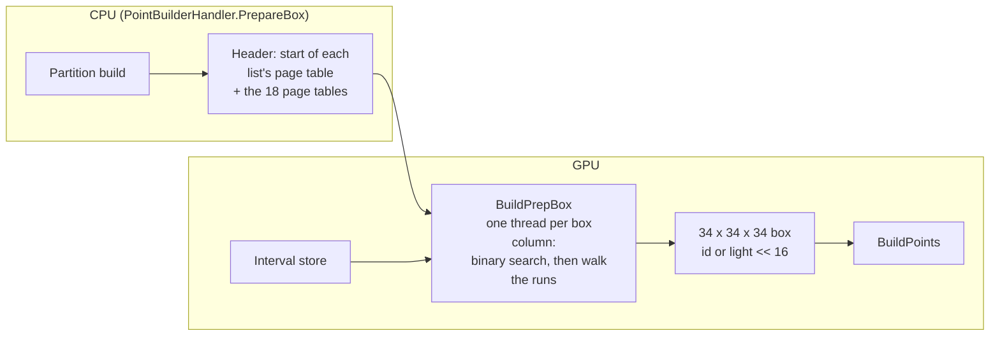

### Description

Until version 1.5, every partition build decompressed all 9 chunks of the 3 × 3 neighbourhood into 9 buffers of
32 × 256 × 32 uints: `BuildPrep` wrote the ids, `BuildPrepLight` then read and rewrote every uint to add the light.
`BuildPoints` reads only the partition and a 1-voxel border of it (a face corner or AO lookup is at most one voxel
away along each axis).

- **Box.** `BuildPrepBox` writes just that border box, 34 × 34 × 34 uints (`BOX_SIZE`), id and light in one pass.
  Box position = partition-local position + 1, index `(bx * 34 + bz) * 34 + by`; `_BoxOriginY` is the world y of
  box layer 0 (the partition's base − 1).
- **Kernel.** One thread per box column (34 × 34). The column's chunk follows from its x and z: the partition spans
  its chunk in x and z, so the border columns lie in the neighbours. Per list (ids, light) the thread finds the
  interval of its first voxel by a binary search, then walks the runs up the column. Layers below the world read
  as air, layers above it as air with sky 15.
- **Page tables.** `_CompPages` starts with 18 entries, the start of each list's page table in the same buffer
  (voxel lists, then light lists, in `PartitionBuildRequest` order), followed by the tables.
- **Lookup.** `get_voxel_safe` maps a position to the box; anything outside reads as air (never reached).
- **Memory.** One 154 KB buffer per handler instead of 9 × 1 MiB.
- **Measured** (EditMode probe, 3 runs; GPU times are 200 back-to-back builds until the GPU is done):
  - issuing the prep on the CPU: 10.1–10.6 µs → 2.9–3.4 µs;
  - prep on the GPU: about 3.86 ms → 23–26 µs per build;
  - whole build until its counts are read back: 4.23 ms → 0.42 ms.
- **Tests.** `PointBuildTests` hashes the points of three partitions (world bottom, surface with every voxel type,
  world top), recorded with the old kernels; they pass unchanged. `IntervalStoreTests` checks every box voxel of
  all 8 partitions of a chunk read through scattered pages and after a growth step.

# Version 1.7 (Rotated voxels)

## Turned Variants as Voxel Ids of Their Own

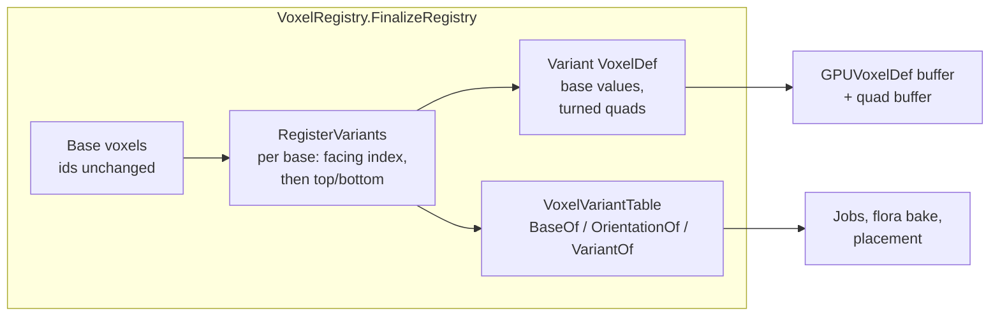

### Description

A voxel asset can turn: `facing` is None, Axis (3 orientations, like a log), Horizontal (4 fronts) or Full (6
fronts), and `topBottom` adds an upper half (a slab). Each turned orientation is a voxel id of its own, so the chunk
data, the interval lists, the light and the point builder stay one `ushort` per voxel and need no extra bits.

- **Ids.** `RegisterVariants` runs after all base voxels are registered and appends the variants: base order, then
  facing index, then top/bottom. Base ids never change. Variant ids depend on the package, so nothing stores them:
  the flora bake, the placement and the tests resolve them through the `VoxelVariantTable` (Burst-friendly native
  arrays: `BaseOf`, `OrientationOf`, `VariantOf`). Data that is ever persisted stores the base id plus the
  orientation. An orientation the base does not have gives the base id.
- **Names.** A variant's name is its base name plus a suffix (for example `std:LogOak#x`, `#-z`, `#u` for an upper half);
  if that does not fit into 32 bytes or is taken, it falls back to `#<base>.<orientation>` and logs a warning.
- **Orientation byte.** Bits 0–2 are the facing index (axis Y 0, X 1, Z 2; fronts +Z 0, +X 1, −Z 2, −X 3, +Y 4,
  −Y 5), bit 3 is the upper half (`VoxelOrientation`). `Rotation` gives the integer rotation of the authored shape:
  the upper half is 180° about Z, applied before the facing.
- **Geometry.** A variant copies its base's `VoxelDef` (mesh layer, collision, light, glow, surface alpha, fog) and
  gets the base quads turned about the voxel centre: `QuadRegistry.RegisterRotated` adds each (quad, rotation) pair
  once, after all authored quads, and the identity returns the quad itself. Positions, normal, up and right turn,
  the UVs stay with their corners, so the texture, the AO basis and the corner light turn with the quad. Each quad
  moves to the draw condition its turned normal points to (`VoxelOrientation.Remap`), so the face culling works on
  the turned shape.
- **Face culling.** A neighbour hid a face whenever it was in the same or a lower mesh layer. That is wrong for a
  slab, which covers only half a face. `GPUVoxelDef` (now 88 bytes) carries `HidesNeighbourFaces`, set for full
  cubes only; a partial shape (slab, plant) leaves its neighbours' faces drawn. Turning a full cube keeps it a full
  cube, so every variant has its base's flag.
- **Placement.** `VoxelPlacement.Resolve` picks the variant for a click like Minecraft: Axis follows the clicked
  face, a front faces the player, top/bottom takes the clicked half. A variant in the hotbar is placed as its base
  would be; picking a voxel returns its base.
- **Generation.** The flora bake resolves the lying logs once (`TreeVariantDef.TrunkVoxelX/Z`); see
  `WorldGenerationPipeline.md`, version 1.10.

Trade-offs:

- The registry, the voxel def buffer and the quad buffer grow by the variants; nothing per chunk grows.
- Adding or removing a rotatable voxel shifts every later variant id, which is why ids are never stored.

# Version 1.8 (Paced Partition Builds)

## The Mesh Step Follows the GPU Build Slots

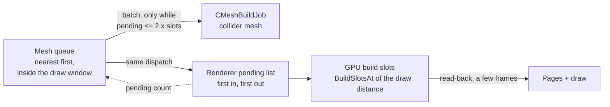

### Description

A meshed partition takes two things: the collider mesh job on the CPU and the point build on the GPU. The renderer
builds one partition per slot (`SchedulerSettings.BuildSlotsAt(DrawDistance)` slots since version 1.9, each with
its own counter buffers of about 8 MB) and a slot is busy until its read-back returns, a few frames later. The mesh step used to
hand over its batches without looking at the renderer. One dispatch schedules the collider mesh job and requests the
GPU builds of the same partitions (`CMeshBuildScheduler.Start`), so both run side by side.

- **Pacing.** The renderer reports the number of partitions that wait for a slot
  (`VoxelWorld.PendingPartitionBuilds`). The mesh step dispatches its next batch only while at most two rounds of
  slots wait (`CMeshBuildScheduler.RendererBehind`); meanwhile it neither scans nor dispatches, but still collects a
  finished batch. Two rounds keep the slots busy between two mesh batches; the
  rest of the backlog stays in the mesh queue, which is re-sorted around the focus and pruned to the draw window
  on every focus update. The renderer's list is first in, first out and cannot follow the focus.
- **Throughput.** With the scheduler of `ChunkPipeline.md` ("Scheduling") the mesh step is no longer bound to one
  batch per twelve frames. The GPU build slots are the limit now: a slot finishes a partition about every second
  frame. So the shipped settings went from a mesh batch of 8 with 4 slots to 16 with 8, a mesh batch being two
  rounds of slots. Fresh world at draw distance 12 and 60 frames per second (2026-11-14):

  | Scheduler | Mesh batch / slots | Frames | Seconds | Partitions per frame |
  | --- | --- | --- | --- | --- |
  | old (one sub-step every fourth frame) | 8 / 4 | 7553 | 125.9 | 0.66 |
  | work-conserving | 8 / 4 | 2532 | 42.8 | 1.98 |
  | work-conserving | 16 / 8 (shipped) | 1345 | 22.4 | 3.72 |
  | work-conserving | 32 / 16 | 1037 | 17.3 | 4.82 |

  With 32 / 16 the collider bake becomes the limit (its queue peaks at 2802 in a flight) and applying a mesh
  batch of 32 takes up to 21 ms of main-thread time in one frame, against 12 ms with 16. (Measured before the
  main-thread budget of `ChunkPipeline.md`; a batch is now applied over several frames, one pool claim per item of
  the budget.)
- **Without a renderer** (EditMode tests, a disabled renderer) the count is 0 and the mesh step never waits.

Trade-offs:

- The collider mesh of a partition is produced by the same batch as its GPU build request, so the pacing also
  delays collider meshes behind the GPU builds. Near partitions come first in both, so the focus column is still
  collidable first.
- More slots raise the throughput at about 8 MB of GPU memory per slot: 66 MB for the 8 shipped slots, 33 MB
  before.

# Version 1.9 (Sizes From the Draw Distance, Partitions Without Voxels)

## Mesh Batch and Build Slots Follow the Draw Distance

### Description

The mesh batch and the GPU build slots only have to be as large as the draw distance needs. Flying across a chunk
border exposes one row of the draw window, `2 x DrawDistance + 1` chunks, so that side length is the work the mesh
step has to keep up with.

- **Rule.** `SchedulerSettings.meshingBatchSize` and `partitionBuildBatchSize` are given for
  `referenceDrawDistance` (shipped: 16 and 8 at 12). `MeshBatchSizeAt(drawDistance)` and `BuildSlotsAt(drawDistance)`
  scale them with the side of the draw window, rounded to the nearest, at least 1:

  | Draw distance | 2 | 4 | 6 | 8 | 12 | 16 | 24 | 40 |
  | --- | --- | --- | --- | --- | --- | --- | --- | --- |
  | Mesh batch | 3 | 6 | 8 | 11 | 16 | 21 | 31 | 32 |
  | GPU build slots | 2 | 3 | 4 | 5 | 8 | 11 | 16 | 16 |
  | GPU memory of the slots (MB) | 17 | 25 | 33 | 41 | 66 | 91 | 132 | 132 |

- **Caps.** Scaling up stops at a mesh batch of 32 and 16 slots (`MaxScaledMeshBatchSize`, `MaxScaledBuildSlots`):
  beyond that the collider bake and the main-thread time of applying one batch are the limit (version 1.8). A value
  the asset sets above a cap is used as it is.
- **When.** Both are read once, when the world is built: `CMeshBuildScheduler` sizes its result map with the batch
  and takes its pacing limit (two rounds of slots) from the slots, `VoxelWorldRenderer` creates one point builder
  with its GPU buffers per slot (`VoxelWorldRenderer.BuildSlots`). A draw distance changed in a running world
  builds the world and these sizes again (version 1.10).
- **No scaling.** `referenceDrawDistance = 0` uses the two values as they are; the test rigs do that.
- **Other batch sizes stay fixed.** Data, light and collider bake did not limit a fresh world or a flight at draw
  distance 6 or 12, so they are not scaled.
- **Why these sizes.** They are the smallest that keep up with a sprint flight (80 units per second) and have the
  first build over well inside 20 s. Measured in the Editor without a frame cap (2026-11-14; a player build is
  faster): the world is built while the player stands, then the flight runs for 30 s.

  | Draw distance | Mesh batch / slots | World built after | Mesh queue in flight: peak / at the end | Meshed share of the draw window in flight | Flight frame ms p95 / p99 |
  | --- | --- | --- | --- | --- | --- |
  | 12 | 8 / 4 | 10.7 s | 3070 / 2643 | 0.58 | 13.9 / 16.3 |
  | 12 | 12 / 6 | 7.3 s | 1644 / 1195 | 0.80 | 15.0 / 17.1 |
  | 12 | 16 / 8 (derived) | 5.6 s | 336 / 156 | 0.97 | 14.1 / 16.4 |
  | 6 | 4 / 2 | 3.6 s | 236 / 82 | 0.93 | 7.7 / 10.2 |
  | 6 | 8 / 4 (derived) | 2.5 s | 131 / 0 | 0.98 | 7.4 / 10.1 |
  | 6 | 16 / 8 | 1.4 s | 88 / 0 | 0.99 | 7.8 / 10.5 |

  With smaller sizes the mesh queue grows during the flight and the edge of the draw window stays unbuilt. The
  frame time of the flight does not depend on the sizes: a larger batch is not what makes a frame long.
- **Frame time (goal: 8.33 ms at the 95th percentile, stable from 20 s after the world start).** Standing, 20 s to
  40 s after the start: p95 5.1 ms, p99 6.7 ms, 13 of 5082 frames over 8.33 ms at draw distance 12; p95 4.6 ms and
  no frame over 8.33 ms at 6. In the sprint flight the goal is met at 6 (p95 7.4 ms, 3 % of the frames over
  8.33 ms) and missed at 12 (p95 14.1 ms, 42 % over 8.33 ms, 0.8 % over 16.67 ms). The long frames come from
  main-thread work that is done in one piece: applying a data batch (2.4 ms on average, up to 8.7 ms) and applying
  a mesh batch (2.4 ms, up to 5.9 ms). These numbers are from before 2026-11-15: since then a main-thread budget
  per frame bounds that work (`ChunkPipeline.md`, "Main-thread budget per frame", with the numbers measured
  with it).

## Partitions Without Voxels Are Not Built

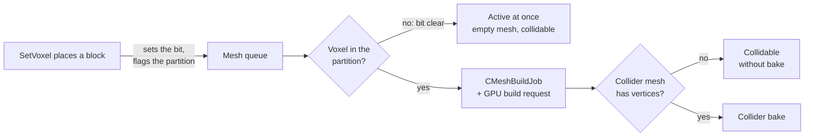

### Description

At draw distance 12 almost half of the partitions of the draw window hold only air (the sky above the terrain).
They used to go through the whole mesh step: a mesh job, a GPU build slot with its read-back, and a place in the
collider bake queue, all for nothing to draw and nothing to collide with.

- **Occupancy bit.** `ChunkVoxelData.OccupiedPartitions` has one bit per partition of the chunk. `AddVoxels`
  (generation) and `SetVoxel` (edits) are the only writers of voxel data; both set the bit of every partition a
  voxel that is not air goes into. The bit is never cleared: a partition the player dug empty is still built, to an
  empty mesh.
- **Why air alone decides.** Every face belongs to the voxel it is a face of, in the point build and in the
  collider mesh. A partition without a voxel therefore has no geometry and no collider, whatever its neighbours
  hold.
- **What is skipped, per stage:**

  | Partition | Mesh job | GPU build | Collider bake |
  | --- | --- | --- | --- |
  | no voxel (bit clear) | skipped | skipped (not requested) | skipped |
  | voxels, collider mesh without a vertex (water, plants, no open solid face) | runs | runs | skipped |
  | voxels with an open solid face | runs | runs | runs |

- **Mesh step.** `MeshJobStateHandler` sorts the partitions it takes from the queue: those with voxels fill the
  batch, those without are claimed in the pool and are active at once (`CMeshBuildScheduler.ApplyEmpty`). They do
  not count against the batch; one turn takes at most four batches of them, so a turn stays bounded. The
  dequeue loop asks the frame's budget for every 32 entries (`MeshJobStateHandler.DefaultDequeueSlice`): in the
  Editor an entry costs 5.2 to 5.4 µs in a capped flight at draw distance 12 (2026-11-15, an upper bound), so a
  slice stays below 0.2 ms and a loop of up to 79 entries below 0.45 ms. A loop the budget cut continues in the
  next frame and completes its batch before it is dispatched.
- **Priority queue check.** `GenericPriorityQueue.Dequeue` (and `FastPriorityQueue`, `StablePriorityQueue`)
  checks the whole heap (`IsValidQueue`, O(capacity)) only with the scripting define `PRIORITY_QUEUE_VALIDATE`
  (Project Settings > Player > Other Settings > Scripting Define Symbols); add it to hunt a corrupted queue.
  Until 2026-11-15 the check ran in every build with `DEBUG`, so in the Editor: an entry of the mesh dispatch
  cost 37 to 57 µs, a dequeue loop took up to 3.7 ms in one piece and was sliced every four entries, and the
  pool claims cost several times what they do now. Editor timings from before that change are not comparable
  with timings after it. The cheap checks (empty queue, null node) still run under `DEBUG`.
- **Collider state.** A partition without a collider is marked collidable right away
  (`MarkCollidableWithoutCollider`), so `VoxelWorld.IsCollidable` means "the collider is ready: baked, or known to
  be empty" and nothing waits for a bake that never comes. A meshed partition whose last solid face went loses its
  old collider the same way, without a bake.
- **Renderer.** No GPU build is requested for a partition without a voxel, so the renderer has no pending entry
  and no slot for it; it never waits for one.
- **Wake-up.** `SetVoxel` sets the bit and always flags the edited partition, so the first block placed in an air
  partition meshes it. `ChunkManager.FlagReMesh` (light changes) and the flags for the neighbours of an edit skip a
  partition without a voxel: it has no face that could change.
- **Pool.** A skipped partition is claimed like a meshed one, so the pool's count, its priority threshold and the
  eviction are unchanged, and "world built" (every partition of the draw window active) is reached as before.
- **Measured** (Editor, draw distance 12, 60 frames per second, 2026-11-14): of the 5000 partitions of a fresh
  world 2398 (48 %) hold no voxel and take no mesh job and no GPU build; 495 more need no bake.

  | | Before the skip | With the skip |
  | --- | --- | --- |
  | Fresh world | 1346 frames / 22.5 s | 703 frames / 11.7 s |
  | Fresh world: mesh queue peak / bake queue peak | 3128 / 1134 | 1661 / 483 |
  | Sprint flight through a building world: mesh queue peak | 3503 | 2366 |
  | Sprint flight: meshed share of the columns within 4 of the focus | 0.68 | 0.93 |
  | World complete after the flight stops | 15.7 s | 3.6 s |

Trade-offs:

- The bit is conservative: it is set for a partition that holds only water or plants, and it stays set after the
  last block is removed. Such partitions take the mesh job and the GPU build; only the bake is skipped.
- A claim in a full pool can reclaim a pooled chunk and unload its data, so the mesh step drops the partitions of
  the batch it is filling that lost a chunk of their neighbourhood; the next scan picks them up again.

# Version 1.10 (Draw Distance at Run Time, GPU Memory Readout)

## The Renderer Rebuilds Its Draw-Distance-Sized Buffers

### Description

The player can change the draw distance in the game's menu (`VoxelWorld.ChangeDrawDistance`,
`ChunkPipeline.md`). The world builds itself again in the running scene, and the renderer follows.

- **What is sized from the draw distance.** The GPU build slots and their point builders, the partition pool, the
  interval store (version 1.5), the request arrays, the three render buffer managers (solid, transparent,
  foliage), the culler and the copy pass. `VoxelWorldRenderer.CreateResources` makes all of them;
  `ReleaseResources` disposes them. `Awake` and `OnDestroy` call the two.
- **On a change.** The world first evicts every chunk, so the renderer releases its lists and pages through the
  normal events. Then it raises `DrawDistanceRebuilding`; the renderer drops its pending partition builds and runs
  `ReleaseResources` and `CreateResources` with the new distance. The world then loads again around the focus,
  and the uploads and builds fill the new buffers as for a fresh world.
- **Sizes.** The interval store starts with 41 pages per list (version 1.5) for every chunk the store can hold:

  | Draw distance | 4 | 6 | 8 | 10 | 12 | 16 |
  | --- | --- | --- | --- | --- | --- | --- |
  | Interval store (MB) | 121 | 178 | 245 | 323 | 411 | 621 |
  | GPU build slots | 3 | 4 | 5 | 7 | 8 | 11 |

  Going back to a distance gives the same sizes again. The render buffers start small and grow with the world as
  before.

## GPU Memory Readout

`VoxelWorldRenderer.GpuMemory` (public, read-only) returns a `GpuMemory` value with the bytes of the engine's own
GPU buffers, counted as `count × stride` of each `GraphicsBuffer`:

- the interval store: bytes, pages, pages in use, the peak in use and how often it grew (`IntervalStoreUsed` and
  `IntervalStorePeak` as 0 to 1);
- the render buffers: count per layer and bytes;
- the build slots: count and bytes;
- the rest: culler, copy pass and the voxel registry's buffers;
- `TotalBytes`, the sum.

It works in every build, unlike Unity's "Gfx Used Memory" counter, which a release player does not have. The
HUD shows both: the engine's buffers always, Unity's counter only where it is valid. Reading it allocates nothing;
it returns an empty value while the renderer is not running.

`DrawDistanceChangeTests` (PlayMode) holds that the store and the build slots follow a change and come back to
their sizes, and that the world is uploaded again after it.

# Version 1.11 (Cut-Out Leaves, Face Shade, Glass Pass, Liquid Top)

## Description

Leaves looked flat and their inner faces cut through each other: they were blended in the transparent queue with
all six faces of every block drawn, so the faces sorted at random. Version 1.11 (WorldGenSpec DEC-118) draws them
like opaque blocks with holes.

- **Draws per layer.** Each `RenderBuffer` is drawn once per material of its manager, from the same culled pages.

  | Layer | Material (shader) | Queue | What it draws |
  | --- | --- | --- | --- |
  | Solid | `VoxelSolidMat` (`Custom/VoxelShader`) | Geometry | everything |
  | Transparent | `VoxelCutout` (`Custom/CutoutVoxel`, `_VoxelPass` 3) | AlphaTest | the cut-out points (leaves) |
  | Transparent | `VoxelTransparent` (`Custom/TransparentVoxel`) | Transparent | liquids (pass `UniversalForward`) |
  | Transparent | same, pass `VoxelGlass` | after the skybox | glass and other blended see-through voxels |
  | Transparent | same, pass `VoxelGlassOver` | after the transparents | the glass again, over liquid pixels |
  | Foliage | `VoxelFoliage` (`Custom/CutoutVoxel`, `_VoxelPass` 0) | AlphaTest | everything |

  `RenderBufferManager.WithCutoutPass` gives the transparent manager its two materials (cut-out first). The
  `VoxelGlass` pass is not drawn by URP's own passes: `VoxelGlassFeature` (on `PC_Renderer` and
  `Mobile_Renderer`) draws it at `AfterRenderingSkybox`, so glass is in the opaque colour copy that a liquid
  surface in front reads. Glass is not in the depth copy (accepted). Glass writes no depth, so a liquid surface
  behind it is still drawn. The liquid pass marks its pixels in the stencil (bit 64); the feature's second pass,
  `VoxelGlassOver` at `AfterRenderingTransparents`, draws the glass again on those pixels where it lies in front of
  the liquid's surface (depth test against the liquid's depth), so the liquid does not cover it. Glass under the
  surface fails that depth test and shows through the liquid as before. Where a liquid lies behind glass, the
  glass is also in the colour copy the liquid shows, so it counts twice there; in the play-test shots this did not
  show. Without a cut-out material `RenderBufferManager.WithCutoutPass` logs a warning (leaves would not be
  drawn). In each pass the vertex shader collapses the quads that belong to another pass to one point, which the
  rasteriser drops.
- **Cut-out.** `Voxel.alphaCutout` (set on the eight leaf voxels) marks a transparent-layer voxel as cut out
  (`VoxelDef.AlphaCutout`). Its points carry the cut-out flag (`PointData.packed.z` bit 14). `CutoutVoxel` clips
  at `_Cutoff` 0.5, writes depth, draws both sides (`Cull Off`), and a back face takes the shade of the face it
  shows. Its `DepthOnly` pass clips too, so the depth copy has the holes.
- **Which voxels are cut out.** Every voxel whose texture alpha is only 0 or 1 draws cut-out (audit of
  2026-11-18). On the transparent layer these are the eight leaf voxels (`RendererSettings.cutoutMaterial`,
  `VoxelCutout.mat`). The whole foliage layer (grass, flowers, ferns, reeds, mushrooms, wheat, dead bush, rocks,
  torch) is cut out through `VoxelFoliage`. Glass (glints at alpha 0.2–0.4), water (0.8) and lava (0.94) stay
  blended. `VoxelFoliage` and `VoxelCutout` share the shader but not the material: the foliage buffer draws all
  its points (`_VoxelPass` 0) without face shade, the transparent buffer only its cut-out points (`_VoxelPass` 3)
  with it. Each buffer is drawn once per material either way, so one material would not save a draw.
- **Face rules** (`should_render_face` in `PointBuilder.compute`):
  - a full cube in the same or a lower layer hides the face (stone keeps its face towards water or leaves);
  - two cut-out cubes share one face: the one towards +x, +y or +z;
  - two different see-through voxels keep both faces (water against leaves or glass);
  - the same see-through voxel culls; turned variants of one voxel count as the same (`GPUVoxelDef.BaseId`).
- **Face shade.** `_FaceShade` = (top, bottom, x sides, z sides) = (1, 0.62, 0.8, 0.88) on the solid, leaves and
  transparent materials; the foliage material has (1, 1, 1, 1), so plants keep their look. `face_shade` in
  `VoxelShaderCommon.hlsl`:
  - with the sun below the horizon (or no URP sun) the fixed values; a slanted quad blends by its normal;
  - while the sun is up, by the face's angle to the sun (`_VoxelSunDirection`, half Lambert): the bottom value
    facing away from it, the top value facing it, so the sunny side is the brightest and the shade moves with the
    day; the blend from the fixed values takes the sun's rise to a height of 0.2 (`SUN_SHADE_RISE`);
  - it darkens only the sky light (`calc_voxel_light`), so a torch lights every side of a block alike;
  - a face seen from its back (`SV_IsFrontFace`, leaves, glass and liquids) takes the shade of the opposite face,
    so the underside of a water surface is shaded like a bottom face;
  - `RendererSettings.faceShadeStrength` (global `_VoxelFaceShadeStrength`, set every frame by
    `VoxelWorldRenderer`, shipped 0.65) pulls the result towards 1: 0 lights every face alike, 1 is the full shade.
- **Mipmaps.** `TexRegistry` builds the texture array with the mip chain of its sources (the smallest mip count
  among them). A tile with fewer levels than the others logs a warning naming it. The 38 leaf and plant tiles have `mipMapsPreserveCoverage`, so their alpha coverage stays the same
  per mip and far leaves do not thin out.
- **Liquid top.** A liquid (category Liquids, `VoxelDef.Liquid`) whose upper neighbour is not the same voxel and
  not a full opaque block is a liquid top (`packed.z` bit 15). The vertex shader lowers its top corners by
  `LIQUID_SURFACE_DROP` 0.1 (`VoxelRenderConstants.LiquidSurfaceDrop`); `VoxelPostProcessHandler.IsLiquidTop`
  uses the same rule (a slab or other partial solid on the water still lowers it) for the under-water check. Where a lowered top meets a full block of the same liquid at its side, a
  0.1 slit can show (accepted).
- **Packed z.** ao u8 | volume fog slot u6 | cut-out u1 | liquid top u1 | surface alpha u8 | glow u8. The volume
  fog slots shrink from 8 to 6 bits (63 liquids with fog).
- **Tests.** `PointBuildTests.BuildPoints_SeeThroughFaceRules` (GPU build of small scenes: face counts and the
  two flags), `LiquidTop_CameraMatchesDrawnSurface` (camera check = drawn surface, also under slabs) and
  `GpuVoxelDefs_CarryTheBaseVoxel`; `RenderDataTests` (cut-out materials in queue AlphaTest, the three voxel
  shaders compile, the shipped face shade strength, both glass passes and the feature on both renderers, the
  missing cut-out material warning, `GPUVoxelDef` 100 bytes); `RegistryTests.TexRegistry_TileWithFewerMips_WarnsAndNamesIt`; `GpuConstantsTests` (`MESH_LAYER_TRANSPARENT`, `VOLUME_FOG_SLOT_MASK`,
  `LIQUID_SURFACE_DROP`).

# Version 1.12 (Simple Liquids, Biome Water Tint)

## Description

The owner found the water wrong as a whole and asked for a simple, Minecraft-like look with no complex vertex
shader (WorldGenSpec DEC-119, 2026-11-20). Version 1.12 replaces the liquid pass of Version 1.11: no colour grading
of the scene behind, no depth fade to opaque, no Snell's window, no opaque colour copy.

- **Liquid surface** (`TransparentVoxel.shader`, pass `UniversalForward`). An alpha-blended surface, lit like every
  other voxel (AO, propagated light, face shade, glow, horizon fog):
  - **Pattern.** The voxel's texture is sampled twice in world space (top and bottom faces by x/z, the sides by
    their horizontal axis and y), scrolled in two directions by `_Time.y × flowSpeed` (on the sides both run
    down), and averaged. Gradients come from the unscrolled coordinates, so the mip level stays steady. Fragment
    shader only; the vertex shader passes the quad's normal (`nointerpolation`).
  - **Colour.** The texture's mean colour is its last mip. A biome-tinted liquid takes the biome water colour and
    carries the pattern as a luminance ratio to the mean (`k = lum(pattern) / lum(mean)`, scaled by
    `patternStrength`); any other liquid keeps its texture colour with the pattern scaled about the mean. Both are
    multiplied by `tint`.
  - **Alpha** = texture alpha × `surfaceAlpha`. Seen from outside, one scene-depth read raises it towards
    `depthAlpha` over `depthFadeDistance` blocks of scene behind the surface (the short depth tint), so deep water
    reads darker. Seen from below, the surface is the same tinted surface; the underwater fog covers the rest.
- **Volume slot** (`VoxelRegistry.VolumeFogDef`, `_VoxelVolumeFog`, 32 bytes): tint (float3), biome tint, depth
  fade, depth alpha, flow speed, pattern strength. A transparent voxel that is not cut out gets a slot when it is a
  liquid (category Liquids), has a depth fade or has underwater fog. The names stay from Version 1.11.
- **Voxel settings.** `Voxel.liquidSurface` (`VoxelLiquidSurface`: tint, biomeTint, flowSpeed, patternStrength,
  depthAlpha), shown for liquids in the voxel inspector. `VoxelPostProcessData` keeps only the fog
  (enableFog, fogColor, fogDensity, depthDarkening, sceneTint); the grading fields are gone.
- **Biome per column.** The chunk job keeps the hard biome of every column with the chunk
  (`ChunkVoxelData.Biomes`, 32 × 32 bytes, index `z + x × 32`, `ChunkJob.WriteBiomes`), freed with the chunk.
  `Biome.WaterColor` and `Biome.WaterFogColor` give each biome its colours; `VoxelWorld` keeps them in config
  order (`BiomeWaterColors`, `BiomeWaterFogColor`, `BiomeColorsVersion`; since Version 1.13 the colours are a
  `BiomeTintPalette`).
- **World tint map** (`WaterTintMap`; Version 1.13 replaces it with `BiomeTintMap`, see there). A repeating sRGB texture with one texel per block column, `2 × draw
  distance + 4` chunks a side (28 chunks, 896² texels, 4.2 MB with mips at draw distance 12; 68 chunks, 24.9 MB at 32). A chunk owns the slot its position falls on (`((c mod N) + N) mod N` per axis); the drawn square never
  puts two chunks on one slot. `VoxelWorldRenderer` writes a chunk's colours before it builds the chunk's first
  partition (`EnsureWaterTint`, marker `Voxel.GpuUpload.WaterTint`): 1,024 pixels into a 32 × 32 staging texture,
  then `Graphics.CopyTexture` into the slot. An evicted chunk is forgotten, new biome colours (a regenerated world)
  forget all, and a draw distance change makes a new map. Globals `_VoxelWaterTint` and `_VoxelWaterTintParams`
  (x = 1 / size, z = blend mip). The map keeps mips 0–2 (`BlendMip` 2: one texel per 4 × 4 columns, never across
  a chunk); `UpdateMips` rebuilds them in `LateUpdate` when chunks were written that frame. The shader reads it by
  world x/z: four bilinear taps two blocks apart diagonally from mip 2, so the colour blends over about 16 blocks
  between biomes. The biome colours stay close to one blue (owner, 2026-11-20); only the Swamp is murky.
- **Underwater.** `UnderwaterFogFeature` keeps its exp² fog with depth darkening. `VoxelPostProcessHandler` no
  longer sets Lift/Gamma/Gain or Colour Adjustments; for a biome-tinted liquid the fog colour is the mean of the
  biomes' water fog colours over 16 × 16 blocks around the camera (4 × 4 columns, 4 blocks apart, in linear light,
  again when the camera's column changes). `sceneTint` (Water 0.8) tints the scene behind the fog with the fog
  colour's hue and the depth darkening, so near blocks look blue as well; Water's fog is a saturated blue
  (0.02, 0.30, 1.0) at density 0.02.
- **Pattern tile.** Water uses an own greyscale tile, `KenneyDerived/water_ripples.png` (16 px per block, alpha 0.8,
  `Docs/Tools/make_water_pattern.py`), with pattern strength 1; the Kenney water tile was almost flat.
- **Opaque copy off.** No shader reads `_CameraOpaqueTexture` any more, so `PC_RPAsset` has
  `m_RequireOpaqueTexture: 0` (the depth texture stays on for the depth tint). Glass is still drawn after the
  skybox and before the transparents, so a liquid surface in front blends over it; the double-counted glass of
  Version 1.11 is gone.
- **Liquid depth pre-pass.** `PageCulling.compute` appends the visible pages in a different order every frame, so
  two liquid faces behind each other (a lake's floor and its surface, seen from an air pocket under it, or water
  through water across a chunk border) blended once or twice by that order: whole partitions flickered. The
  `VoxelLiquidDepth` pass of `TransparentVoxel.shader` (`ColorMask 0`, `ZWrite On`, `Cull Off`, the liquid vertex
  shader, no alpha test) writes the liquids' depth first; `VoxelGlassFeature` draws it at
  `BeforeRenderingTransparents`, between the glass pass and the transparents. The forward pass then draws only the
  nearest liquid face per pixel (`ZTest LEqual`). The depth texture is copied after the opaques, so the depth tint
  still sees the floor. Without `VoxelGlassFeature` in the renderer the flicker comes back (owner's pick
  "Depth pre-pass", 2026-11-20). Cost: one depth-only draw of the liquid pages per frame. Measured with the
  goal run (bef7c14 / 28c7163 / 28c7163 / bef7c14, Editor, draw 12): standing over the sea the GPU frame is
  0.3 to 0.4 ms longer (3.21, 3.20 against 2.83, 2.92 ms avg; frame p95 5.99, 5.80 against 5.02, 5.50 ms), the
  main camera's URP render 0.03 ms; in the flights the difference stays inside the spread.
- **Liquid depth pulled towards the camera.** A liquid face next to leaves (or glass) lies in the plane of the
  leaf face, and the two quads split into triangles along different diagonals, so from inside the water whole
  triangles of the leaf showed through the water surface and changed as the camera moved. `vert_filtered` pulls
  every liquid vertex `LIQUID_DEPTH_PULL` (1/128 block, at most half the distance) towards the camera along its
  view ray: its place on screen stays the same, only its depth changes, so the liquid face wins against a face in
  its own plane and no seams open. (A first try moved the faces 1/64 block into their block; that opened a visible
  seam at every corner of a water body and was dropped.) The depth pre-pass has `Offset 1, 1`, so the forward
  pass, compiled separately, always passes for the nearest face. Checked in Play mode: camera in water next to a
  leaf wall (green triangles before, an even water surface after) and a water corner on sand (no seam).
- **Icon.** The water tile is a grey pattern, so `Voxel.DisplayTint` (a liquid's surface tint, with biome tint
  times `Biome.DefaultWaterColor`) colours its inventory and hotbar icon (`BlockIcon.Set`).
- **Tests.** `WaterRenderingTests` (the chunk job keeps the column biomes, tint map size and slot wrap, the pixel
  layout and fallback, ensure/forget/new colours, a written chunk read back from the GPU, one mip rebuild after
  writes, the fog colour average, opaque copy off and depth on, the shipped water asset, biome colours close to one
  blue); `RegistryTests.VoxelRegistry_LiquidsAndDepthFades_GetVolumeSlots`
  (slot rules and the 32-byte entries); `RenderDataTests.VolumeFogDef_Is32Bytes`,
  `RenderDataTests.TransparentMaterial_HasGlassPassForTheGlassFeature` (also the liquid depth pass) and the shader
  compile check.
- **Measured** (2026-11-20, Editor, focused, `FrameTimeGoal_MainThread_IsAttributed` at draw distance 12, uncapped;
  master, branch, branch, master in one session; branch / second master run): standing frame p95 5.14, 4.33 / 4.35 ms;
  flight 80 u/s p95 7.66, 7.57 / 7.57 ms; flight 40 u/s p95 6.69, 6.59 / 6.52 ms. The GPU frame is 0.05 to 0.13 ms
  longer on average (the liquid pass), the main thread is unchanged within the spread, and the tint upload costs
  0.016 ms per frame on average (p95 0.099 ms) in the 80 u/s flight. The underwater fog pass is not in this run
  (the rig stays above the terrain).

# Version 1.13 (Biome Grass and Plant Tint)

## Description

The owner asked for the per-biome colour of the water on grass and plants as well (WorldGenSpec DEC-120,
2026-11-20): grass tops and sides and the green plants take a biome colour, Minecraft style, from grey tiles. Tree
leaves are not tinted (spec idea 16.8 stays open); flowers, mushrooms, rocks, wheat, the torch and the dead plants
(GrassFDead, DeadBush) keep their colours. Version 1.13 extends the water tint of Version 1.12 to three layers.

- **Palette** (`BiomeTintPalette`). Per layer (0 water, 1 grass, 2 plants, the values of `VoxelBiomeTint`) the
  colour of every biome in config order, kept in linear light, and a default per layer (`Biome.DefaultWaterColor`,
  `DefaultGrassColor` #7cc24a, `DefaultFoliageColor` #6aae3a: the Plains colours) for columns without a biome or a
  biome the palette lacks. `Biome.GrassColor` and `Biome.FoliageColor` are new fields; every shipped biome has its
  pair (plants a shade darker than the grass). `VoxelWorld.BiomeTintPalette` is rebuilt with a new version when
  the biomes change.
- **Tint map** (`BiomeTintMap`, was `WaterTintMap`). A repeating sRGB `Tex2DArray` render texture with one slice
  per layer and one texel per 4 × 4 block columns (8 × 8 texels a chunk, the mean of its 16 columns in linear
  light), `2 × draw distance + 4` chunks a side: 224² texels × 3 slices, 0.6 MB at draw distance 12 (Version 1.12:
  4.2 MB with mips), 3.6 MB at 32. No mips: the texels are what the old blend mip held, so `UpdateMips` and its
  `LateUpdate` call are gone. A chunk's three blocks go into one 8 × 24 staging texture (`FillPixels`, pixel
  `x + (z + layer × 8) × 8`) and from there with three `Graphics.CopyTexture` calls into its slot; the slices are
  cleared to the layer defaults. `VoxelWorldRenderer.EnsureBiomeTint` writes the chunk and its eight neighbours
  that are loaded before the chunk's first partition is built (marker `Voxel.GpuUpload.BiomeTint`), so a chunk
  border never blends with the default colour. Globals `_VoxelBiomeTint` (the array) and `_VoxelBiomeTintParams`
  (x = 1 / size in blocks). `biome_tint_color(positionWS, layer)` in `VoxelShaderCommon.hlsl` takes the four
  bilinear taps two blocks apart from mip 0 (the same blend over about 16 blocks); the liquid shader reads slice 0.
- **Which texture is tinted.** The packed point data has no free bit, so the tint goes by texture: the registry
  keeps a tint word per texture of each texture array (`TexRegistry.TintWords`, `_VoxelTexTint`, a
  `StructuredBuffer<uint>` per layer material): bits 0–1 the layer, bit 2 masked, bits 16–31 the slice of the mask
  in `_VoxelTintMasks` (a `Texture2DArray` of the voxels' `biomeTintMask` overlays, one clear slice when there is
  none). A texture registered again with another word keeps its first and logs an error, so every voxel that shares
  a tile is tinted the same way. A transparent voxel asking for a tint logs a warning and stays untinted.
- **Face rule** (`Voxel.BiomeTintOf`). One texture for every face (AllSame, AllUnique): every face, through the
  mask if one is set. Top/bottom/sides or six sides: the top fully, the bottom never, the sides through the mask,
  or fully without one. Turned variants use the original face.
- **Shaders.** `SolidVoxel.shader` and `CutoutVoxel.shader` run `vert_tinted` in the forward pass only (the depth
  passes keep `vert`): it reads the word and, for a tinted texture, the biome colour / `TINT_GREY_MEAN` (0.70) into
  a `float3` varying, with the mask slice as a `nointerpolation uint`. The fragment shader multiplies the albedo
  before AO and light, `albedo × lerp(1, tint, mask alpha)`, the mask sampled with the albedo's gradients (taken
  outside the branch). An untinted texture costs the buffer read in the vertex shader and nothing per pixel.
- **Grey tiles** (`Docs/Tools/make_tint_tiles.py`, from the Kenney tiles). Every tinted pixel is turned grey with
  its relative luminance kept and the mean scaled to a linear 0.70, so a biome colour is the mean the tinted part
  shows before light. A grass side has its grass band greyed and an overlay with alpha 255 on that band and 0 on the
  dirt (DXT5); the solid tiles are saved without alpha (DXT1). Tiles: `grass_top_tint` (Grass and StoneGrassy tops),
  `dirt_grass_tint` + overlay, `stone_grass_tint` + overlay, `grass1_tint` (GrassFSwamp), `grass2_tint` (Fern),
  `grass3_tint` (GrassFTall), `grass4_tint` (GrassF, Reeds), `grass_tan_tint` (GrassFDry).
- **Folded blocks.** With the colour from the biome, the per-biome grass blocks were the same block: GrassDry,
  GrassJungle, GrassSwamp and GrassTaiga are now Grass; StoneGrassyTaiga is StoneGrassy (now tinted too);
  GrassFTallDry and GrassFTallJungle are one GrassFTall. Their tiles are gone from `make_tiles.py`.
- **Icons and tools.** `Voxel.DisplayTint` is the default layer colour / 0.70 for a tinted voxel;
  `DisplaySideTint` is white when the overlay carries the tint. `BlockIcon.Set` takes a side tint and an overlay
  drawn over both side faces, so a grass icon shows green on the top and on the band and brown dirt. The world-gen
  preview colours tinted voxels the same way (`PreviewSlice.ColorOf`); the voxel inspector shows `biomeTint` and,
  when set, `biomeTintMask`.
- **Tests.** `BiomeTintTests` (palette defaults and config order; tint map size and slot wrap; the pixel layout per
  layer, the linear 4 × 4 mean and the defaults; ensure/forget/new palette; every slice of a written chunk read back
  from the GPU; no allocation; the face rule and the icon tints; tint words and mask slices of the registry, the
  clear fallback slice, a texture with two tints, a tinted transparent voxel; the shipped voxels, the folded blocks,
  the grey tiles' mean, the overlays' binary alpha and the biome colours). The tint map tests left
  `WaterRenderingTests`.
