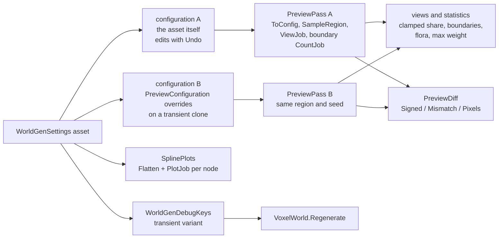
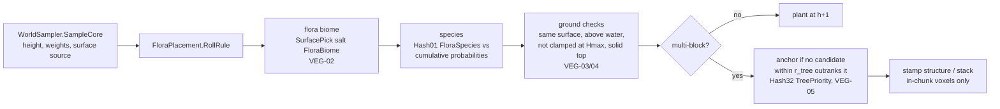
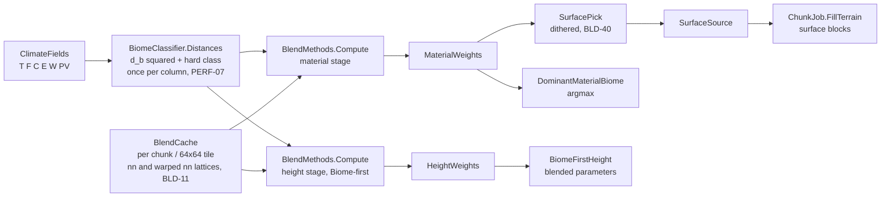
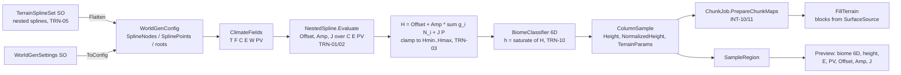
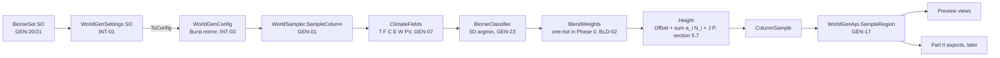
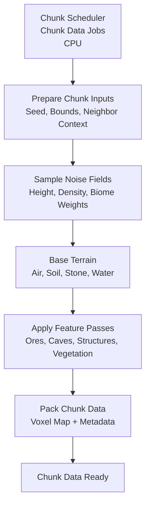

# World Generation (Overview)

# Version 1.6 (Phase 5 — Preview tooling)

Phase 5 of `WorldGenSpec.html` (§11.5) turns the preview window into the comparison tool for Part I. In the window you
can switch architecture, blend method and strength. You can compare two configurations side by side with a difference
view (INT-20/21), read the boundary lengths of every biome pair with implausible pairs flagged (GEN-24), and see every
spline level as a 1D plot (TRN-06). The game gets a debug key that regenerates the loaded world with another
configuration, plus camera bookmarks (INT-30). Generation itself does not change in this phase; every tool reads
`WorldGenApi.SampleRegion` or the Burst spline evaluator, so the preview still shows what the chunk job builds.
With this, Part I is complete.

## Preview and comparison data flow

### Description

- **Configurations** (`Editor/WorldGen/PreviewConfiguration.cs`, INT-20/21): the knobs the preview switches.
  - The knobs are architecture, the method of each stage (`MaterialMethod`, `HeightMethod`), the strengths
    (B_mat, σ_mat, B_hgt, σ_hgt) and the warp of DistortedBoundary (A, λ_d, octaves).
  - Configuration A is the asset. Its controls `Capture` the knobs, draw them and `ApplyTo` the asset with Undo.
  - Configuration B is preview-only (decision 2026-10-20):
    - `BuildConfig` instantiates a hidden clone of the asset, applies the knobs and calls `ToConfig`, then destroys the
      clone. The asset is never written.
    - "Copy A → B" and "Apply B to asset" are the only bridges between the two.
    - B shares biomes, splines and climate with the asset.
  - `Describe()` lists only the strengths the selected methods use. Terrain-first has no height stage (TRN-21).
- **Passes** (`Editor/WorldGen/PreviewPass.cs`): each configuration owns one `PreviewPass` with persistent region
  buffers and textures.
  - `Schedule` builds the config, calls `SampleRegion`, then chains the `ViewJob` (all colour views, hillshade on
    the height view) and the boundary `CountJob`.
  - `Finish` uploads the textures and computes:
    - clamped share;
    - mean maximum material weight;
    - flora counts per species;
    - the boundary list.
  - Views (`PreviewView`):
    - height (with hillshade: light from the NW at 45°, adjustable exaggeration);
    - hard biome, dominant material biome, maximum material weight, surface source and flora;
    - climate, erosion and peaks/valleys;
    - in Terrain-first, also the spline outputs Offset, Amp and J.
- **Comparison** (`Editor/WorldGen/PreviewDiff.cs`, INT-21): with "Compare A/B" on, the window shows A | B | Diff for
  the selected view. Both passes use the same region and seed. The difference reads sampled buffers only.
  - Height: signed B − A. Red means B is higher, blue means B is lower, with square-root scaling to the largest
    difference. Statistics: mean |Δ|, max |Δ|, mean Δ and the share of columns with |Δ| ≥ 1 block.
  - Categorical views (hard, dominant, surface, flora): a mismatch mask (magenta) over the A view dimmed to 30 %,
    plus the share of mismatching columns.
  - Any other view: the per-channel pixel difference, amplified ×4.
- **Boundary lengths** (`Editor/WorldGen/BiomeBoundaryStats.cs`, GEN-24):
  - A Burst job counts the 4-neighbour edges between different dominant material biomes per unordered pair.
  - Length = edges × sample stride, in blocks, sorted longest first, with each pair's share of all boundaries.
  - `BiomeSet.ImplausibleNeighbours` lists pairs that should not touch (default Desert–Snow). Those pairs are shown
    in red. The list is preview-only and is not part of the canonical JSON.
- **Spline plots** (`Editor/WorldGen/SplinePlots.cs`, TRN-06):
  - `TerrainSplineSet.Flatten` can record every node in pre-order (`FlatSpline`: tree, source point, depth, subtree).
    A subtree is contiguous, so `SplineRoot{NodeStart, NodeCount}` evaluates it on its own.
  - A Burst `PlotJob` per node samples the curve over its axis range, the value at every control point (a nested
    child counts as a point), and the value at the probe (C, E, PV) from the Distribution sliders.
  - The window draws each level as a 1D plot with the probe marked.
- **In game** (`Scripts/UI/WorldGenDebugKeys.cs`, INT-30):
  - F10 regenerates the loaded world with the next configuration and Shift+F10 with the previous one. The list holds
    the asset as assigned, Biome-first × 4 methods, and Terrain-first with None and with DistanceBlend. Strengths are
    the asset's.
  - Each variant is a transient copy of the asset, destroyed right after `VoxelWorld.Regenerate`.
  - F1–F4 restore a camera bookmark (position, yaw, pitch) and Shift+F1–F4 store one. Bookmarks persist in
    PlayerPrefs.
  - `PlayerManager.HoldUntilGrounded` keeps the player in place until the ground has colliders again, and lifts the
    player when the new terrain would bury them.
- **World reset** (`World/VoxelWorld.cs`, INT-30): `Regenerate(WorldGenSettings = null)` runs in this order:
  1. Builds the new `ChunkScheduler` (the provider takes the override), so invalid settings throw while the world is
     still intact.
  2. Completes and applies the running batches (`VoxelEngineScheduler.CompleteRunning`).
  3. Disposes the schedulers.
  4. Evicts everything through the normal events: `ChunkPool.ReclaimAll` for the pool chunks, partitions and colliders,
     then `ChunkManager.UnloadAll` for the load ring. The renderer releases its buffers.
  5. Rebuilds the schedulers and resets the focus, so loading restarts around the player. World edits are lost.
- **Fix**: `DataImporter.OnDestroy` now waits for the world's jobs (`VoxelWorld.WaitForJobs`) before it disposes the
  registries those jobs read. The scene's destruction order is undefined, and a running `ChunkJob` used to throw at
  play-mode exit.
- **Tests**:
  - `PreviewCompareTests`: knob round trip; B leaves the asset's canonical JSON unchanged; `Describe`; the three
    difference kinds.
  - `BiomeBoundaryStatsTests`: edges × stride; unordered pairs sorted longest first; out-of-range ids ignored;
    implausible pairs in either order but never inactive or empty biomes; the default asset flags Desert–Snow.
  - `SplinePlotsTests`: the flatten order covers every node with contiguous subtrees; plots hit constant knots and
    children agree with their parents; an invalid set reports an error.
  - PlayMode `WorldRegenerationTests`: everything is evicted; the other architecture changes the terrain;
    regenerating with the asset reproduces it.
- **Performance**: no chunk-job code changed, so the generation benchmarks only confirm there is no regression.
  See `Tests/Performance/Baselines/README.md` (Phase 5). PERF-05 (Biome-first spatial-blend misses, accepted in
  Phase 3) is still to be revisited now that Phases 4 and 5 are done.

### Ownership of native memory (D-05)

- `PreviewPass` owns its persistent region buffers, pixel arrays, boundary edge counts and its `WorldGenConfig`. The
  config is replaced at the start of the next build and released in `Dispose`. The window completes a running
  build, then disposes both passes in `OnDisable`.
- `PreviewConfiguration.BuildConfig` returns a config the caller disposes. The transient clone is destroyed inside
  the call.
- `PreviewDiff` and `SplinePlots` allocate only TempJob scratch, which is released before they return.
- `VoxelWorld.Regenerate`: the new `GeneratorConfig.WorldGen` belongs to the new `ChunkScheduler`, like the original.
  The old one is released when the old scheduler is disposed. The `WorldGenSettings` passed in stays the caller's.

# Version 1.5 (Phase 4 — Flora)

Phase 4 of `WorldGenSpec.html` brings vegetation back (§10, INT-11). Placement is a pure function of
(x, z, seed, settings) on the material-stage result (VEG-01): the same decision comes out of `WorldSampler.SampleColumn`,
`WorldGenApi.SampleRegion` and the chunk job, so plants and trees have no chunk seams. Each biome carries a list of
`FloraRule`s; the Standard biomes have the spec placeholder rules (R5, not tuned).

## Flora in the column pipeline

### Description

- **Rules** (`WorldGen/Flora/FloraRules.cs`, VEG-03): a `FloraRule` names a species (one voxel or one
  `VoxelStructure`), a per-column probability, `RequiresSurfaceFromSameBiome` (default false) and
  `MinHeightAboveWater` (default 1).
  - Extension: `MinStackHeight` / `MaxStackHeight` (default 1) stack a single voxel, for the cactus 1–3 of the
    placeholder rules. A stack above 1 counts as multi-block.
- **Config** (`WorldGen/Flora/FloraConfigBuilder.cs`): `WorldGenSettings.ToConfig` flattens the rules of the active biomes into
  `WorldGenConfig.FloraRules`; each `BiomeDef` addresses its range.
  - Species ids are 1-based, in first-use order (`WorldGenSettings.FloraSpeciesNames()`, [0] = "none").
  - Structures are expanded to voxel offsets once (`FloraStructures`, `FloraVoxels`):
    - offset (0, 0, 0) is the first voxel above the top block;
    - Line is inclusive;
    - Box is centred on its origin;
    - Circle is a horizontal disc (a ring when not filled);
    - Cylinder stacks circles.
  - Other tables:
    - `FloraMultiBlockIntervals`: the cumulative ranges of multi-block rules, used as a sample-free pre-filter.
    - `FloraReach`: the largest horizontal structure extent.
    - `FloraPadding`: reach + r_tree, or 0 without multi-block rules.
    - `VoxelClasses`: the replace class per voxel id.
  - A rule with neither or both species fields is skipped with a warning; a biome whose probabilities sum past 1 is
    reported.
  - `TreeSpacingRadius` (r_tree, default 3, must be ≥ 0) lives in `WorldGenSettings`.
- **Decision** (`WorldGen/Flora/FloraPlacement.cs`), per column:
  1. The flora biome is a dithered pick from w_mat with salt FloraBiome, independent of the surface pick (DEC-04). With
     material method None it is the hard biome.
  2. The species is the rule whose cumulative interval holds Hash01(FloraSpecies); none means no plant.
  3. The ground must allow it:
     - the surface biome's top block is solid;
     - the column is not clamped at Hmax;
     - h_int + 1 − WaterLevel ≥ max(minHeightAboveWater, 0), so a plant is never below the water surface.
  4. A multi-block candidate becomes an anchor only if no other candidate in its r_tree disc outranks it:
     - the higher Hash32(TreePriority) wins;
     - equal hashes go to the lower (x, z), a strict order, so two anchors are never within r_tree.

  `ColumnSample.FloraSpecies` / `FloraSource` (and the region buffers of the same name) hold the result at single
  plants and anchors, (0, −1) elsewhere (VEG-06).
- **Chunk job** (`Jobs/Chunk/ChunkGenerationTerrain.cs`, `ChunkGenerationVegetation.cs`):
  - `PrepareChunkMaps` fills a `FloraGrid` over chunk ± `FloraPadding`:
    - the core sample and rule roll of every chunk column;
    - for ring columns that pass the pre-filter, the same sample and roll, keeping only multi-block rules;
    - the anchor flag for chunk ± reach.
  - The `BlendCache` covers the ring too, and `WorldGenApi` extends its tile caches by `FloraPadding` in the same way.
  - `PlaceVegetation` (re-enabled, INT-11) then writes:
    1. single-block plants at h + 1;
    2. every anchor in world (x, then z) order: its structure, or its stack, with height from salt FloraStackHeight.

    Voxels outside the chunk are clipped.
  - **Overwrite rule:** a flora voxel replaces only a voxel of a lower class: air < foliage < leaves (transparent with
    collision) < solid. Ids not in the table (terrain, water) count as solid. Logs therefore beat leaves, and leaves
    beat grass tufts. Because the order is the world order, every voxel ends up as in a whole-world stamp, whichever
    chunk holds it (TST-03).
  - The old stub's per-chunk random stream and its skipped edge columns are gone (D-01, D-02).
- **Renderer** (PERF-04, TST-E21): flora adds voxel runs per column. The pre-allocated GPU chunk buffers in
  `VoxelWorldRenderer` therefore hold eight intervals per column instead of four. Without the change, chunks met
  during flight did not fit any free buffer, and a new `GraphicsBuffer` was created mid-flight. Measured during the
  flight: median 4.6 and maximum 6 intervals per column; already 40 % of the chunks without flora needed more than 4.
- **Burst**: `WorldSampler.SampleCore` is a Burst direct-call entry like `SampleColumn`. Without it, the managed
  flora path ran the core in Mono, and Terrain-first heights differed from the jobs by 1 ulp.
- **Tests**:
  - `Tests/EditMode/FloraChunkTests.cs`:
    - TST-02: `PrepareChunkMaps` columns and chunk-job voxels over 4×4 chunks equal `SampleRegion` and a test-side
      whole-world stamp, in all 8 configurations.
    - TST-03: border-crossing trees are complete.
    - TST-10: repeat runs are identical.
  - `Tests/EditMode/FloraPlacementTests.cs`: VEG-02…05 rule semantics, structure expansion and config tables.
  - `DataImporterTests`: the shipped settings resolve every flora id through the registry, and every land biome
    carries flora.
  - Fixture: `Tests/EditMode/FloraFixture.cs`.
- **Performance** (`Tests/Performance/ChunkGenerationBenchmark.cs`): new rows
  `ChunkJob.Run <architecture> <method> flora ms/chunk`. They use the same 16 chunks as the per-method rows, with
  the placeholder rules. See `Tests/Performance/Baselines/README.md` (Phase 4).

### Ownership of native memory (D-05)

- `WorldGenConfig` owns the flora tables:
  - `FloraRules`
  - `FloraStructures`
  - `FloraVoxels`
  - `FloraMultiBlockIntervals`
  - `VoxelClasses`

  They are always created by `ToConfig` (possibly empty), and `WorldGenConfig.Dispose` releases them.
- The `FloraGrid` lives in `Allocator.Temp` inside one chunk's `Execute` and is disposed there (INT-12).

# Version 1.4 (Phase 3 — Blending methods)

Phase 3 of `WorldGenSpec.html` adds the four blend methods of section 9 per stage (BLD-01): the material stage in
both architectures, the height stage in Biome-first (Terrain-first height has no biome input, so its height is the
same for every material method, TST-04). That gives 8 configurations: Terrain-first × 4 material methods and
Biome-first × 4 methods. Both stages take the method and strength from `WorldGenSettings` (`MaterialMethod`,
`MaterialBlendWidth` B_mat, `MaterialSigma`; `HeightMethod`, `HeightBlendWidth` B_hgt, `HeightSigma`; `WarpAmplitude`
A, `WarpWavelength`, `WarpOctaves`), and they can be switched in the preview's settings inspector and in the game.
The values are the spec defaults and placeholders (R5).

## Blend stages in the column pipeline

### Description

- **Methods** (`WorldGen/Blending/BlendMethods.cs`): one enum switch per stage (R2), every result normalised, Σ w = 1
  (BLD-02).
  - **1 None**: one-hot on the hard class.
  - **2 DistanceBlend**: the compact kernel k(r) = (1 − r²/R²)² over the hard classes nn(q) of a world-aligned lattice
    (§9.3).
  - **3 DistortedBoundary**: the hard class at the warped position q + A·Ω(q), where Ω is a two-octave simplex warp
    (`WorldGen/Noise/WarpField.cs`, salts BlendWarpX/Y).
    - Material stage: one-hot on the warped class.
    - Height stage: warp plus the kernel of method 2 over the warped classes with B_hgt (BLD-22).
    - A = 0 reduces it to the unwarped method.
  - **4 ParameterSpaceWeighting**: the shifted Gaussian w_b ∝ exp(−(d_b² − d_min²)/(2σ²)) over the parameter-space
    distances.
    - The hard class always gets the largest weight (BLD-31), and σ → 0 gives method 1 (TST-06).
    - It needs no neighbourhood.
- **Kernel taps** (`WorldGen/Blending/KernelTaps.cs`): per-phase tap lists on a lattice of stride
  clamp(floor(R/4), 1, 2), in a fixed row-major order (BLD-10/12). They are built once in `WorldGenSettings.ToConfig`
  and owned by `WorldGenConfig` (`MaterialTaps`, `HeightTaps`). The phase uses floor modulo, so negative columns get
  the same taps as positive ones.
- **Lattice cache** (`WorldGen/Blending/BlendLattice.cs`, BLD-11): `ChunkJob.PrepareChunkMaps` builds a `BlendCache`
  per chunk, and `WorldGenApi.SampleRegion` builds one per 64×64 tile (the region job now runs one index per tile).
  - The cache holds a padded lattice of nn(q) for DistanceBlend and one of the warped classes for the
    DistortedBoundary height stage. Both are classified by the same Burst entry points the pure sampler calls per
    tap (`WorldSampler.ClassifyAt` / `ClassifyWarpedAt`).
  - A cached column is therefore bit-identical to the pure `SampleColumn(x, z, cfg)` (GEN-02, TST-01).
  - A summed-area table of boundary points lets a kernel window with one class return one-hot weights without
    summing (PERF-07).
  - A zoomed-out preview, where the columns are further apart than the taps, skips the lattice and evaluates the
    taps directly, with the same result.
- **Shared work** (PERF-07):
  - The squared parameter-space distances and the hard class are computed once per column and shared by
    classification and method 4.
  - In Biome-first, the height stage reuses the material weights when both stages use the same method and strength
    (`WorldGenConfig.StagesShareWeights`; never for DistortedBoundary, whose stages differ).
  - Method 1 sets the dominant biome and the surface source to the hard class directly.
- **Surface source** (`WorldGen/Blending/SurfacePick.cs`, BLD-40/41): a white-noise dithered pick from the material
  weights, using hash salt SurfacePick.
  - If rounding leaves the cumulative sum just below the threshold, it falls back to the last biome with non-zero
    weight, so it never returns "none" for non-empty weights (TST-14).
  - One-hot weights return their own biome.
  - `FillTerrain` takes the surface blocks from this biome (INT-11).
- **Validation** (`WorldGenSettings`): a strength the selected method uses and cannot work with is reported in
  `OnValidate` and rejected by `ToConfig` with an `InvalidOperationException`:
  - B ≤ 0
  - σ ≤ 0
  - A < 0 or non-finite
  - fewer than one warp octave

  Unused strengths are not checked, and nothing is clamped (R5).
- **Preview** (`Editor/WorldGen/WorldGenerationPreviewWindow.cs`): the new "Surface source" view shows the dithered
  pick next to the hard-class biome view, so the material methods are visible. In Biome-first the height view shows
  the height methods. Method dropdowns, strength sliders and side-by-side comparison follow in Phase 5 (INT-20).
- **Tests** (`Tests/EditMode/BlendingTests.cs`): TST-01, 04, 05, 06, 07, 09 and 14, plus:
  - kernel taps and floor-modulo phases
  - the warp field
  - each method against its formula
  - validation
  - a Burst guard for the new entry points

  The chunk-job tests check the spatial methods against the sampler in both architectures.
- **Performance** (`Tests/Performance/ChunkGenerationBenchmark.cs`): new rows `ChunkJob.Run <architecture> <method>
  ms/chunk`, each the mean over 16 fixed chunks. See `Tests/Performance/Baselines/README.md` for the Phase 3 numbers:
  - Method 1 costs about 5 % more than in Phase 2 (PERF-03).
  - Terrain-first DistanceBlend and DistortedBoundary and Biome-first DistortedBoundary are above the initial 3 ms
    PERF-05 budget.

### Ownership of native memory (D-05)

- `WorldGenConfig` owns `MaterialTaps` and `HeightTaps` (only created when a method uses them); `WorldGenConfig.Dispose`
  releases them with the rest.
- A `BlendCache` lives in `Allocator.Temp` inside the job that builds it (one chunk or one region tile) and is disposed
  there (INT-12).
- A default `BlendCache` means "no cache": the sampler then evaluates every tap itself.

# Version 1.3 (Phase 2 — Biome-first)

Phase 2 of `WorldGenSpec.html` adds the Biome-first architecture (section 8) and removes the legacy generator
(INT-40). `GenArchitecture` now has two values, `TerrainFirst` and `BiomeFirst`; every chunk goes through
`WorldSampler.SampleColumn`. The shipped `Assets/EngineSettings/WorldGenSettings.asset` still selects Terrain-first
(the class default for new assets is Biome-first); the blend methods follow in Phase 3, so Biome-first shows a height
step at every biome boundary for now.

## Biome-first column pipeline

```mermaid
flowchart LR
    S[WorldGenSettings SO\nWaterLevel, octave tables] -->|ToConfig| C[WorldGenConfig\nOctaveCoefficients a_b,i, GEN-22]
    B[BiomeSet SO\nOffset_b, HeightAmplitude_b,\nOctaveWeights_b, Jaggedness_b] --> S
    C --> F[ClimateFields\nT F C E W PV]
    F --> K[BiomeClassifier 5D\nno height dimension, BIO-01]
    K --> W[BlendWeights\none-hot until Phase 3]
    W --> H[BiomeFirstHeight\nH = Offset + sum a_i N_i + J P\nfrom the blended parameters, BIO-02/03]
    H --> O[ColumnSample\nHeight, NormalizedHeight]
    O --> J[ChunkJob.PrepareChunkMaps\nINT-10/11]
    J --> V[FillTerrain]
    O --> R[SampleRegion] --> P[Preview views]
    T[Terrain-first reference] -.->|BIO-20 calibration| B
```

### Description

- **Classification first** (`WorldSampler.SampleColumn`, Biome-first branch): the biome is the 5D argmin over
  (T, F, C, E, PV) without a height dimension (BIO-01); the material and height weights are both one-hot on that
  biome until Phase 3 (BLD-02).
- **Biome-first height** (`WorldGen/Height/BiomeFirstHeight.cs`): the height-stage weights blend the per-biome
  parameters, Offset = Σ w_b Offset_b, a_i = Σ w_b a_{b,i} with a_{b,i} = HeightAmplitude_b × OctaveWeights_{b,i}
  (GEN-22, precomputed in `WorldGenConfig.OctaveCoefficients`), J = Σ w_b J_b, and H is computed once from them
  (BIO-02). All biomes sample the same N_i and P (BIO-03); because every biome parameter enters H linearly, blending
  the parameters equals blending the per-biome heights (section 8.3), which Phase 3 relies on. The clamp to
  [Hmin, Hmax] is recorded as before (GEN-12).
- **Legacy removal** (INT-40, GEN-08): `NoiseCalculator`, `BiomeCalculator`, `NoiseSettings` and the Elevation
  noise are gone. `GeneratorConfig` holds `WaterLevel`, `GlobalSeed`, `Voxels` and `WorldGen` only; `WaterLevel`
  lives on `WorldGenSettings` (DEC-02, default 124) and is part of the canonical JSON. `VoxelEngineSettings`
  requires a `WorldGenSettings`; the chunk scheduler throws without one. `NoiseProfileSettings` and
  `WarpedNoiseLayerSettings` moved to `WorldGen/Settings/`.
- **Preview** (`Editor/WorldGen/WorldGenerationPreviewWindow.cs`, menu Infinitile → World Generation Preview):
  rewritten on `WorldGenApi.SampleRegion` for both architectures; the settings and biome inspectors sit next to the
  views, and every edit rebuilds the preview (Undo included). It is the tool for iterating generation parameters.
- **Height calibration** (`Editor/WorldGen/BiomeFirstCalibration.cs`, panel "Height calibration (BIO-20)" in the
  preview): samples the Terrain-first pipeline of the same settings over the framed area, groups the columns by
  their Terrain-first biome and suggests Jaggedness_b = mean J, Offset_b = mean H − Jaggedness_b · mean P and
  HeightAmplitude_b = std(detail residual) / std(Σ OctaveWeights_{b,i} N_i), so both architectures produce similar
  height distributions. The J·mean P correction keeps the non-negative ridge term from lifting jagged biomes
  (Mountain, Snow) above their Terrain-first mean height. Suggestions appear next to the current values; a biome is written only on its Apply click.
- **Performance** (`Tests/Performance/ChunkGenerationBenchmark.cs`): `ChunkJob.Run BiomeFirst ms/chunk` replaces
  the legacy `TerrainRle` row; see `Tests/Performance/Baselines/README.md` for the Phase 2 numbers (PERF-02/03).

### Ownership of native memory (D-05)

Unchanged in substance: `GeneratorConfig.Dispose` releases `WorldGen` only; the voxel map belongs to the
`VoxelRegistry`. `WorldGenConfig.CreateEmpty` is gone with the legacy path, so a `WorldGenSettings` is always the
source of the config. The 1.1 and 1.2 sections below describe the legacy path as it existed at the time.

# Version 1.2 (Phase 1 — Terrain-first)

Phase 1 of `WorldGenSpec.html` makes the Terrain-first architecture (section 7) the one the game runs:
`Assets/EngineSettings/WorldGenSettings.asset` now selects `GenArchitecture.TerrainFirst` with
`TerrainSplineSet_Default.asset` (the section 19.1 placeholder splines), and the chunk job takes its columns from
`WorldSampler.SampleColumn` (INT-10). `Legacy` stays selectable (INT-40); Biome-first follows in Phase 2, the blend
methods in Phase 3.

## Terrain-first column pipeline

### Description

- **Nested splines** (`WorldGen/Height/NestedSpline.cs`): a spline is a list of control points over one axis (C, E or
  PV) whose values are constants or child splines over another axis (TRN-01). The asset keeps a flat, pre-ordered
  tree (children have higher node indices), so Burst evaluates a root with one pass from the last node to the first
  into a fixed-size value list. Interpolation is Fritsch–Carlson monotone cubic Hermite (Wikipedia, "Monotone cubic
  interpolation") or linear per spline; outside the control range the end value holds (TRN-02).
- **Terrain-first height** (`WorldGen/Height/TerrainFirstHeight.cs`): Offset, Amp and J are evaluated at the column
  from the three roots, then H = Offset + Amp · Σ g_i N_i + J · P with the global octave weights g_i and the shared
  detail octaves; the clamp to [Hmin, Hmax] is recorded as before (GEN-12). No biome takes part (TRN-03), so the
  height is continuous wherever the fields are (TST-12).
- **Classification** (`WorldSampler.SampleColumn`): the normalised height h = saturate((H − Hmin)/(Hmax − Hmin)) is the
  sixth distance dimension with weight λ_h (TRN-10); the material weights are still one-hot (method 1, BLD-02) until
  Phase 3. A `HeightMethod` other than None is ignored with a warning in Terrain-first (TRN-21).
- **Spline asset** (`WorldGen/Settings/TerrainSplineSet.cs`): a `ScriptableObject` with named splines, three root
  indices and `Notes`. `Validate` reports missing roots, unsorted or duplicate X, out-of-range X, cycles, nesting
  deeper than 8 and more than 127 nodes per root; `Flatten` throws on any problem (R5: no silent repair). `ToJson`
  / `FromJson` round-trip the human-readable form of section 19.1 (`{"Axis","Interpolation","Points":[{"X","Value"}]}`,
  TRN-05), and `ResetToPlaceholders` restores the spec's placeholder trees. `WorldGenSettings.ToCanonicalJson`
  inlines the tree (INT-02).
- **Chunk job** (`Jobs/Chunk/ChunkGenerationTerrain.cs`): with a non-legacy architecture `PrepareChunkMaps` calls
  `WorldSampler.SampleColumn` per column, independent of the chunk origin, so chunk borders carry no seam (TST-03).
  `ChunkColumn` gained `SurfaceSource`, `FloraSpecies`, `FloraSource` and `HeightF`; the blocks come from the
  surface-source biome. `FillTerrain` places the top block at h_int even under water, so Ocean floors are sand
  (GEN-14, GEN-25); its ice override follows `EnableClimateOverrides` (GEN-14). Vegetation stays
  disabled until Phase 4. `ChunkJob` compiles with `CompileSynchronously` and `FloatMode.Strict` because it calls the
  sampler (GEN-16).
- **Preview** (`WorldGenerationPreviewWindow`): in Terrain-first the spec views add Offset, Amp and J per column
  (TRN-06); the 1D spline plots are left to the Phase 5 tooling.
- **Performance** (`Tests/Performance/ChunkGenerationBenchmark.cs`): `ChunkJob.Run TerrainFirst ms/chunk` sits next
  to the legacy sample group; see `Tests/Performance/Baselines/README.md` for the Phase 1 numbers (PERF-02/03).

### Ownership of native memory (D-05)

`WorldGenConfig` now also owns `SplineNodes` and `SplinePoints`; both are released by `WorldGenConfig.Dispose`
with the other arrays, and `CreateEmpty` allocates them with zero length so the job safety system accepts the config
on the legacy path.

# Version 1.1 (Phase 0 — spec foundations)

Phase 0 of `WorldGenSpec.html` adds the foundations of the spec pipeline next to the legacy generator. The game
still runs the legacy path (`GenArchitecture.Legacy`, INT-40); the new code is exercised by the tests, the World
Generation Preview and, from Phase 1 on, the chunk job.

## Sampler pipeline

### Description

- **Hashing and noise basis** (`WorldGen/Core/Hash.cs`, `WorldGen/Core/HashSalts.cs`, `WorldGen/Noise/SeededSimplex.cs`):
  every noise instance is a seeded 2D simplex with hashed gradients. The seed changes the field itself, not a
  translation of it (F-02 fixed); each instance gets its own salt and a hashed offset (GEN-04…06, GEN-15).
  `NoiseProfile` and `WarpedNoiseLayer` sit on this basis, so the legacy path shares it.
- **Fields** (`WorldGen/Noise/ClimateFields.cs`): T, F, C, E, W and the derived PV = 1 − |3|W| − 2| per column,
  with `ClimateFrequencyScale` scaling the position and `WGain` on W (GEN-07). `DetailOctaves` (K octaves,
  wavelengths 512…16) and `PeakNoise` (P = (1 − |n|)²) supply the height detail (GEN-09, GEN-10).
- **Settings** (`WorldGen/Settings/`): `WorldGenSettings` holds architecture, blend methods and widths, λ weights,
  height range, octave tables, the T/F/C/E/W climate profiles with their couplings (independent of the legacy
  `NoiseSettings`) and references to a `BiomeSet` and a `TerrainSplineSet` (stub until Phase 1). `ToCanonicalJson` produces a deterministic manifest with the biome set inlined (INT-02). `ToConfig`
  builds the `WorldGenConfig` mirror: flattened NativeArrays, the per-biome octave coefficients
  a_{b,i} = HeightAmplitude × OctaveWeights (GEN-22) and the climate instances.
- **Biome** gained TargetErosion, TargetPV, HeightOffset, HeightAmplitude, OctaveWeights, Jaggedness and FloraRules
  (section 6.2, VEG-03). Which biomes are active is decided by the `BiomeSet` asset, in index order (GEN-20/21);
  `Assets/EngineSettings/BiomeSet_Default.asset` lists Plains, Desert, Mountain, Snow, Forest, Ocean.
- **Sampler** (`WorldGen/Core/WorldSampler.cs`): `SampleFields` and `SampleColumn` are pure functions of
  (x, z, seed, config). Phase 0 classifies hard in 5D, uses one-hot weights in both stages and composes the common
  height formula from the classified biome; Phases 1–4 replace these placeholders (splines, blend methods, surface
  pick, flora). The entry points are Burst direct-call, so the preview and the tests see the same bits as the jobs.
- **Region API** (`WorldGen/Core/WorldGenApi.cs`): `SampleRegion(in WorldGenRequest, ref RegionBuffers)` fills any
  subset of caller-owned buffers in a `CompileSynchronously`/`FloatMode.Strict` job (GEN-16/17). Unrequested buffers
  stay unallocated. The element layout follows EXP-01; an optional stride gives zoomed-out previews.

### Ownership of native memory (D-05)

| Container | Owner | Released by |
|---|---|---|
| `GeneratorConfig.BiomeDefs`, `.Voxels` | `BiomeRegistry` / `VoxelRegistry` | the registries |
| `GeneratorConfig.NoiseParams` | the `ChunkScheduler` that received the config | `GeneratorConfig.Dispose` |
| `GeneratorConfig.WorldGen` (all arrays and climate profiles) | same as above | `GeneratorConfig.Dispose` → `WorldGenConfig.Dispose` |
| `RegionBuffers` | the caller of `SampleRegion` | the caller |
| Dummy arrays for unrequested buffers | `SampleRegion` | disposed with the returned handle |

`GeneratorConfig` travels inside job structs, so its `WorldGen` field must always be constructed:
`WorldGenSettings.ToConfig` when a settings asset exists, `WorldGenConfig.CreateEmpty` otherwise (legacy path,
test fixtures).

# Version 1.0 (Chunk Jobs)

## Generation Pipeline

### Description

In version 1.0, world generation is fully chunk-based and CPU job driven.
The scheduler collects generation requests, batches chunk jobs, and builds voxel data for each chunk.
Inside the generate step, each chunk job runs a fixed sequence: prepare inputs, sample noise fields, classify base
materials, run feature passes (ores/caves/structures/vegetation), apply border fixups, then pack the final voxel map and
metadata.
When chunk data is finished, it is registered in the chunk manager and forwarded to the mesh pipeline for visual and
collider updates.

Advantages:

- Simple and deterministic pipeline with clear stage boundaries.
- Easy to debug because generation and handoff happen in explicit queue steps.
- Works well for small and medium visible worlds.

Trade-offs:

- Regeneration cost can spike when many chunks are dirty in the same frame.
- CPU-side generation becomes a bottleneck as world size and update frequency grow.
- Local edits can trigger broader recomputation depending on chunk dependencies.
