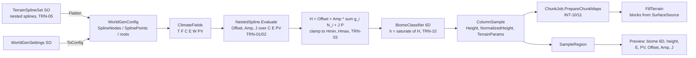
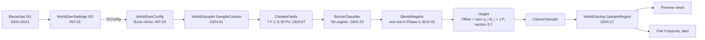
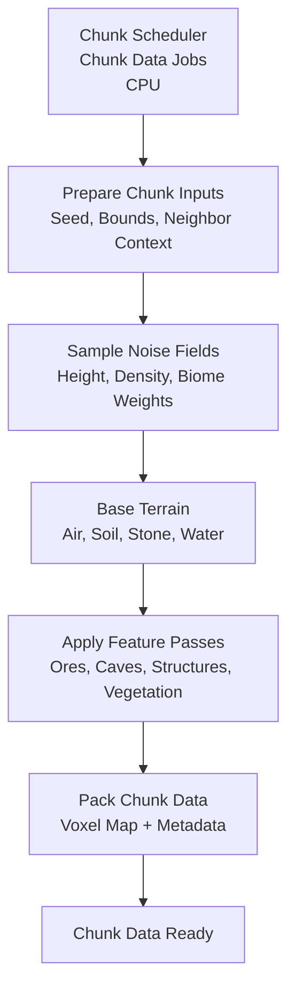

# World Generation (Overview)

# Version 1.2 (Phase 1 — Terrain-first)

Phase 1 of `WorldGenSpec.html` makes the Terrain-first architecture (section 7) the one the game runs:
`Assets/EngineSettings/WorldGenSettings.asset` now selects `GenArchitecture.TerrainFirst` with
`TerrainSplineSet_Default.asset` (the section 19.1 placeholder splines), and the chunk job takes its columns from
`WorldSampler.SampleColumn` (INT-10). `Legacy` stays selectable (INT-40); Biome-first follows in Phase 2, the blend
methods in Phase 3.

## Terrain-first column pipeline

### Description

- **Nested splines** (`WorldGen/Height/NestedSpline.cs`): a spline is a list of control points over one axis (C, E or
  PV) whose values are constants or child splines over another axis (TRN-01). The asset keeps a flat, pre-ordered
  tree (children have higher node indices), so Burst evaluates a root with one pass from the last node to the first
  into a fixed-size value list. Interpolation is Fritsch–Carlson monotone cubic Hermite (Wikipedia, "Monotone cubic
  interpolation") or linear per spline; outside the control range the end value holds (TRN-02).
- **Terrain-first height** (`WorldGen/Height/TerrainFirstHeight.cs`): Offset, Amp and J are evaluated at the column
  from the three roots, then H = Offset + Amp · Σ g_i N_i + J · P with the global octave weights g_i and the shared
  detail octaves; the clamp to [Hmin, Hmax] is recorded as before (GEN-12). No biome takes part (TRN-03), so the
  height is continuous wherever the fields are (TST-12).
- **Classification** (`WorldSampler.SampleColumn`): the normalised height h = saturate((H − Hmin)/(Hmax − Hmin)) is the
  sixth distance dimension with weight λ_h (TRN-10); the material weights are still one-hot (method 1, BLD-02) until
  Phase 3. A `HeightMethod` other than None is ignored with a warning in Terrain-first (TRN-21).
- **Spline asset** (`WorldGen/Settings/TerrainSplineSet.cs`): a `ScriptableObject` with named splines, three root
  indices and `Notes`. `Validate` reports missing roots, unsorted or duplicate X, out-of-range X, cycles, nesting
  deeper than 8 and more than 127 nodes per root; `Flatten` throws on any problem (R5: no silent repair). `ToJson`
  / `FromJson` round-trip the human-readable form of section 19.1 (`{"Axis","Interpolation","Points":[{"X","Value"}]}`,
  TRN-05), and `ResetToPlaceholders` restores the spec's placeholder trees. `WorldGenSettings.ToCanonicalJson`
  inlines the tree (INT-02).
- **Chunk job** (`Jobs/Chunk/ChunkGenerationTerrain.cs`): with a non-legacy architecture `PrepareChunkMaps` calls
  `WorldSampler.SampleColumn` per column, independent of the chunk origin, so chunk borders carry no seam (TST-03).
  `ChunkColumn` gained `SurfaceSource`, `FloraSpecies`, `FloraSource` and `HeightF`; the blocks come from the
  surface-source biome. `FillTerrain` places the top block at h_int even under water, so Ocean floors are sand
  (GEN-14, GEN-25); its ice override follows `EnableClimateOverrides` (GEN-14). Vegetation stays
  disabled until Phase 4. `ChunkJob` compiles with `CompileSynchronously` and `FloatMode.Strict` because it calls the
  sampler (GEN-16).
- **Preview** (`WorldGenerationPreviewWindow`): in Terrain-first the spec views add Offset, Amp and J per column
  (TRN-06); the 1D spline plots are left to the Phase 5 tooling.
- **Performance** (`Tests/Performance/ChunkGenerationBenchmark.cs`): `ChunkJob.Run TerrainFirst ms/chunk` sits next
  to the legacy sample group; see `Tests/Performance/Baselines/README.md` for the Phase 1 numbers (PERF-02/03).

### Ownership of native memory (D-05)

`WorldGenConfig` now also owns `SplineNodes` and `SplinePoints`; both are released by `WorldGenConfig.Dispose`
with the other arrays, and `CreateEmpty` allocates them with zero length so the job safety system accepts the config
on the legacy path.

# Version 1.1 (Phase 0 — spec foundations)

Phase 0 of `WorldGenSpec.html` adds the foundations of the spec pipeline next to the legacy generator. The game
still runs the legacy path (`GenArchitecture.Legacy`, INT-40); the new code is exercised by the tests, the World
Generation Preview and, from Phase 1 on, the chunk job.

## Sampler pipeline

### Description

- **Hashing and noise basis** (`WorldGen/Core/Hash.cs`, `WorldGen/Core/HashSalts.cs`, `WorldGen/Noise/SeededSimplex.cs`):
  every noise instance is a seeded 2D simplex with hashed gradients. The seed changes the field itself, not a
  translation of it (F-02 fixed); each instance gets its own salt and a hashed offset (GEN-04…06, GEN-15).
  `NoiseProfile` and `WarpedNoiseLayer` sit on this basis, so the legacy path shares it.
- **Fields** (`WorldGen/Noise/ClimateFields.cs`): T, F, C, E, W and the derived PV = 1 − |3|W| − 2| per column,
  with `ClimateFrequencyScale` scaling the position and `WGain` on W (GEN-07). `DetailOctaves` (K octaves,
  wavelengths 512…16) and `PeakNoise` (P = (1 − |n|)²) supply the height detail (GEN-09, GEN-10).
- **Settings** (`WorldGen/Settings/`): `WorldGenSettings` holds architecture, blend methods and widths, λ weights,
  height range, octave tables, the T/F/C/E/W climate profiles with their couplings (independent of the legacy
  `NoiseSettings`) and references to a `BiomeSet` and a `TerrainSplineSet` (stub until Phase 1). `ToCanonicalJson` produces a deterministic manifest with the biome set inlined (INT-02). `ToConfig`
  builds the `WorldGenConfig` mirror: flattened NativeArrays, the per-biome octave coefficients
  a_{b,i} = HeightAmplitude × OctaveWeights (GEN-22) and the climate instances.
- **Biome** gained TargetErosion, TargetPV, HeightOffset, HeightAmplitude, OctaveWeights, Jaggedness and FloraRules
  (section 6.2, VEG-03). Which biomes are active is decided by the `BiomeSet` asset, in index order (GEN-20/21);
  `Assets/EngineSettings/BiomeSet_Default.asset` lists Plains, Desert, Mountain, Snow, Forest, Ocean.
- **Sampler** (`WorldGen/Core/WorldSampler.cs`): `SampleFields` and `SampleColumn` are pure functions of
  (x, z, seed, config). Phase 0 classifies hard in 5D, uses one-hot weights in both stages and composes the common
  height formula from the classified biome; Phases 1–4 replace these placeholders (splines, blend methods, surface
  pick, flora). The entry points are Burst direct-call, so the preview and the tests see the same bits as the jobs.
- **Region API** (`WorldGen/Core/WorldGenApi.cs`): `SampleRegion(in WorldGenRequest, ref RegionBuffers)` fills any
  subset of caller-owned buffers in a `CompileSynchronously`/`FloatMode.Strict` job (GEN-16/17). Unrequested buffers
  stay unallocated. The element layout follows EXP-01; an optional stride gives zoomed-out previews.

### Ownership of native memory (D-05)

| Container | Owner | Released by |
|---|---|---|
| `GeneratorConfig.BiomeDefs`, `.Voxels` | `BiomeRegistry` / `VoxelRegistry` | the registries |
| `GeneratorConfig.NoiseParams` | the `ChunkScheduler` that received the config | `GeneratorConfig.Dispose` |
| `GeneratorConfig.WorldGen` (all arrays and climate profiles) | same as above | `GeneratorConfig.Dispose` → `WorldGenConfig.Dispose` |
| `RegionBuffers` | the caller of `SampleRegion` | the caller |
| Dummy arrays for unrequested buffers | `SampleRegion` | disposed with the returned handle |

`GeneratorConfig` travels inside job structs, so its `WorldGen` field must always be constructed:
`WorldGenSettings.ToConfig` when a settings asset exists, `WorldGenConfig.CreateEmpty` otherwise (legacy path,
test fixtures).

# Version 1.0 (Chunk Jobs)

## Generation Pipeline

### Description

In version 1.0, world generation is fully chunk-based and CPU job driven.
The scheduler collects generation requests, batches chunk jobs, and builds voxel data for each chunk.
Inside the generate step, each chunk job runs a fixed sequence: prepare inputs, sample noise fields, classify base
materials, run feature passes (ores/caves/structures/vegetation), apply border fixups, then pack the final voxel map and
metadata.
When chunk data is finished, it is registered in the chunk manager and forwarded to the mesh pipeline for visual and
collider updates.

Advantages:

- Simple and deterministic pipeline with clear stage boundaries.
- Easy to debug because generation and handoff happen in explicit queue steps.
- Works well for small and medium visible worlds.

Trade-offs:

- Regeneration cost can spike when many chunks are dirty in the same frame.
- CPU-side generation becomes a bottleneck as world size and update frequency grow.
- Local edits can trigger broader recomputation depending on chunk dependencies.
