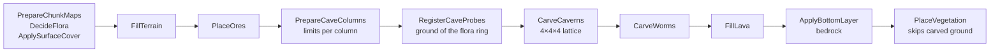
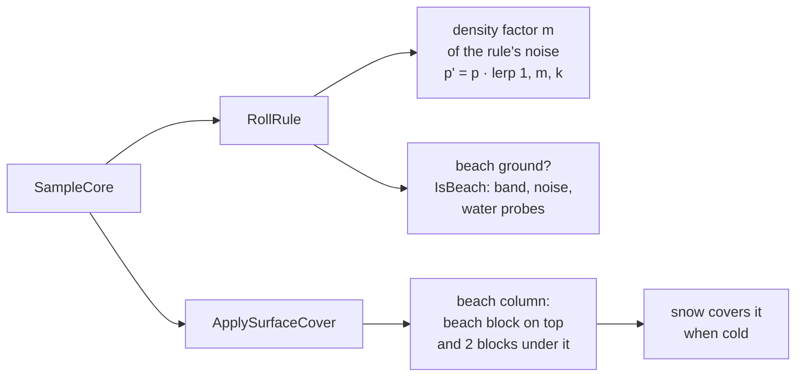
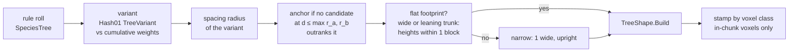
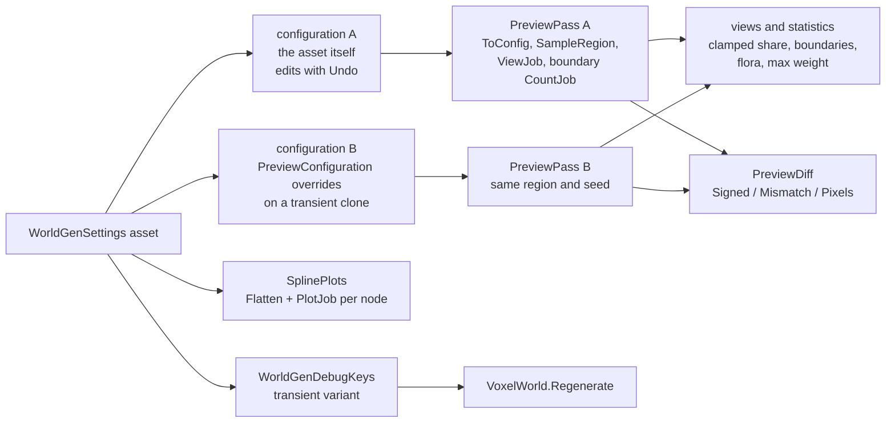
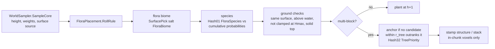
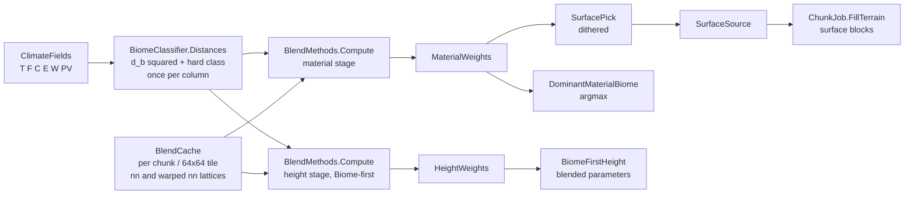
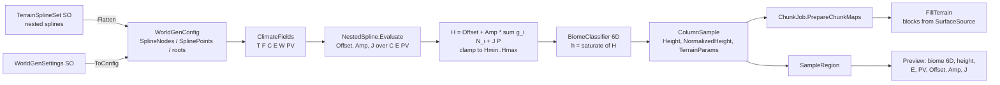
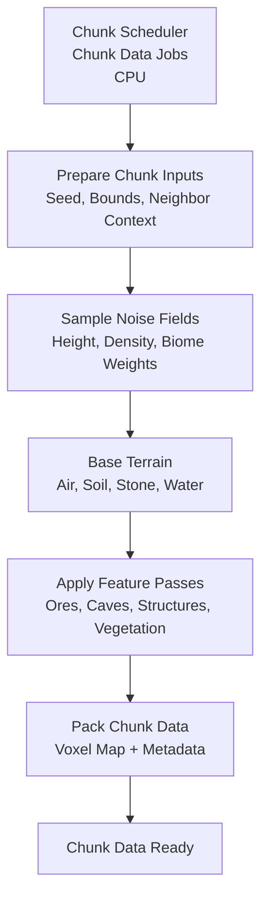

# World Generation (Overview)

# Version 1.11 (Caves)

Caves are on everywhere, in the code defaults too. Halls, worm tunnels, lava, ore veins and a bedrock floor are 3D
passes after the terrain fill. They change voxels below the surface and never the column data, so the surface, the
biome and the flora decisions stay those of the uncarved column. Every voxel is a pure function of its world
position, the seed and the config. All values are placeholders.

## Voxel passes of a block

### Description

- **One pipeline**: `ChunkJob.GenerateVoxels` runs the passes in this order at any world origin, with the vegetation
  optional. Chunks, `WorldGenApi.SampleSlice` and the cave volume of the region API share it. Each pass is its own
  non-inlined method after `PrepareChunkMaps`. The cave passes run only when `Caves.Enabled` is set; the bottom
  layer always runs.
- **Settings**: `CaveSettings` (the `Caves` section of `WorldGenSettings`, in `ToCanonicalJson`) with its Burst mirror
  `CaveConfig` on `WorldGenConfig`. The water, ice, lava, ore and bedrock ids are resolved into the config, so no
  pass looks up voxel names.
- **Column limits** (`CaveColumns`, `PrepareCaveColumns`): halls and worms carve only up to `Cover` (8) below the
  surface. Where the column or one of its 8 neighbours lies under water, both limits are `WaterCover` (6) below the
  lowest of the 9 heights, so no cave drains a lake or floods. Inside the entrance mask (wavelength 96, threshold 0.7),
  with no water within `EntranceWaterDistance` (16) blocks, worms may carve up to the surface, so the rare openings
  appear there. Nothing carves at or below the floor (y 2). In Biome-first the blend lattice spans the water probe
  cells as well, since a probe outside it would evaluate every blend tap.
- **Halls** (`Caverns`, `CarveCaverns`): a hall noise and a pillar noise (seeded 3D simplex after Gustavson) on a
  world-aligned 4 × 4 × 4 lattice, interpolated trilinearly at every voxel of the hall band in the columns whose
  cavern mask (wavelength 384) is open. The threshold rises towards the band edges and over the 0.1 of mask value
  above its threshold, so halls close before the mask edge instead of ending in a wall. Pillars keep rock where the
  pillar noise is high.
- **Worms** (`Worms`, `CarveWorms`): worms start in 64 × 64 cells (`WormsPerCell` 0.6, at most 2), walk in steps of
  one block with damped yaw and pitch jitter, carve a sphere whose radius changes smoothly, may branch once, and stay
  within `WormReach` (128) of their start. A block walks every worm that starts within `WormPadding` (reach + largest
  radius) of it, in full, and carves the steps whose sphere touches it. There is no buffer, so no cap can drop a
  worm. A worm that starts in the entrance mask starts just below the surface and aims down until it is `Cover`
  deep. The start tests only the mask and a dry column, not the water distance: starts lie up to `WormPadding` away,
  beyond the block's water probes, and the column limits keep the worm `Cover` deep wherever water is near.
- **Flora on carved ground**: `RegisterCaveProbes` gives the worm pass the ground voxels of the flora ring. The worm
  pass records which of them a sphere carves, and `PlaceVegetation` skips plants and tree anchors whose ground is
  carved (halls and pockets are tested directly).
- **Lava** (`LavaPockets`, `FillLava`): inside the lava mask (wavelength 256), flat pockets of a squashed 3D noise in
  the low band, below each column's hall limit, with lava at or below `LavaLevel` (5) and air above. Every voxel the
  halls and worms carved at or below `LavaLevel` inside the mask becomes lava too.
- **Ores** (`OreVeins`, `PlaceOres`): 16³ cells hold a hashed number of vein seeds per ore rule (mean
  `VeinsPerCell`). A vein is a hashed random walk of `VeinSize` voxels that replaces only the rule's host within its
  y range, rules in list order. The pass runs before the carving, so caves expose the ores. The shipped table has
  eight rules (coal to diamond in Stone, ruby in StoneGrey, emerald in SandStoneRed).
- **Bedrock** (`ApplyBottomLayer`): all of y 0 and hashed shares of y 1 (0.5) and y 2 (0.25). The voxel is
  `Unbreakable`, so `VoxelEditor` does not break it; `SetVoxel` stays unrestricted.
- **Pure references**: `CaveCarving.Kind(x, y, z, cfg)` (solid, air or lava) and `OreVeins.Apply` evaluate one voxel
  without a block; the tests compare every pass with them.
- **Region API and preview**: `SampleSlice` returns the final voxels of an XY or ZY slice. `RegionBuffers` has
  `CaveVolume` (carved voxels per column) and the cavern, entrance and lava mask values. The preview has a
  cross-section mode (top view plus slice) and top-view layers for the cave volume and the masks.
- **Tests**:
  - `CaveTests`: seams across shifted and reordered blocks, chunks against the pure evaluation, worms that cross
    chunks or start beyond their reach, the worm padding, the water, floor, cover and lava rules over 64 chunks,
    ores against their hosts and the pure walk, and flora on carved ground.
  - `CaveReportTests`: a report over 4096² columns (mask shares, entrances per km², carved share per 16-block band,
    hall share, voxels per ore rule, voxel runs per column), with no hard limits.
  - `SampleSliceTests` and the region API tests compare slices and the cave volume with the chunk job.
- **Performance** (ms per chunk on one worker, DistanceBlend flora world with the shipped caves): Terrain-first
  5.65 with caves against 4.70 without, Biome-first 6.01 against 2.75; the cave worst case 6.82 / 10.62. The
  carving itself costs about the same in both (ores, halls, worm walking and lava 0.6–0.9 ms); Biome-first pays
  more for height reads outside the chunk: the wider blend lattice over the water probes (+0.75) and the exact
  surface height at each worm start, about 18 uncached blends per chunk (+1.25). The hall lattice takes 1.06 ms
  per worst-case chunk against 5.92 with both noises at every voxel. Light with lava pockets 0.99 ms, cave
  partitions of the collider mesh 0.52 ms against 0.36 without caves. Benchmarks: `ChunkGenerationBenchmark`
  (caves on/off, worst case), `CaveCarvingBenchmark`, `LightJobBenchmark` (lava pockets) and
  `ColliderMeshBenchmark` (cave partitions); baseline `2026-10-26-phaseK-editmode-baseline.json`.
- **Engine effects**: the voxel runs per column grow from a median of 4 to 8 (maximum 68 with flora); the play-mode
  flight peaks at 11840 of 17986 interval-store pages (66 %) and allocates in none of its 300 frames. Cave walls add
  solid points below the surface: +80 % (Terrain-first) and +69 % (Biome-first) in the solid layer around the spawn;
  water and foliage are unchanged. Occlusion culling for them is an idea in spec §16.12, not built.

### Ownership of native memory

- `CaveColumnData` (heights, hall and worm limits, ground probes of the block and its flora ring) is Temp memory of
  one `GenerateVoxels` call and is released at its end, like the flora grid.
- The ore rules are a `NativeArray` on `CaveConfig`, released with the world-gen config.

# Version 1.10 (Lying logs)

Trees use turned logs (see `MeshAndRenderPipeline.md`, Version 1.7). An upright trunk stands, a fallen log lies
along its direction, and a branch log lies along the step that reached it.

- **Baked ids**: `TreeVariantDef` carries `TrunkVoxelX` and `TrunkVoxelZ` next to `TrunkVoxel`.
  `FloraConfigBuilder.AddTree` fills them once per settings change from a variant lookup (base id, orientation →
  variant id; `VoxelRegistry.VariantOf` in the engine). A trunk voxel without the axis mode (the cactus), or a
  missing lookup, keeps the trunk voxel in all three. The variants get the trunk's replace class.
- **Lying trunk**: every voxel is `TrunkVoxelX` when the direction is along x, otherwise `TrunkVoxelZ`.
- **Branches**: a branch is a chain of single steps. A step along x places `TrunkVoxelX`, a step along z places
  `TrunkVoxelZ`, and an upward step places the upright trunk voxel. An arm has one sideways log, then upright
  ones. A diagonal branch has lying and upright logs in turn. Trunks stay upright even when they lean or are 2 wide.
- **Same voxels everywhere**: the chunk job, the whole-world reference of the tests and the species gallery all call
  `TreeShape.Build` with the same def. Duplicates keep the first voxel of the highest class, as before. The gallery
  hands out local ids for the variants and draws lying logs in a lighter brown.
- **Tests**: the test fixture's log has the axis mode and its own variant ids (`FloraFixture.LogX`, `LogZ`), so the
  seam, chunk-order and determinism tests of `FloraChunkTests` run with variant ids.
  - `TreeShapeTests`:
    - a fallen log lies along its direction, and both directions occur;
    - a cactus, or no lookup, keeps the base id;
    - trunks stand, and every branch log follows its step: a lying log has a log next to it along its axis, and
      an upright branch log has a log below it.
  - `FloraChunkTests`:
    - the shipped FallenLog stamps logs along x and along z, and none upright;
    - the Tiered and Snag fixture variants stamp lying branch logs.
  - `FloraPlacementTests` checks the baked ids and their classes.

# Version 1.9 (Groves, ground details and beaches)

Flora clusters into groves and clearings, boulders and fallen logs lie on the ground, and shores get patchy sand
beaches. Everything stays a pure function of the world position. All values below are placeholders.

## Density noises, beaches and lying trunks in the column pipeline

### Description

- **Density noises**: four low-frequency noises on `WorldGenSettings` (Trees 96, Undergrowth 48, Flowers 24, Ground
  details 64 blocks; contrast 2). A flora rule names one (`DensityNoise`) and an influence k (`DensityInfluence`,
  default 0). Its probability at a column is p' = p · lerp(1, m, k), where m = clamp(1 + c · D, 0, 2) and D is the
  noise. The mean of m is 1, so a rule's long-run density stays p. A biome with such a rule computes its intervals
  per column and scales them to a sum of 1 when they exceed it. The multi-block pre-filter computes the intervals of
  such a biome at the column too, from the same noise factors and with the same non-inlined code as the roll, so it
  stays a necessary condition and passes only columns whose roll picks a multi-block rule in some biome. The switch
  `FloraDensityNoise` turns all influences to 0. Every shipped rule uses influence 1: trees on the Trees noise, grass,
  dead bushes and bushes on Undergrowth, flowers on Flowers, rocks, mushrooms and boulders on Ground details, fallen
  logs on Trees.
- **Preview**: the flora view has a "Flora density" option that shades the bare ground by one noise's factor
  (dark = clearing, bright = grove).
- **Sink**: a tree variant can sink 0…n blocks. The whole shape is built that much lower, and its crown noise is
  hashed there. Boulders are Round crowns of stone with no trunk (Stone, Grey and Grassy variants, radius 1–2,
  sink 0–1). Stone has voxel class Solid, so a sunk boulder never replaces terrain.
- **Lying trunks**: a lying variant (`Lying`) builds its trunk as a line along x or z from the anchor, with the
  direction hashed and `TrunkHeight` as the length; its reach is length − 1. The line needs the anchor's terrain
  height under its whole length. Otherwise it is built 2 long, and if even that does not fit, no log is placed.
  `FloraPlacement.LyingFit` decides this from the sampled heights, so the chunk (anchor code 1, 2 or 0) and the
  sampler (species 0 when nothing fits) agree. The FallenLog species has Oak and Birch variants, length 3–6.
- **Beaches**: a biome has an optional `BeachBlock` (Sand on all shipped biomes except Snow and Mountain) and a
  beach height h_b,max (3). The beach noise B (wavelength 128) gives each column a beach height
  h_b = round(h_b,max · smoothstep(0.45, 0.45 + 0.15, B)). With threshold 0.45, about half of the shores get no
  beach. A dry column whose top lies 0 … h_b − 1 above the water surface is a beach if water lies near it. A beach
  column takes the beach block as its top block and in the two blocks under it. Snow still covers a cold beach.
- **Water probes**: "near water" means that some probe within `BeachWaterDistance` (16) blocks, measured as a
  Euclidean distance, lies under water. Probes are the columns at multiples of 4 blocks, and each is tested by its
  terrain height alone (`WorldSampler.SampleHeight`, the height of `SampleCore` bit for bit). The test runs only
  for columns that pass the band and the noise, nearest probes first. `BlendCache` remembers the probes of a chunk or
  region tile, so neighbouring columns share them. Water narrower than 4 blocks can go unseen. Without this test,
  low flats far from any water turned into sand. At 4096² before the test, 15 % (Terrain-first) and 32 %
  (Biome-first) of the beach columns had no water within 32 blocks.
- **Beach flora**: flora rules treat beach columns as ground of the beach block. A rule with `RequiresBeachGround`
  grows only on beaches whose beach block is solid, and all other rules skip beach columns. No shipped rule uses it
  yet.
- **Tests**:
  - `FloraDensityTests`: on all four noises, the mean density of k = 1 rules over 4096² stays within 5 %. Also
    checked: clustering, the switch off equals k = 0, scaling above 1, the pre-filter stays necessary.
  - `FloraChunkTests`: the chunk job against the region API with every rule dense; both log outcomes; the shipped
    species including Boulder and FallenLog.
  - `TreeShapeTests`: sink moves the whole shape down; a lying trunk is a line in one of the four directions,
    2 long when narrowed.
  - `BeachTests`: the band and noise mask, `SampleHeight` equal to the core height in every Biome-first method,
    `NearWater` (pure and cached) against brute force, and the chunk job against the region API in both
    architectures, including beach-only flora and a beach block without plants.

# Version 1.8 (Species set)

The standard package ships six tree species with two variants each, on the land biomes next to the single-voxel
plants. The set is data in `Resources/VoxelDataPackages/Standard/Trees`, and every value is a placeholder to tune
in the species gallery; the only code change is the arm rule below.

| Species  | Variants (weight)              | Voxels                   | Biomes (probability per column)      |
|----------|--------------------------------|--------------------------|--------------------------------------|
| Oak      | Normal 0.85, Big 0.15          | LogOak, Leaves           | Plains .004, Forest .02125           |
| Birch    | Slim 0.6, Tall 0.4             | LogBirch, Leaves         | Forest .00875, Plains .001           |
| Spruce   | Cone 0.5, Tiered 0.5           | LogSpruce, LeavesSpruce  | Mountain .01, Snow .004              |
| Bush     | Low 0.6 (no trunk), Round 0.4  | LogOak, Leaves           | Plains .006, Forest .005, Mountain .002 |
| DeadTree | Bare 0.5, Branched 0.5         | LogOak, no leaves        | Snow .002, Desert .00025             |
| Cactus   | Pillar 0.7, Arms 0.3           | Cactus                   | Desert .0025                         |

- **Voxels**: LeavesSpruce, LogSpruce and DeadBush are appended to the end of the Standard voxel list, so the
  registry ids of the existing voxels stay the same. Their textures are tinted copies in `Artwork/Placeholder`.
  DeadBush is a foliage cross like GrassFDead; the Desert's dry plants are GrassFDead .005 and DeadBush .0025.
- **Cactus**: the tree species replaces the stacked cactus voxel rule of the Desert. Pillar is a bare trunk of 1 to 3
  blocks; Arms adds one or two Arm branches without leaves. `TreeShape` cuts an Arm branch on a crownless trunk so
  its tip ends at least one block below the trunk top; an arm never reaches the top of its pillar.
- **Bush**: Low has no trunk and its crown sits on the ground (`CrownBase` 1). Round has a one-block trunk with the
  crown one layer above it (`CrownBase` 1), so the trunk shows.
- **Flora tables**: the Big oak sets the shipped reach to 6 (branch 3, cluster 2, bump 1) and the largest spacing
  radius to 5, so the padding grows from 7 to 11. Chunk generation in play samples a wider ring for flora; the
  benchmarks keep their own placeholder flora.
- **Tests**:
  - `TreeShapeTests`: every shipped variant over 200 anchors stands on its anchor, reaches its crown, stays within
    its reach and above the hang layer. Leafless variants carry no leaves, cone and tiered crowns keep their
    minimum base, and the arms of a crownless trunk stay below its top.
  - `FloraChunkTests`: every shipped variant matches the whole-world stamp in both architectures, with an anchor
    next to a chunk corner. Trees with reach cross chunk borders, and from reach 4 on some fall into four chunks. The region API comparison (8 configurations)
    and the border test also run on `FloraFixture.ShippedSpeciesBiomes`, the biome pair with all six species.
  - `DataImporterTests`: the shipped tables (reach 6, spacing 5, padding 11, six species, the new voxel classes),
    and a 4096² area in which every species grows and picks every variant.
  - `PointBuildTests`: the case that scatters every voxel type is re-recorded for the three new voxels.

# Version 1.7 (Tree species)

Trees are parametric: a `TreeSpecies` asset holds weighted variants, and every value of a tree (variant, trunk,
crown, branches, crown noise) is rolled from its anchor column and the seed. A tree therefore comes out voxel for
voxel the same in every chunk that holds part of it, and neighbouring crowns differ. The standard
package ships the Oak with one variant, Normal (today's tree), in Forest and Plains.

## Trees in the flora pipeline

### Description

- **Assets** (`VoxelConfig/Data/Generation/TreeSpecies.cs`): a `FloraRule` names a `SpeciesTree` instead of a voxel
  or structure. A `TreeVariant` has a name, a weight, and these parts:
  - trunk: voxel, height range (0 for none), width 1 or 2, largest lean;
  - crown: shape (None, Round, Ellipsoid, Cone, Tiered), main and alternative leaf voxel, radius, top radius,
    height, `CrownBase` (lowest layer relative to the trunk top) and `CrownMinBase` (layers below are cut);
  - branches: chance (a tree gets branches at all), count, style (Diagonal, Arm), length, start band as a fraction
    of the trunk, tip cluster radius;
  - crown noise: hole, bump, hang and alternative-leaf chances;
  - its own spacing radius.

  All ranges are inclusive `IntRange`s; swapped bounds are sorted.
- **Config** (`FloraConfigBuilder.AddTree`): `WorldGenConfig.TreeSpecies` (start and count into the variants) and
  `TreeVariants`. These are the sanitised values: clamped chances, the lean in per mille, the branch band in per
  mille of the trunk height, and branches at most `TreeShape.MaxBranches`. Each variant also has a `Reach`: the
  largest |x| or |z| of any voxel, from the range maxima.
  - `FloraReach` is the largest reach of every structure and variant.
  - `FloraSpacingMax` is the largest spacing radius: r_tree for structures and stacks, the variant's radius for
    trees.
  - `FloraPadding` = `FloraReach` + `FloraSpacingMax`.
  - A missing trunk or leaf voxel is id 0 and never stamped; `AddTree` warns about it.
- **Decision** (`FloraPlacement`): the spacing radius of a candidate is that of its variant (the variant is picked
  first, `TreeShape.PickVariant`), otherwise r_tree. Two candidates at squared distance d² conflict when
  d ≤ max(r_a, r_b) (`Conflict`). A candidate is an anchor if no candidate it conflicts with outranks it, by the same
  strict order as before. So two anchors never lie within the larger of their radii.
- **Shape** (`WorldGen/Flora/TreeShape.cs`): `Roll` rolls every range at the anchor column, and `Build` appends the
  voxels relative to the anchor's top block + 1. Horizontal positions are doubled coordinates from the crown axis, so
  a width-2 trunk gets a centred crown.
  - Trunk: it leans one block at a time and gains the voxels that keep it face-connected. It is extended up to the
    crown's lowest layer.
  - Crown: centred on the trunk's top column, with its lowest layer `CrownBase` above the trunk top (negative is
    lower) and its top layer at least one above the trunk top. Round and Ellipsoid use one formula (a sphere without
    a height range); Cone narrows from the radius to the top radius; Tiered makes every second layer from the top
    one block narrower.
  - Branches start next to the trunk voxel that faces their direction:
    - Diagonal branches step out and up in one of 8 directions;
    - Arm branches go one block out, then straight up.
    - Both rise one layer per length step. With a crown, a branch starts at least so high that its tip reaches the
      crown's lowest layer, so no bare stub sticks out below the crown.
  - Crown noise is a 3D hash (`Hash.Hash32(x, y, z, …)`) at each voxel's world position. It drops outer voxels
    (holes), adds one voxel outward (bumps) or below the lower edge (hangs), and picks the alternative leaf. Leaves
    right above the trunk top are never dropped. Because the hash is in world space, overlapping trees agree on
    every voxel they share.
- **Flat footprint**: a wide or leaning trunk needs the terrain heights under its footprint (`TreeShape.Footprint`:
  the box from the anchor to the leaning top) to lie within 1 block. Otherwise the tree is built 1 wide and upright
  (`TreeRoll.Narrow`), keeping its variant and spacing. The heights are the sampler's, so every chunk decides the
  same.
- **Chunk job**:
  - `PrepareChunkMaps` fills the core samples and rule rolls, as before, and hands its `BlendCache` to the grid.
  - `DecideFlora` (a separate pass, not inlined, because extra code inside `PrepareChunkMaps` slows the Burst build
    of its sampling loops) fills the per-candidate `FloraGrid.Radius`, then the anchors within reach (`Anchor` 1, or 2 when narrowed).
    For footprint columns outside the chunk it samples the core through the grid's cache. Then it fills species
    and source of every chunk column.
  - `PlaceVegetation` rolls and builds each anchored tree, and stamps it with the class overwrite rule.
- **Preview**: the tree species gallery in the preview window (`TreeGallery`,
  `WorldGenerationPreviewWindow.Gallery.cs`) stamps every variant of a species for a row of seeds. It draws a side
  view (nearest voxel, darker with depth) and a top view (highest voxel), with the share, reach, spacing, height and
  voxel ranges per variant, and the species inspector below. An option builds wide and leaning trunks as on uneven
  ground. It redraws whenever the asset's dirty count changes, so edits and undo show at once.
- **Tests**:
  - `TreeShapeTests`: per crown shape, branch style and width over 200 seeds, the trunk is face-connected and stands
    at the anchor, every voxel stays within the reach, noise never moves a log, the leaf count stays within the
    noise bounds, and nearly every pair of anchors differs. Also: the roll is pure, the variant frequencies match
    the weights, and the spacing with mixed radii leaves no conflicting anchors.
  - `FloraChunkTests`: every fixture variant matches the whole-world stamp across chunk corners in both
    architectures, including narrowed anchors, and trees do not depend on the chunk order.
  - `HashAndSimplexTests`: the 3D hash avalanches, is uniform and does not correlate along an axis.
  - `FloraPlacementTests`, `DataImporterTests`: tree tables, reach, spacing and padding; the shipped Oak.
  - `TreeGalleryTests`: one row per variant, view sizes from the reach, the narrow option.
- **Performance**: no new rows; the benchmark flora still uses the placeholder structure. See the 2026-10-24
  parametric trees entry in `Tests/Performance/Baselines/README.md`.

### Ownership of native memory

- `WorldGenConfig` owns `TreeSpecies` and `TreeVariants`, which are created by `ToConfig` and released by `Dispose`.
- `FloraGrid` owns `Radius` and the `BlendCache` it takes over from `PrepareChunkMaps`; both are `Allocator.Temp`
  and are disposed with the grid at the end of the chunk's `Execute`.
- `TreeShape.Build` appends to a caller-owned `NativeList<FloraVoxel>` (one Temp list per chunk, cleared per tree).

# Version 1.6 (Preview tooling)

The preview window is the comparison tool for world generation. It switches architecture, blend method and strength,
compares two configurations side by side with a difference view, lists the boundary lengths of every biome pair with
implausible pairs flagged, and draws every spline level as a 1D plot. In game, a debug key regenerates the loaded
world with another configuration, and camera bookmarks return to the same spots. Every tool reads
`WorldGenApi.SampleRegion` or the Burst spline evaluator, so the preview shows what the chunk job builds.

## Preview and comparison data flow

### Description

- **Configurations** (`Editor/WorldGen/PreviewConfiguration.cs`): the knobs the preview switches.
  - The knobs are architecture, the method of each stage (`MaterialMethod`, `HeightMethod`), the strengths
    (B_mat, σ_mat, B_hgt, σ_hgt) and the warp of DistortedBoundary (A, λ_d, octaves).
  - Configuration A is the asset. Its controls `Capture` the knobs, draw them and `ApplyTo` the asset with Undo.
  - Configuration B is preview-only:
    - `BuildConfig` instantiates a hidden clone of the asset, applies the knobs and calls `ToConfig`, then destroys the
      clone. The asset is never written.
    - "Copy A → B" and "Apply B to asset" are the only bridges between the two.
    - B shares biomes, splines and climate with the asset.
  - `Describe()` lists only the strengths the selected methods use. Terrain-first has no height stage.
- **Passes** (`Editor/WorldGen/PreviewPass.cs`): each configuration owns one `PreviewPass` with persistent region
  buffers and textures.
  - `Schedule` builds the config, calls `SampleRegion`, then chains the `ViewJob` (all colour views, hillshade on
    the height view) and the boundary `CountJob`.
  - `Finish` uploads the textures and computes:
    - clamped share;
    - mean maximum material weight;
    - flora counts per species;
    - the boundary list.
  - Views (`PreviewView`):
    - height (with hillshade: light from the NW at 45°, adjustable exaggeration);
    - hard biome, dominant material biome, maximum material weight, surface source and flora;
    - climate, erosion and peaks/valleys;
    - in Terrain-first, also the spline outputs Offset, Amp and J.
- **Comparison** (`Editor/WorldGen/PreviewDiff.cs`): with "Compare A/B" on, the window shows A | B | Diff for
  the selected view. Both passes use the same region and seed. The difference reads sampled buffers only.
  - Height: signed B − A. Red means B is higher, blue means B is lower, with square-root scaling to the largest
    difference. Statistics: mean |Δ|, max |Δ|, mean Δ and the share of columns with |Δ| ≥ 1 block.
  - Categorical views (hard, dominant, surface, flora): a mismatch mask (magenta) over the A view dimmed to 30 %,
    plus the share of mismatching columns.
  - Any other view: the per-channel pixel difference, amplified ×4.
- **Boundary lengths** (`Editor/WorldGen/BiomeBoundaryStats.cs`):
  - A Burst job counts the 4-neighbour edges between different dominant material biomes per unordered pair.
  - Length = edges × sample stride, in blocks, sorted longest first, with each pair's share of all boundaries.
  - `BiomeSet.ImplausibleNeighbours` lists pairs that should not touch (default Desert–Snow). Those pairs are shown
    in red. The list is preview-only and is not part of the canonical JSON.
- **Spline plots** (`Editor/WorldGen/SplinePlots.cs`):
  - `TerrainSplineSet.Flatten` can record every node in pre-order (`FlatSpline`: tree, source point, depth, subtree).
    A subtree is contiguous, so `SplineRoot{NodeStart, NodeCount}` evaluates it on its own.
  - A Burst `PlotJob` per node samples the curve over its axis range, the value at every control point (a nested
    child counts as a point), and the value at the probe (C, E, PV) from the Distribution sliders.
  - The window draws each level as a 1D plot with the probe marked.
- **Window structure** (`Editor/WorldGen/`):
  - `WorldGenerationPreviewWindow.cs` holds the layout: toolbar, statistics, distribution plane, spline plots,
    settings and biome panels, the view grid and panning.
  - `.Compare.cs` holds the A/B configuration panel, the compare views and the difference.
  - `.Calibration.cs` holds the height calibration panel.
  - `PreviewBuilder` does the build scheduling:
    - it waits for a pause in the change requests (`RebuildDebounceSeconds`);
    - it owns passes A and B, the distribution plane job and the spline plots;
    - it raises `Finished` when a build has been applied.
- **In game** (`Scripts/UI/WorldGenDebugKeys.cs`):
  - F10 regenerates the loaded world with the next configuration and Shift+F10 with the previous one. The list holds
    the asset as assigned, Biome-first × 4 methods, and Terrain-first with None and with DistanceBlend. Strengths are
    the asset's.
  - Each variant is a transient copy of the asset, destroyed right after `VoxelWorld.Regenerate`.
  - F1–F4 restore a camera bookmark (position, yaw, pitch) and Shift+F1–F4 store one. Bookmarks persist in
    PlayerPrefs.
  - `PlayerManager.HoldUntilGrounded` keeps the player in place until the ground has colliders again, and lifts the
    player when the new terrain would bury them.
- **World reset** (`World/VoxelWorld.cs`): `Regenerate(WorldGenSettings = null)` runs in this order:
  1. Builds the new `ChunkScheduler` (the provider takes the override), so invalid settings throw while the world is
     still intact.
  2. Completes and applies the running batches (`VoxelEngineScheduler.CompleteRunning`).
  3. Disposes the schedulers.
  4. Evicts everything through the normal events: `ChunkPool.ReclaimAll` for the pool chunks, partitions and colliders,
     then `ChunkManager.UnloadAll` for the load ring. The renderer releases its buffers.
  5. Rebuilds the schedulers and resets the focus, so loading restarts around the player. World edits are lost.
- **Shutdown**: `DataImporter.OnDestroy` waits for the world's jobs (`VoxelWorld.WaitForJobs`) before it disposes the
  registries those jobs read, because the scene's destruction order is undefined.
- **Tests**:
  - `PreviewCompareTests`: knob round trip; B leaves the asset's canonical JSON unchanged; `Describe`; the three
    difference kinds.
  - `BiomeBoundaryStatsTests`: edges × stride; unordered pairs sorted longest first; out-of-range ids ignored;
    implausible pairs in either order but never inactive or empty biomes; the default asset flags Desert–Snow.
  - `SplinePlotsTests`: the flatten order covers every node with contiguous subtrees; plots hit constant knots and
    children agree with their parents; an invalid set reports an error.
  - PlayMode `WorldRegenerationTests`: everything is evicted; the other architecture changes the terrain;
    regenerating with the asset reproduces it.
- **Performance**: the tooling does not touch the chunk job; see `Tests/Performance/Baselines/README.md`. The
  blend configurations above the 3 ms/chunk budget (Version 1.4) remain to be revisited.

### Ownership of native memory

- `PreviewPass` owns its persistent region buffers, pixel arrays, boundary edge counts and its `WorldGenConfig`. The
  config is replaced at the start of the next build and released in `Dispose`.
- `PreviewBuilder` owns both passes and the distribution plane arrays of a running build. Its `Dispose` (from the
  window's `OnDisable`) completes a running build, then disposes both passes and the distribution texture.
- `PreviewConfiguration.BuildConfig` returns a config the caller disposes. The transient clone is destroyed inside
  the call.
- `PreviewDiff` and `SplinePlots` allocate only TempJob scratch, which is released before they return.
- `VoxelWorld.Regenerate`: the new `GeneratorConfig.WorldGen` belongs to the new `ChunkScheduler`, like the original.
  The old one is released when the old scheduler is disposed. The `WorldGenSettings` passed in stays the caller's.

# Version 1.5 (Flora)

Flora placement is a pure function of (x, z, seed, settings) on the material-stage result: the same decision comes
out of `WorldSampler.SampleColumn`, `WorldGenApi.SampleRegion` and the chunk job, so plants and trees have no chunk
seams. Each biome carries a list of `FloraRule`s; the standard biomes have untuned placeholder rules.

## Flora in the column pipeline

### Description

- **Rules** (`WorldGen/Flora/FloraRules.cs`): a `FloraRule` names a species (one voxel or one
  `VoxelStructure`), a per-column probability, `RequiresSurfaceFromSameBiome` (default false) and
  `MinHeightAboveWater` (default 1).
  - `MinStackHeight` / `MaxStackHeight` (default 1) stack a single voxel, e.g. a cactus of height 1–3. A stack above 1
    counts as multi-block.
- **Config** (`WorldGen/Flora/FloraConfigBuilder.cs`): `WorldGenSettings.ToConfig` flattens the rules of the active biomes into
  `WorldGenConfig.FloraRules`; each `BiomeDef` addresses its range.
  - Species ids are 1-based, in first-use order (`WorldGenSettings.FloraSpeciesNames()`, [0] = "none").
  - Structures are expanded to voxel offsets once (`FloraStructures`, `FloraVoxels`):
    - offset (0, 0, 0) is the first voxel above the top block;
    - Line is inclusive;
    - Box is centred on its origin;
    - Circle is a horizontal disc (a ring when not filled);
    - Cylinder stacks circles.
  - Other tables:
    - `FloraMultiBlockIntervals`: the cumulative ranges of multi-block rules in biomes without density noise, used
      as a sample-free pre-filter.
    - `FloraDenseMultiBlockBiomes`: the biomes with density noise and a multi-block rule, whose intervals the
      pre-filter computes per column.
    - `FloraReach`: the largest horizontal structure extent.
    - `FloraPadding`: reach + r_tree, or 0 without multi-block rules.
    - `VoxelClasses`: the replace class per voxel id.
  - A rule with neither or both species fields is skipped with a warning; a biome whose probabilities sum past 1 is
    reported.
  - `TreeSpacingRadius` (r_tree, default 3, must be ≥ 0) lives in `WorldGenSettings`.
- **Decision** (`WorldGen/Flora/FloraPlacement.cs`), per column:
  1. The flora biome is a dithered pick from w_mat with salt FloraBiome, independent of the surface pick. With
     material method None it is the hard biome.
  2. The species is the rule whose cumulative interval holds Hash01(FloraSpecies); none means no plant.
  3. The ground must allow it:
     - the surface biome's top block is solid;
     - the column is not clamped at Hmax;
     - h_int + 1 − WaterLevel ≥ max(minHeightAboveWater, 0), so a plant is never below the water surface.
  4. A multi-block candidate becomes an anchor only if no other candidate in its r_tree disc outranks it:
     - the higher Hash32(TreePriority) wins;
     - equal hashes go to the lower (x, z), a strict order, so two anchors are never within r_tree.

  `ColumnSample.FloraSpecies` / `FloraSource` (and the region buffers of the same name) hold the result at single
  plants and anchors, (0, −1) elsewhere.
- **Chunk job** (`Jobs/Chunk/ChunkGenerationTerrain.cs`, `ChunkGenerationVegetation.cs`):
  - `PrepareChunkMaps` fills a `FloraGrid` over chunk ± `FloraPadding`:
    - the core sample and rule roll of every chunk column;
    - for ring columns that pass the pre-filter, the same sample and roll, keeping only multi-block rules;
    - the anchor flag for chunk ± reach.
  - The `BlendCache` covers the ring too, and `WorldGenApi` extends its tile caches by `FloraPadding` in the same way.
  - `PlaceVegetation` then writes:
    1. single-block plants at h + 1;
    2. every anchor in world (x, then z) order: its structure, or its stack, with height from salt FloraStackHeight.

    Voxels outside the chunk are clipped.
  - **Overwrite rule:** a flora voxel replaces only a voxel of a lower class: air < foliage < leaves (transparent with
    collision) < solid. Ids not in the table (terrain, water) count as solid. Logs therefore beat leaves, and leaves
    beat grass tufts. Because the order is the world order, every voxel ends up as in a whole-world stamp, whichever
    chunk holds it.
- **Renderer**: flora adds voxel runs per column (measured in flight: median 4.6, maximum 6 intervals per column).
  All chunk lists share one paged interval store, so a longer list just takes more pages
  (`MeshAndRenderPipeline.md`, Version 1.5).
- **Burst**: `WorldSampler.SampleCore` is a Burst direct-call entry like `SampleColumn`. Run managed (Mono), the
  core's Terrain-first heights differ from the jobs by 1 ulp.
- **Tests**:
  - `Tests/EditMode/FloraChunkTests.cs`:
    - `PrepareChunkMaps` columns and chunk-job voxels over 4×4 chunks equal `SampleRegion` and a test-side
      whole-world stamp, in all 8 configurations.
    - Border-crossing trees are complete.
    - Repeat runs are identical.
  - `Tests/EditMode/FloraPlacementTests.cs`: flora biome, species, ground checks and anchor rules, structure
    expansion and config tables.
  - `DataImporterTests`: the shipped settings resolve every flora id through the registry, and every land biome
    carries flora.
  - Fixture: `Tests/EditMode/FloraFixture.cs`.
- **Performance** (`Tests/Performance/ChunkGenerationBenchmark.cs`): new rows
  `ChunkJob.Run <architecture> <method> flora ms/chunk`. They use the same 16 chunks as the per-method rows, with
  the placeholder rules. See `Tests/Performance/Baselines/README.md`.

### Ownership of native memory

- `WorldGenConfig` owns the flora tables:
  - `FloraRules`
  - `FloraStructures`
  - `FloraVoxels`
  - `FloraMultiBlockIntervals`
  - `FloraDenseMultiBlockBiomes`
  - `VoxelClasses`

  They are always created by `ToConfig` (possibly empty), and `WorldGenConfig.Dispose` releases them.
- The `FloraGrid` lives in `Allocator.Temp` inside one chunk's `Execute` and is disposed there.

# Version 1.4 (Blending methods)

Each stage has four blend methods: the material stage in both architectures, the height stage in Biome-first
(Terrain-first height has no biome input, so it is the same for every material method). That gives 8
configurations: Terrain-first × 4 material methods and Biome-first × 4 methods. Both stages take the method and
strength from `WorldGenSettings` (`MaterialMethod`, `MaterialBlendWidth` B_mat, `MaterialSigma`; `HeightMethod`,
`HeightBlendWidth` B_hgt, `HeightSigma`; `WarpAmplitude` A, `WarpWavelength`, `WarpOctaves`), and they can be switched
in the preview and in the game. The default values are untuned placeholders.

## Blend stages in the column pipeline

### Description

- **Methods** (`WorldGen/Blending/BlendMethods.cs`): one enum switch per stage, every result normalised, Σ w = 1.
  - **1 None**: one-hot on the hard class.
  - **2 DistanceBlend**: the compact kernel k(r) = (1 − r²/R²)² over the hard classes nn(q) of a world-aligned lattice.
  - **3 DistortedBoundary**: the hard class at the warped position q + A·Ω(q), where Ω is a two-octave simplex warp
    (`WorldGen/Noise/WarpField.cs`, salts BlendWarpX/Y).
    - Material stage: one-hot on the warped class.
    - Height stage: warp plus the kernel of method 2 over the warped classes with B_hgt.
    - A = 0 reduces it to the unwarped method.
  - **4 ParameterSpaceWeighting**: the shifted Gaussian w_b ∝ exp(−(d_b² − d_min²)/(2σ²)) over the parameter-space
    distances.
    - The hard class always gets the largest weight, and σ → 0 gives method 1.
    - It needs no neighbourhood.
- **Kernel taps** (`WorldGen/Blending/KernelTaps.cs`): per-phase tap lists on a lattice of stride
  clamp(floor(R/4), 1, 2), in a fixed row-major order. They are built once in `WorldGenSettings.ToConfig`
  and owned by `WorldGenConfig` (`MaterialTaps`, `HeightTaps`). The phase uses floor modulo, so negative columns get
  the same taps as positive ones.
- **Lattice cache** (`WorldGen/Blending/BlendLattice.cs`): `ChunkJob.PrepareChunkMaps` builds a `BlendCache`
  per chunk, and `WorldGenApi.SampleRegion` builds one per 64×64 tile (the region job runs one index per tile).
  - The cache holds a padded lattice of nn(q) for DistanceBlend and one of the warped classes for the
    DistortedBoundary height stage. Both are classified by the same Burst entry points the pure sampler calls per
    tap (`WorldSampler.ClassifyAt` / `ClassifyWarpedAt`).
  - A cached column is therefore bit-identical to the pure `SampleColumn(x, z, cfg)`.
  - A summed-area table of boundary points lets a kernel window with one class return one-hot weights without
    summing.
  - A zoomed-out preview, where the columns are further apart than the taps, skips the lattice and evaluates the
    taps directly, with the same result.
- **Shared work**:
  - The squared parameter-space distances and the hard class are computed once per column and shared by
    classification and method 4.
  - In Biome-first, the height stage reuses the material weights when both stages use the same method and strength
    (`WorldGenConfig.StagesShareWeights`; never for DistortedBoundary, whose stages differ).
  - Method 1 sets the dominant biome and the surface source to the hard class directly.
- **Surface source** (`WorldGen/Blending/SurfacePick.cs`): a white-noise dithered pick from the material
  weights, using hash salt SurfacePick.
  - If rounding leaves the cumulative sum just below the threshold, it falls back to the last biome with non-zero
    weight, so it never returns "none" for non-empty weights.
  - One-hot weights return their own biome.
  - `FillTerrain` takes the surface blocks from this biome.
- **Validation** (`WorldGenSettings`): a strength the selected method uses and cannot work with is reported in
  `OnValidate` and rejected by `ToConfig` with an `InvalidOperationException`:
  - B ≤ 0
  - σ ≤ 0
  - A < 0 or non-finite
  - fewer than one warp octave

  Unused strengths are not checked, and nothing is clamped.
- **Preview** (`Editor/WorldGen/WorldGenerationPreviewWindow.cs`): the "Surface source" view shows the dithered
  pick next to the hard-class biome view, so the material methods are visible. In Biome-first the height view shows
  the height methods. Method switching and comparison are described in Version 1.6.
- **Tests** (`Tests/EditMode/BlendingTests.cs`):
  - cached columns are bit-identical to the pure sampler, and columns outside the cache fall back to it
  - Terrain-first height is bitwise identical for every material method; Biome-first blended height is the weighted
    sum of the biome heights
  - weights are normalised for every method and stage
  - method 4 is the shifted Gaussian, its argmax is the hard class, and its hard limit is method 1
  - the surface pick never returns "none" for weights just below one, and its frequencies follow the weights
  - kernel taps, stride and floor-modulo phases
  - the warp field, and DistortedBoundary at zero amplitude
  - each method against its formula
  - validation and shared stage weights
  - a Burst guard for the blend entry points

  The chunk-job tests check the spatial methods against the sampler in both architectures.
- **Performance** (`Tests/Performance/ChunkGenerationBenchmark.cs`): rows `ChunkJob.Run <architecture> <method>
  ms/chunk`, each the mean over 16 fixed chunks (numbers in `Tests/Performance/Baselines/README.md`):
  - Method 1 costs about 5 % more than the unblended pipeline did.
  - Terrain-first DistanceBlend and DistortedBoundary and Biome-first DistortedBoundary are above the 3 ms/chunk
    budget.

### Ownership of native memory

- `WorldGenConfig` owns `MaterialTaps` and `HeightTaps` (only created when a method uses them); `WorldGenConfig.Dispose`
  releases them with the rest.
- A `BlendCache` lives in `Allocator.Temp` inside the job that builds it (one chunk or one region tile) and is disposed
  there.
- A default `BlendCache` means "no cache": the sampler then evaluates every tap itself.

# Version 1.3 (Biome-first)

`GenArchitecture` has two values, `TerrainFirst` and `BiomeFirst`; every chunk goes through
`WorldSampler.SampleColumn`. The shipped `Assets/EngineSettings/WorldGenSettings.asset` selects Terrain-first (the
class default for new assets is Biome-first). Without a blend method, Biome-first shows a height step at every biome
boundary.

## Biome-first column pipeline

```mermaid
flowchart LR
    S[WorldGenSettings SO\nWaterLevel, octave tables] -->|ToConfig| C[WorldGenConfig\nOctaveCoefficients a_b,i]
    B[BiomeSet SO\nOffset_b, HeightAmplitude_b,\nOctaveWeights_b, Jaggedness_b] --> S
    C --> F[ClimateFields\nT F C E W PV]
    F --> K[BiomeClassifier 5D\nno height dimension]
    K --> W[BlendWeights\nheight stage]
    W --> H[BiomeFirstHeight\nH = Offset + sum a_i N_i + J P\nfrom the blended parameters]
    H --> O[ColumnSample\nHeight, NormalizedHeight]
    O --> J[ChunkJob.PrepareChunkMaps]
    J --> V[FillTerrain]
    O --> R[SampleRegion] --> P[Preview views]
    T[Terrain-first reference] -.->|height calibration| B
```

### Description

- **Classification first** (`WorldSampler.SampleColumn`, Biome-first branch): the biome is the 5D argmin over
  (T, F, C, E, PV) without a height dimension; the material and height weights come from the blend methods
  (Version 1.4).
- **Biome-first height** (`WorldGen/Height/BiomeFirstHeight.cs`): the height-stage weights blend the per-biome
  parameters, Offset = Σ w_b Offset_b, a_i = Σ w_b a_{b,i} with a_{b,i} = HeightAmplitude_b × OctaveWeights_{b,i}
  (precomputed in `WorldGenConfig.OctaveCoefficients`), J = Σ w_b J_b, and H is computed once from them. All biomes
  sample the same N_i and P; because every biome parameter enters H linearly, blending the parameters equals blending
  the per-biome heights. The clamp to [Hmin, Hmax] is recorded.
- **Configuration**: `GeneratorConfig` holds `Voxels` and `WorldGen` only; the seed and the water level are read from
  `WorldGen` (`WorldGenConfig`). `WaterLevel` lives on `WorldGenSettings` (default 124) and is part of the canonical JSON. `VoxelEngineSettings` requires a
  `WorldGenSettings`; the chunk scheduler throws without one. `NoiseProfileSettings` and `WarpedNoiseLayerSettings`
  live in `WorldGen/Settings/`.
- **Preview** (`Editor/WorldGen/WorldGenerationPreviewWindow.cs`, menu Infinitile → World Generation Preview):
  built on `WorldGenApi.SampleRegion` for both architectures; the settings and biome inspectors sit next to the
  views, and every edit rebuilds the preview (Undo included). It is the tool for iterating generation parameters.
- **Height calibration** (`Editor/WorldGen/BiomeFirstCalibration.cs`, panel "Height calibration" in the
  preview): samples the Terrain-first pipeline of the same settings over the framed area, groups the columns by
  their Terrain-first biome and suggests Jaggedness_b = mean J, Offset_b = mean H − Jaggedness_b · mean P and
  HeightAmplitude_b = std(detail residual) / std(Σ OctaveWeights_{b,i} N_i), so both architectures produce similar
  height distributions. The J·mean P correction keeps the non-negative ridge term from lifting jagged biomes
  (Mountain, Snow) above their Terrain-first mean height. Suggestions appear next to the current values; a biome is
  written only on its Apply click.
- **Performance** (`Tests/Performance/ChunkGenerationBenchmark.cs`): row `ChunkJob.Run BiomeFirst ms/chunk`; numbers
  in `Tests/Performance/Baselines/README.md`.

### Ownership of native memory

`GeneratorConfig.Dispose` releases `WorldGen` only; the voxel map belongs to the `VoxelRegistry`. A
`WorldGenSettings` is always the source of the config.

# Version 1.2 (Terrain-first)

The game runs the Terrain-first architecture: `Assets/EngineSettings/WorldGenSettings.asset` selects
`GenArchitecture.TerrainFirst` with `TerrainSplineSet_Default.asset` (placeholder splines), and the chunk job takes
its columns from `WorldSampler.SampleColumn`.

## Terrain-first column pipeline

### Description

- **Nested splines** (`WorldGen/Height/NestedSpline.cs`): a spline is a list of control points over one axis (C, E or
  PV) whose values are constants or child splines over another axis. The asset keeps a flat, pre-ordered
  tree (children have higher node indices), so Burst evaluates a root with one pass from the last node to the first
  into a fixed-size value list. Interpolation is Fritsch–Carlson monotone cubic Hermite (Wikipedia, "Monotone cubic
  interpolation") or linear per spline; outside the control range the end value holds.
- **Terrain-first height** (`WorldGen/Height/TerrainFirstHeight.cs`): Offset, Amp and J are evaluated at the column
  from the three roots, then H = Offset + Amp · Σ g_i N_i + J · P with the global octave weights g_i and the shared
  detail octaves; the clamp to [Hmin, Hmax] is recorded. No biome takes part, so the height is continuous wherever
  the fields are.
- **Classification** (`WorldSampler.SampleColumn`): the normalised height h = saturate((H − Hmin)/(Hmax − Hmin)) is the
  sixth distance dimension with weight λ_h. A `HeightMethod` other than None is ignored with a warning in
  Terrain-first.
- **Spline asset** (`WorldGen/Settings/TerrainSplineSet.cs`): a `ScriptableObject` with named splines, three root
  indices and `Notes`. `Validate` reports missing roots, unsorted or duplicate X, out-of-range X, cycles, nesting
  deeper than 8 and more than 127 nodes per root; `Flatten` throws on any problem (no silent repair). `ToJson`
  / `FromJson` round-trip a human-readable form (`{"Axis","Interpolation","Points":[{"X","Value"}]}`), and
  `ResetToPlaceholders` restores the placeholder trees. `WorldGenSettings.ToCanonicalJson` inlines the tree.
- **Chunk job** (`Jobs/Chunk/ChunkGenerationTerrain.cs`): `PrepareChunkMaps` calls `WorldSampler.SampleColumn` per
  column, independent of the chunk origin, so chunk borders carry no seam. `ChunkColumn` carries `SurfaceSource`,
  `FloraSpecies`, `FloraSource` and `HeightF`; the blocks come from the surface-source biome. `FillTerrain` places the
  top block at h_int even under water, so Ocean floors are sand; its ice override follows `EnableClimateOverrides`.
  `ChunkJob` compiles with `CompileSynchronously` and `FloatMode.Strict` because it calls the sampler.
- **Preview** (`WorldGenerationPreviewWindow`): in Terrain-first the views add Offset, Amp and J per column; the 1D
  spline plots are described in Version 1.6.
- **Performance** (`Tests/Performance/ChunkGenerationBenchmark.cs`): row `ChunkJob.Run TerrainFirst ms/chunk`; numbers
  in `Tests/Performance/Baselines/README.md`.

### Ownership of native memory

`WorldGenConfig` also owns `SplineNodes` and `SplinePoints`; both are released by `WorldGenConfig.Dispose` with the
other arrays.

# Version 1.1 (Sampler foundations)

The foundations of the column sampler: seeded noise, climate fields, settings, the Burst config mirror, the pure
sampler and the region API used by the preview and the tests.

## Sampler pipeline

### Description

- **Hashing and noise basis** (`WorldGen/Core/Hash.cs`, `WorldGen/Core/HashSalts.cs`, `WorldGen/Noise/SeededSimplex.cs`):
  every noise instance is a seeded 2D simplex with hashed gradients. The seed changes the field itself, not a
  translation of it; each instance gets its own salt and a hashed offset. `NoiseProfile` and `WarpedNoiseLayer` sit
  on this basis.
- **Fields** (`WorldGen/Noise/ClimateFields.cs`): T, F, C, E, W and the derived PV = 1 − |3|W| − 2| per column,
  with `ClimateFrequencyScale` scaling the position and `WGain` on W. `DetailOctaves` (K octaves, wavelengths
  512…16) and `PeakNoise` (P = (1 − |n|)²) supply the height detail.
- **Settings** (`WorldGen/Settings/`): `WorldGenSettings` holds architecture, blend methods and widths, λ weights,
  height range, octave tables, the T/F/C/E/W climate profiles with their couplings and references to a `BiomeSet`
  and a `TerrainSplineSet`, plus `OnValidate`.
  - `ToCanonicalJson` produces a deterministic manifest with the biome set inlined. The tree is built in
    `WorldGenSettingsJson`.
  - `ToConfig` builds the `WorldGenConfig` mirror: flattened NativeArrays, the per-biome octave coefficients
    a_{b,i} = HeightAmplitude × OctaveWeights and the climate instances. The conversion is in
    `WorldGenConfigBuilder`.
- **Biome** carries TargetErosion, TargetPV, HeightOffset, HeightAmplitude, OctaveWeights, Jaggedness and
  FloraRules. Which biomes are active is decided by the `BiomeSet` asset, in index order;
  `Assets/EngineSettings/BiomeSet_Default.asset` lists Plains, Desert, Mountain, Snow, Forest, Ocean.
- **Sampler** (`WorldGen/Core/WorldSampler.cs`): `SampleFields` and `SampleColumn` are pure functions of
  (x, z, seed, config). The entry points are Burst direct-call, so the preview and the tests see the same bits as
  the jobs.
- **Region API** (`WorldGen/Core/WorldGenApi.cs`): `SampleRegion(in WorldGenRequest, ref RegionBuffers)` fills any
  subset of caller-owned buffers in a `CompileSynchronously`/`FloatMode.Strict` job. Unrequested buffers stay
  unallocated. Element [j × Size.x + i] is column (Origin.x + i·Stride, Origin.y + j·Stride); a stride above 1 gives
  zoomed-out previews.

### Ownership of native memory

| Container | Owner | Released by |
|---|---|---|
| `GeneratorConfig.Voxels` | `VoxelRegistry` | the registry |
| `GeneratorConfig.WorldGen` (all arrays and climate profiles) | the `ChunkScheduler` that received the config | `GeneratorConfig.Dispose` → `WorldGenConfig.Dispose` |
| `RegionBuffers` | the caller of `SampleRegion` | the caller |
| Dummy arrays for unrequested buffers | `SampleRegion` | disposed with the returned handle |

`GeneratorConfig` travels inside job structs, so its `WorldGen` field must always be constructed (by
`WorldGenSettings.ToConfig`).

# Version 1.0 (Chunk Jobs)

## Generation Pipeline

### Description

In version 1.0, world generation is fully chunk-based and CPU job driven.
The scheduler collects generation requests, batches chunk jobs, and builds voxel data for each chunk.
Inside the generate step, each chunk job runs a fixed sequence: prepare inputs, sample noise fields, classify base
materials, run feature passes (ores/caves/structures/vegetation), apply border fixups, then pack the final voxel map and
metadata.
When chunk data is finished, it is registered in the chunk manager and forwarded to the mesh pipeline for visual and
collider updates.

Advantages:

- Simple and deterministic pipeline with clear stage boundaries.
- Easy to debug because generation and handoff happen in explicit queue steps.
- Works well for small and medium visible worlds.

Trade-offs:

- Regeneration cost can spike when many chunks are dirty in the same frame.
- CPU-side generation becomes a bottleneck as world size and update frequency grow.
- Local edits can trigger broader recomputation depending on chunk dependencies.
