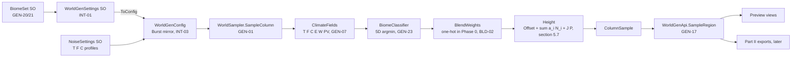
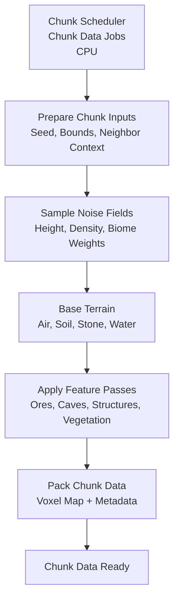

# World Generation (Overview)

# Version 1.1 (Phase 0 — spec foundations)

Phase 0 of `WorldGenSpec.html` adds the foundations of the spec pipeline next to the legacy generator. The game
still runs the legacy path (`GenArchitecture.Legacy`, INT-40); the new code is exercised by the tests, the World
Generation Preview and, from Phase 1 on, the chunk job.

## Sampler pipeline

### Description

- **Hashing and noise basis** (`WorldGen/Core/Hash.cs`, `WorldGen/Core/HashSalts.cs`, `WorldGen/Noise/SeededSimplex.cs`):
  every noise instance is a seeded 2D simplex with hashed gradients. The seed changes the field itself, not a
  translation of it (F-02 fixed); each instance gets its own salt and a hashed offset (GEN-04…06, GEN-15).
  `NoiseProfile` and `WarpedNoiseLayer` sit on this basis, so the legacy path shares it.
- **Fields** (`WorldGen/Noise/ClimateFields.cs`): T, F, C, E, W and the derived PV = 1 − |3|W| − 2| per column,
  with `ClimateFrequencyScale` scaling the position and `WGain` on W (GEN-07). `DetailOctaves` (K octaves,
  wavelengths 512…16) and `PeakNoise` (P = (1 − |n|)²) supply the height detail (GEN-09, GEN-10).
- **Settings** (`WorldGen/Settings/`): `WorldGenSettings` holds architecture, blend methods and widths, λ weights,
  height range, octave tables, E/W profiles and references to a `BiomeSet` and a `TerrainSplineSet` (stub until
  Phase 1). `ToCanonicalJson` produces a deterministic manifest with the biome set inlined (INT-02). `ToConfig`
  builds the `WorldGenConfig` mirror: flattened NativeArrays, the per-biome octave coefficients
  a_{b,i} = HeightAmplitude × OctaveWeights (GEN-22) and the climate instances.
- **Biome** gained TargetErosion, TargetPV, HeightOffset, HeightAmplitude, OctaveWeights, Jaggedness and FloraRules
  (section 6.2, VEG-03). Which biomes are active is decided by the `BiomeSet` asset, in index order (GEN-20/21);
  `Assets/EngineSettings/BiomeSet_Default.asset` lists Plains, Desert, Mountain, Snow, Forest, Ocean.
- **Sampler** (`WorldGen/Core/WorldSampler.cs`): `SampleFields` and `SampleColumn` are pure functions of
  (x, z, seed, config). Phase 0 classifies hard in 5D, uses one-hot weights in both stages and composes the common
  height formula from the classified biome; Phases 1–4 replace these placeholders (splines, blend methods, surface
  pick, flora). The entry points are Burst direct-call, so the preview and the tests see the same bits as the jobs.
- **Region API** (`WorldGen/Core/WorldGenApi.cs`): `SampleRegion(in WorldGenRequest, ref RegionBuffers)` fills any
  subset of caller-owned buffers in a `CompileSynchronously`/`FloatMode.Strict` job (GEN-16/17). Unrequested buffers
  stay unallocated. The element layout follows EXP-01; an optional stride gives zoomed-out previews.

### Ownership of native memory (D-05)

| Container | Owner | Released by |
|---|---|---|
| `GeneratorConfig.BiomeDefs`, `.Voxels` | `BiomeRegistry` / `VoxelRegistry` | the registries |
| `GeneratorConfig.NoiseParams` | the `ChunkScheduler` that received the config | `GeneratorConfig.Dispose` |
| `GeneratorConfig.WorldGen` (all arrays and climate profiles) | same as above | `GeneratorConfig.Dispose` → `WorldGenConfig.Dispose` |
| `RegionBuffers` | the caller of `SampleRegion` | the caller |
| Dummy arrays for unrequested buffers | `SampleRegion` | disposed with the returned handle |

`GeneratorConfig` travels inside job structs, so its `WorldGen` field must always be constructed:
`WorldGenSettings.ToConfig` when a settings asset exists, `WorldGenConfig.CreateEmpty` otherwise (legacy path,
test fixtures).

# Version 1.0 (Chunk Jobs)

## Generation Pipeline

### Description

In version 1.0, world generation is fully chunk-based and CPU job driven.
The scheduler collects generation requests, batches chunk jobs, and builds voxel data for each chunk.
Inside the generate step, each chunk job runs a fixed sequence: prepare inputs, sample noise fields, classify base
materials, run feature passes (ores/caves/structures/vegetation), apply border fixups, then pack the final voxel map and
metadata.
When chunk data is finished, it is registered in the chunk manager and forwarded to the mesh pipeline for visual and
collider updates.

Advantages:

- Simple and deterministic pipeline with clear stage boundaries.
- Easy to debug because generation and handoff happen in explicit queue steps.
- Works well for small and medium visible worlds.

Trade-offs:

- Regeneration cost can spike when many chunks are dirty in the same frame.
- CPU-side generation becomes a bottleneck as world size and update frequency grow.
- Local edits can trigger broader recomputation depending on chunk dependencies.
